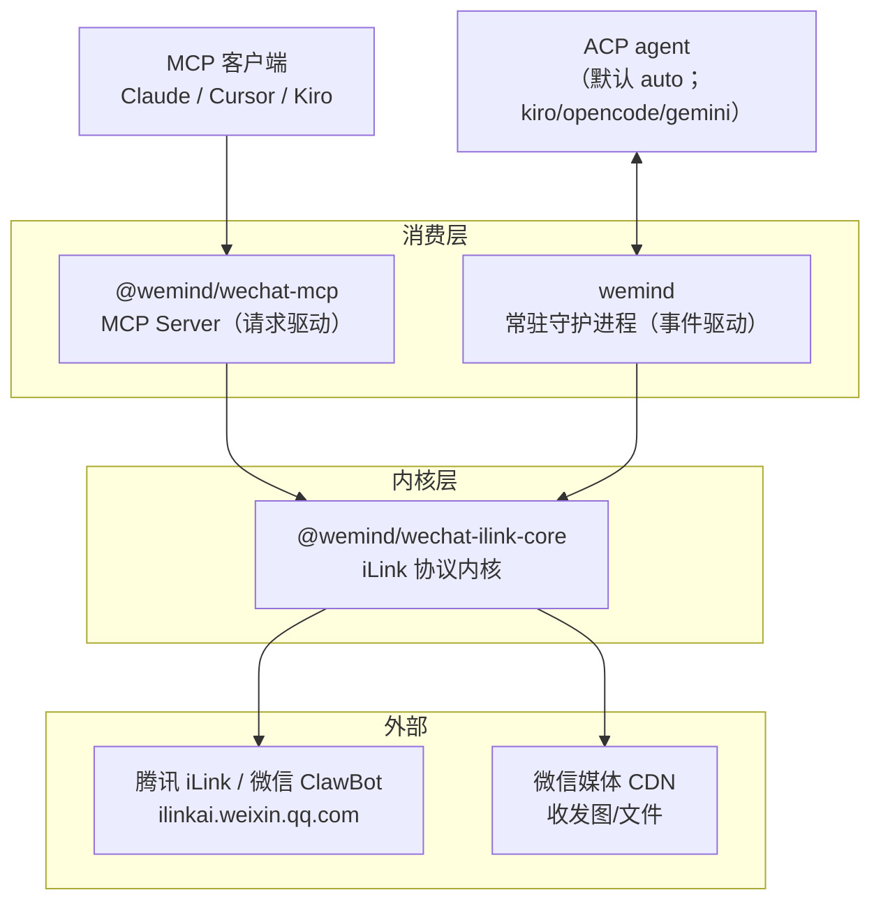
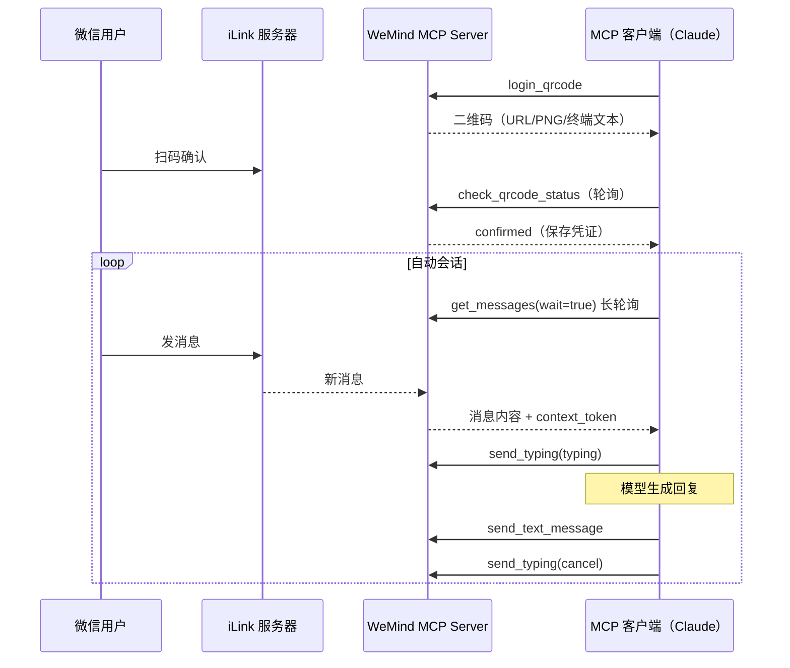
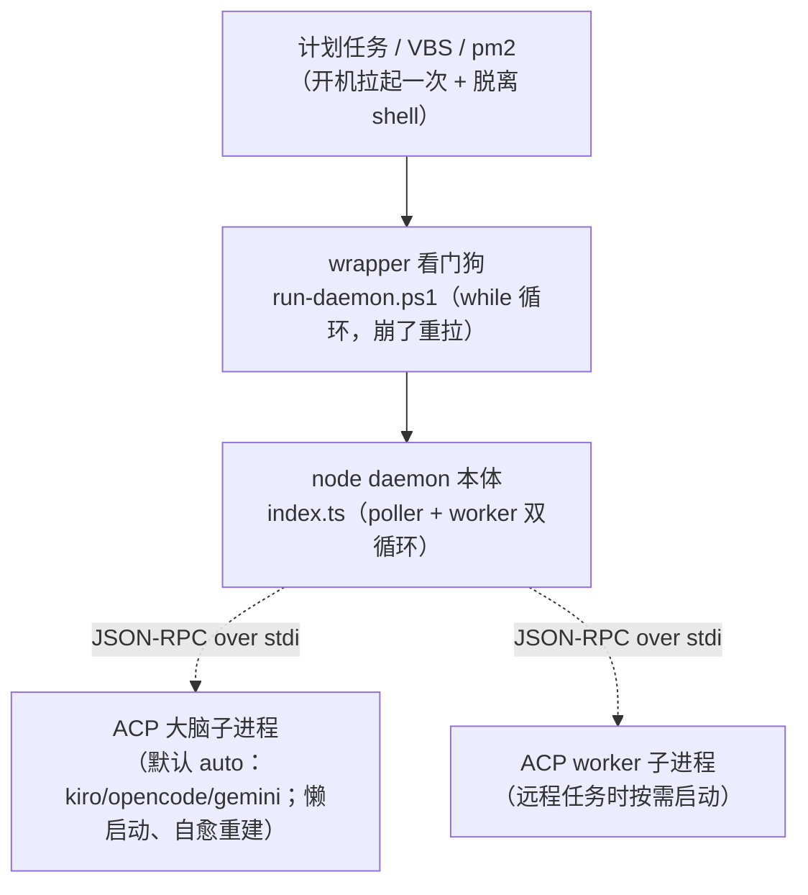
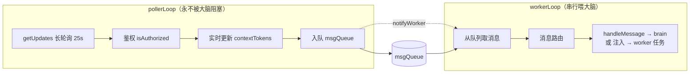
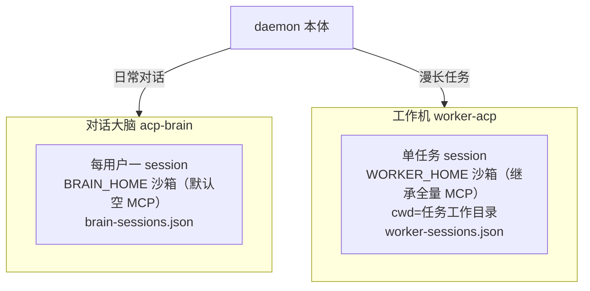
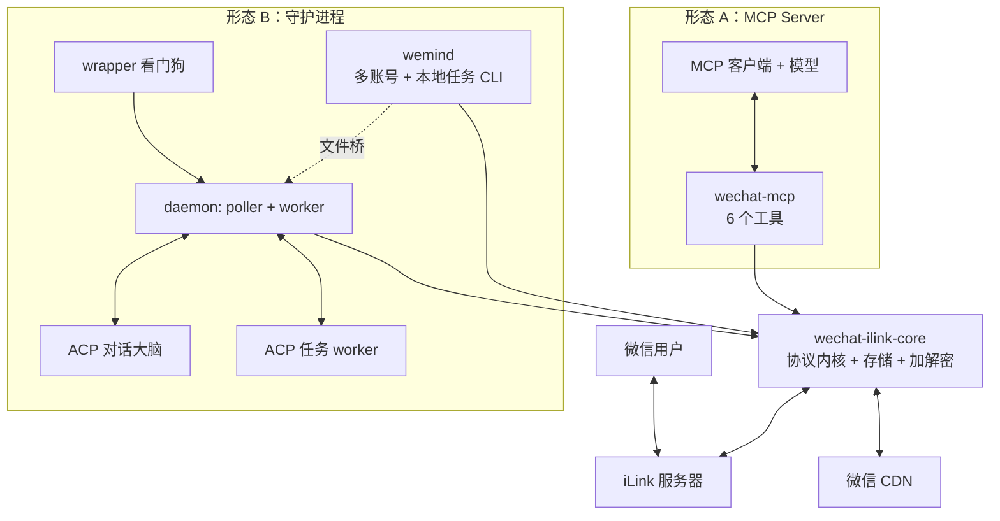

# 2. 系统架构

> 上一页：[1. 项目概览](01-项目概览.md) ｜ 下一页：[3. iLink 协议内核](03-iLink-协议内核.md)
>
> **适用版本**：WeMind 1.0.1 ｜ **最后核对**：2026-10-24

本章从整体视角说明 WeMind 的分层、两种接入形态、端到端数据流与进程模型。

## 2.1 分层总览

WeMind 是一个分层清晰的系统：底层是协议内核，上层是两个互不依赖的消费形态。

内核层 `wechat-ilink-core` 把所有「与腾讯服务器打交道」的细节（HTTP 协议、加解密、错误码、状态持久化）收口，对上提供纯函数式的 API。两个消费层各自决定「如何编排这些 API」。

## 2.2 两种接入形态对比

这是理解 WeMind 最关键的一点：**同一套内核，两种完全不同的使用方式**。

| 维度 | MCP Server | 守护进程 Daemon |
|------|-----------|----------------|
| 驱动方式 | 请求驱动（被动） | 事件驱动 + 全自动 |
| 谁在编排 | MCP 客户端（如 Claude）自己调工具 | daemon 内部 poller/worker 循环 |
| AI 大脑 | 就是 MCP 客户端背后的模型 | 独立常驻的 ACP agent 进程 |
| 是否常驻 | 否（随 MCP 客户端生命周期） | 是（看门狗 + 开机自启） |
| 多轮记忆 | 由 MCP 客户端维护 | ACP session 原生多轮 |
| 典型场景 | 在 Claude Desktop 里手动「帮我看微信」 | 7×24 自动客服式收发、远程任务遥控 |
| 富媒体/任务/多账号 | 仅文本收发 | 收发图、worker 任务、多账号俱全 |
| 发布形态 | 本项目唯一已发布到 npm 的子包 | 私有本机运行 |

简言之：**MCP Server 是「把微信能力借给一个已有的 AI 客户端」；daemon 是「一个自带 AI 大脑、自己跑起来的微信机器人」。**

## 2.3 MCP 形态：端到端流程

MCP 形态下，WeMind 不主动做任何事，全靠 MCP 客户端按工具描述编排。典型循环：

关键点：`get_messages` 的工具描述里**强制约定**了这套工作流（wait=true 长轮询 + 发送前后打字状态保活），引导 MCP 客户端正确编排。详见 [4. MCP Server](04-MCP-Server.md)。

## 2.4 Daemon 形态：进程模型

daemon 形态是 WeMind 的「完全体」。它在运行时是一棵三层进程树：

- **wrapper（看门狗）**：永不结束的监督循环，node 退出后 5 秒重拉。保活完全交给它，daemon 内部不自重启。
- **node daemon 本体**：两个 `while(true)` 循环（poller + worker），永不自然退出。
- **ACP 大脑 / worker**：JSON-RPC over stdio 驱动的子进程，懒启动、可自愈重建。大脑负责对话，worker 负责跑漫长任务，两者是独立进程并存。

完整常驻原理（PID 文件链、单实例 Mutex、开机自启）见 [10. 部署与运维](10-部署与运维.md)。

## 2.5 Daemon 内部：poller / worker 解耦

daemon 本体内部最重要的架构决策是**把「拉消息」和「喂大脑」解耦**。

**为什么解耦**：AI 大脑处理一条消息可能耗时数十秒甚至数分钟（ACP session 严格串行）。如果用单循环，大脑处理期间就无法 `getUpdates`，会导致这期间新消息的 `context_token` 抓不到、连发消息可能丢失。

**解法**：拆成两个并发循环，用一个内存队列协作。

- **poller**：持续长轮询、实时更新所有最新 token、鉴权后入队，**永不被大脑阻塞**。
- **worker**：串行从队列取消息喂大脑（尊重 ACP 单 session 串行约束），发送时取最新 token，规避参数错误。

这套解耦的实现细节（消息路由、回合编排、连续发送上限管理）是 [5. 守护进程 Daemon](05-守护进程-Daemon.md) 的主题。

## 2.6 双 ACP 进程：大脑 vs worker

daemon 形态下有**两个独立的 ACP 进程并存，互不干扰**：

| | 对话大脑（brain） | 工作机（worker） |
|---|------------------|------------------|
| 用途 | 日常聊天问答 | 漫长任务执行 |
| 会话粒度 | 每用户一个 session | 单任务一个 session |
| 沙箱 MCP | 默认空，对话中按需加载 | 继承全量（仅排除 `wechat`） |
| cwd | `BRAIN_HOME` 沙箱 | 任务工作目录 |
| 超时 | 较紧（idle 120s / cap 15min） | 较宽松（idle 180s / cap 30min） |

大脑详见 [6. ACP 大脑与沙箱](06-ACP-大脑与沙箱.md)，worker 详见 [7. 远程任务 Worker](07-远程任务-Worker.md)。

## 2.7 状态与持久化

所有运行时状态都落在账号数据目录 `~/.wemind/<account>/`，**独立于代码仓库**（改名/重装/重新 clone 都不影响登录态）。核心文件：

| 文件 | 内容 |
|------|------|
| `account.json` | 登录凭证（botToken / botId / userId / baseUrl） |
| `state.json` | 长轮询游标、各会话 `context_token`、去重用 `lastMessageId` |
| `allowFrom.json` | 授权发件人清单（安全闸） |
| `brain-sessions.json` / `worker-sessions.json` | ACP session 映射（重建后恢复上下文） |
| `brain-home/` / `worker-home/` | 两个大脑的沙箱目录 |
| `*.pid` | wrapper / daemon / brain / worker 进程 pid |

完整文件清单与多账号机制见 [8. 数据存储与多账号](08-数据存储与多账号.md)。

## 2.8 一张图看懂全貌

---

接下来：[3. iLink 协议内核](03-iLink-协议内核.md) 深入最底层的协议实现。
