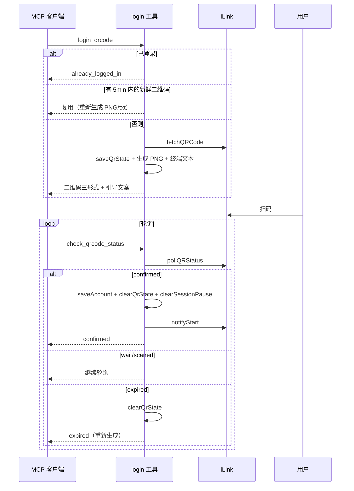

# 4. MCP Server（@wemind/wechat-mcp）

> 上一页：[3. iLink 协议内核](03-iLink-协议内核.md) ｜ 下一页：[5. 守护进程 Daemon](05-守护进程-Daemon.md)

MCP Server 把协议内核能力暴露为标准 MCP 工具，让任何兼容 MCP 的客户端（Claude Desktop、Cursor、Kiro IDE 等）都能驱动微信收发。本包是 WeMind 的两个对外发布入口之一（`@wemind/wechat-mcp`，bin: `wemind-mcp`；另一个是完整应用 CLI `wemind`，见 [`docs/发布-wemind-npm.md`](../发布-wemind-npm.md)）。

## 4.1 模块结构

```
packages/wechat-mcp/src/
├── index.ts          # MCP server 入口（注册 6 个工具）
├── version.ts        # 读自身 package.json 的 version 上报
└── tools/
    ├── login.ts      # login_qrcode / check_qrcode_status / logout
    ├── messages.ts   # get_messages（长轮询）
    ├── send.ts       # send_text_message
    └── typing.ts     # send_typing
```

## 4.2 入口与生命周期（index.ts）

入口是一个标准 MCP server：用 **MCP TypeScript SDK v2** 的 `@modelcontextprotocol/server`（`McpServer`）与 `@modelcontextprotocol/server/stdio`（`StdioServerTransport`，stdio 传输），server name 为 `wemind`，版本来自 `version.ts`。

启动 `main()` 流程：

1. 连接 stdio transport；
2. 若已登录（`loadAccount()` 有 token），打印连接信息并 `notifyStart` 通知上线；否则提示先调 `login_qrcode`；
3. 注册 `SIGINT`/`SIGTERM` 优雅关停 —— 退出前 `notifyStop` 通知下线（best-effort）。

`version.ts` 是个 3 行的薄适配层：调 core 的 `readOwnVersion(import.meta.url, "@wemind/wechat-mcp")`，从**本包**的 `package.json` 读 version。查找逻辑与 CLI 包（`@wemind/cli`）共用同一份（都在 core），并且带 `name` 校验——只认自己包的 `package.json`，绝不会静默返回别人的版本。dev（`src/`）、tsc 产物（`dist/`）、tsdown 单文件打包三种布局下都能命中正确的版本号。

## 4.3 六个 MCP 工具

| 工具                  | 说明                                                  |
| --------------------- | ----------------------------------------------------- |
| `login_qrcode`        | 生成微信登录二维码（返回 URL，并生成 PNG 与终端文本） |
| `check_qrcode_status` | 检查二维码是否已扫码确认（轮询到 `confirmed`）        |
| `logout`              | 退出登录并清除凭证                                    |
| `get_messages`        | 拉取新消息（`wait=true` 阻塞等待直到收到消息）        |
| `send_text_message`   | 发送文本消息                                          |
| `send_typing`         | 发送或取消「正在输入」状态                            |

每个工具用 `zod` schema 声明参数，工具描述（description）里写明用法与约束 —— 这些描述是引导 MCP 客户端正确编排的关键。

## 4.4 登录流程（tools/login.ts）



要点：

- `login_qrcode` 会生成三种扫码形式：二维码 URL、PNG 图片（`qrcode.png`）、终端 ANSI 文本（`qrcode.txt`），并在文案里**强制要求 Agent 自己 `cat qrcode.txt`** 把二维码显示给用户。
- 二维码 TTL 为 5 分钟（`QR_TTL_MS`），新鲜则复用。
- `check_qrcode_status` 在 `confirmed` 时保存凭证、清扫码态、清会话冷却、通知上线。
- `logout`：通知下线 + 重置状态 + 清凭证。
- 默认基础 URL 为 `https://ilinkai.weixin.qq.com`。

## 4.5 消息轮询（tools/messages.ts）

`get_messages` 是最核心也最特殊的工具。它的工具描述里**强制约定**了 Agent 工作流：

> 1. 用 `wait=true` + 大超时长轮询，阻塞直到有消息（MCP 客户端工具超时要设到至少 120 秒）；
> 2. 收到消息开始处理时立刻 `send_typing(typing)`；
> 3. 处理期间每 15-20 秒续发 typing 保活；
> 4. 回复后 `send_typing(cancel)`。

实现细节：

- `wait=true` 时用 `LONG_POLL_MS=25s` 长轮询，最长等 7 天（`deadline`）；
- `POLL_FLOOR_MS=1000`：服务端快速返回空时补足地板间隔，防零间隔请求风暴；
- 命中 errcode `-14` → `pauseSession` 并返回 `session_expired` 提示（含剩余冷却分钟数）；
- 过滤 `message_type === 1`（USER）且 `message_id > lastMessageId` 去重，更新 `lastMessageId` 与 `contextTokens[botId:from_user_id]`；
- `wait` 模式下瞬时网络错误退避 2s 重试，不让一次抖动终结长轮询；
- `formatMessage` 把消息格式化：text / `[Image]` / `[Voice: 转写文本]` / `[File: 文件名]` / `[Video]`，并处理 `ref_msg`（从 item 取，修复上游死代码）。

## 4.6 发送与打字（tools/send.ts、tools/typing.ts）

**`send_text_message`**：从 `state.contextTokens[botId:to]` 取该用户的 context_token，**没有则报错**（iLink 不能主动发起对话，必须先收到对方消息）。组装 `BOT` + `FINISH` + `TEXT` 消息发出。

**`send_typing`**：先 `getConfig` 取 `typing_ticket`（缺失视为失败、不带空 ticket 继续），再 `sendTyping` —— `status=1` 显示打字、`status=2` 取消。

## 4.7 接入示例

该子包已发布到 npm，直接用 `npx`（无需 clone / 构建）：

```json
// Claude Desktop / Cursor: claude_desktop_config.json / ~/.cursor/mcp.json
{
  "mcpServers": {
    "wechat": { "command": "npx", "args": ["-y", "@wemind/wechat-mcp"] }
  }
}
```

```json
// OpenCode: opencode.json（V2：server 定义在 mcp.servers 下）
{
  "mcp": {
    "servers": {
      "wechat": { "type": "local", "command": ["npx", "-y", "@wemind/wechat-mcp"] }
    }
  }
}
```

本地开发（改了本仓源码）才需构建，并用绝对路径指向 `packages/wechat-mcp/dist/index.js`：

```json
{
  "command": "node",
  "args": ["/abs/path/WeMind/packages/wechat-mcp/dist/index.js"]
}
```

> 设计意图：`@wemind/wechat-mcp` 是独立发布的**自包含子包**（tsdown 单文件、内核已内联），已于 2026-10 发布到公共 registry（`@wemind/wechat-mcp`，最新版本见 npm）——`npx -y @wemind/wechat-mcp` 即可接入（该包只有一个 bin `wemind-mcp`，npx 按「唯一 bin」规则自动解析）。

## 4.8 打包发布（tsdown.config.ts）

MCP server 用 [tsdown](https://tsdown.dev/)（rolldown + oxc，tsup 的继任者）打包：

- 输出 ESM、target node20、入口 `src/index.ts`，并用 `outExtensions` 强制输出 `dist/index.js`（而非默认 `.mjs`，保持 bin/main 引用不变）；
- **`deps.alwaysBundle: ["@wemind/wechat-ilink-core"]`** —— 把内核内联进单一产物，发布时无需单独发布 core；
- 其余运行时依赖（MCP SDK / zod / qrcode）保持 external，由使用者安装；
- **`dts: false`** —— 该包不对外暴露类型；关掉也避免 tsdown 加载 `typescript` 包（TypeScript 7.0 原生已不再暴露旧 JS API，否则启动即报错）；
- 入口 shebang（`#!/usr/bin/env node`）由 rolldown 自动保留。

`package.json` 标记 `publishConfig.access: public`，与 `wemind` 一起属于两个**已发布**的子包（`@wemind/wechat-mcp`、`wemind`）；`@wemind/wechat-ilink-core` 保持 `private`，只做内联。

## 4.9 MCP 形态 vs Daemon 形态

MCP 形态是**无状态的请求驱动**：WeMind 不主动做任何事，靠 MCP 客户端按工具描述自己编排长轮询和打字状态。多轮记忆、回复生成都由 MCP 客户端背后的模型负责。

如果你想要的是「一个自己跑起来、自带 AI 大脑、7×24 自动收发」的机器人，那是 daemon 形态 —— 见 [5. 守护进程 Daemon](05-守护进程-Daemon.md)。

---

接下来：[5. 守护进程 Daemon](05-守护进程-Daemon.md) 进入项目最复杂的部分。
