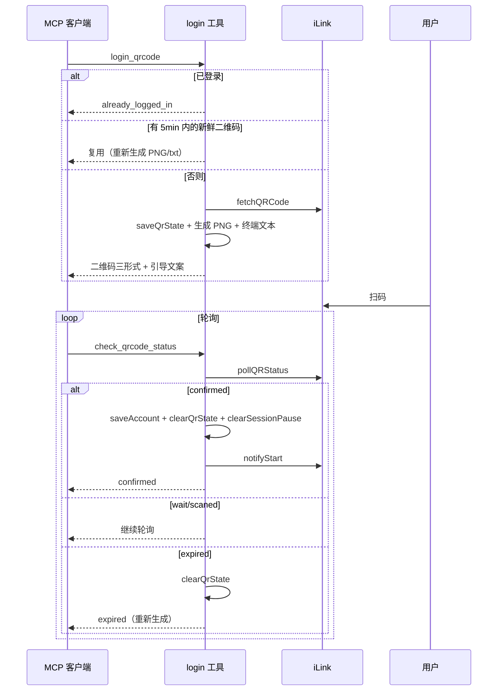

# 4. MCP Server（@wemind/wechat-mcp）

> 上一页：[3. iLink 协议内核](03-iLink-协议内核.md) ｜ 下一页：[5. daemon](05-daemon.md)
>
> **最后核对**：2026-11-14

MCP Server 把协议内核能力暴露为标准 MCP 工具，让任何兼容 MCP 的客户端（Claude Desktop、Cursor、Kiro IDE 等）都能驱动微信收发。本包是 WeMind 的两个对外发布入口之一（`@wemind/wechat-mcp`，bin: `wemind-mcp`；另一个是完整应用 CLI `@wemind/cli`（命令 `wemind`），见 [`docs/发布与变更记录/如何发布新版本.md`](../发布与变更记录/如何发布新版本.md)）。

## 4.1 模块结构

```
packages/wechat-mcp/src/
├── index.ts          # MCP server 入口（注册 6 个工具）
├── version.ts        # 读自身 package.json 的 version 上报
└── tools/
    ├── login.ts      # login_qrcode / check_qrcode_status / logout
    ├── messages.ts   # get_messages（长轮询）
    ├── send.ts       # send_text_message
    ├── typing.ts     # send_typing
    ├── session-result.ts  # 会话过期（-14）的统一返回与恢复指引
    └── tool-result.ts     # 6 个工具共用的返回体构造（JSON / 纯文本）
```

## 4.2 入口与生命周期（index.ts）

入口是一个标准 MCP server：用 **MCP TypeScript SDK v2** 的 `@modelcontextprotocol/server`（`McpServer`）与 `@modelcontextprotocol/server/stdio`（`StdioServerTransport`，stdio 传输），server name 为 `wemind`，版本来自 `version.ts`。

启动 `main()` 流程：

1. 连接 stdio transport；
2. 若已登录（`loadAccount()` 有 token），打印连接信息并 `notifyStart` 通知上线；否则提示先调 `login_qrcode`；
3. 注册 `SIGINT`/`SIGTERM` 优雅关停 —— 退出前 `notifyStop` 通知下线（best-effort）。

`version.ts` 是个 3 行的薄适配层：调 core 的 `readOwnVersion(import.meta.url, "@wemind/wechat-mcp")`，从**本包**的 `package.json` 读 version。查找逻辑与 CLI 包（`@wemind/cli`）共用同一份（都在 core），并且带 `name` 校验——只认自己包的 `package.json`，绝不会静默返回别人的版本。dev（`src/`）、tsc 产物（`dist/`）、tsdown 单文件打包三种布局下都能命中正确的版本号。

## 4.3 六个 MCP 工具

| 工具                  | 说明                                                      | 代码 description（简要转述，非逐字原文）                                                                                                                                                                |
| --------------------- | --------------------------------------------------------- | ------------------------------------------------------------------------------------------------------------------------------------------------------------------------------------------------------- |
| `login_qrcode`        | 取登录二维码（返回 URL，并在数据目录生成 PNG 与终端文本） | Get a WeChat login QR code. Scan it with WeChat to connect the bot. … You MUST show all three returned forms (image URL / PNG file / terminal text file) to the user.                                   |
| `check_qrcode_status` | 查扫码状态（轮询到 `confirmed` 即登录成功）               | Check whether the QR code from `login_qrcode` has been scanned and confirmed. … If it returns `need_verifycode` or an IDC-redirect status, tell the user to run the `wemind login` CLI command instead.（未安装 CLI 时可临时用 `npx -y @wemind/cli login`） |
| `logout`              | 登出并清除已保存的凭证                                    | Log out the current WeChat bot session. … Clears saved credentials, runtime state and any pending QR login. Only call this when the user asks to log out or wants to switch accounts.                   |
| `get_messages`        | 长轮询收消息（`wait=true` 阻塞直到收到，最长 7 天；图片/视频/文件只给占位符，语音带微信转写） | Poll for new WeChat messages. Always call with `wait=true` to block until a message arrives.（后接 4 步 typing 工作流）                                                                                 |
| `send_text_message`   | 发文本消息（`state="generating"` 发进度、默认 `finish` 发最终答复） | Send a text message to a WeChat user. … iLink bots cannot initiate conversations: if you have never received a message from that user, this call fails.                                                 |
| `send_typing`         | 打字状态（`typing` 显示 / `cancel` 取消）                 | Show or cancel the "typing..." indicator for a WeChat user. … Re-send status `typing` every 15-20 seconds while still working, because the indicator expires on its own.                                |

每个工具用 `zod` schema 声明参数，工具描述（description）里写明用法与约束 —— 这些描述是引导 MCP 客户端正确编排的关键。6 个 description 统一为「做什么 → 何时调用/返回什么 → 硬约束」的空行分段格式（表格里是简写转述、以 `…` 标省略，完整原文见 `index.ts`），且**一律写英文**：MCP 生态惯例，且模型对 `MUST` / `wait=true` 这类强制约束的英文原文遵循度更高。用户能看到的提示文案在 `tools/*.ts` 的 `message` 字段，均为中文。

### 入参与返回体

| 工具 | 入参（`zod` schema） | 返回体关键字段 |
| --- | --- | --- |
| `login_qrcode` | 无 | 二维码三形式（URL / PNG 路径 / 终端文本路径）与引导文案；已登录时 `already_logged_in` |
| `check_qrcode_status` | 无 | `status`：`wait` / `scaned` / `confirmed` / `expired` / `need_verifycode` / IDC 重定向 |
| `logout` | 无 | 是否真的清除了凭证；删不掉时 `logout_failed` + 原因 |
| `get_messages` | `wait`（布尔，默认 `false`）、`timeout`（1000–60000，默认 `10000`，`wait=true` 时忽略） | `{ message_count, messages[], cancelled? }`；`-14` 时 `session_expired`（含剩余冷却分钟） |
| `send_text_message` | `to`、`text`（均必填非空）、`state`（`finish` 默认 / `generating`） | 发送结果；`-2` 退避重试一次后仍失败给可操作错误 |
| `send_typing` | `to`、`status`（`typing` 默认 / `cancel`） | 打字状态结果 |

所有工具都通过 `tools/tool-result.ts` 的 `jsonResult()` / `textResult()` 返回**单个 text content**（结构化结果用 `JSON.stringify(obj, null, 2)`）。

## 4.4 登录流程（tools/login.ts）



要点：

- `login_qrcode` 会生成三种扫码形式：二维码 URL、PNG 图片（`qrcode.png`）、终端 ANSI 文本（`qrcode.txt`），并在文案里**强制要求 Agent 自己 `cat qrcode.txt`** 把二维码显示给用户。
- 二维码 TTL 为 5 分钟（`QR_TTL_MS`），新鲜则复用。
- `check_qrcode_status` 在 `confirmed` 时保存凭证、清扫码态、清会话冷却、通知上线；若数据目录就是 CLI 的标准账号目录（`DATA_DIR === accountDir(ACCOUNT_KEY)`，默认 `~/.wemind/default` 且未设 `WECHAT_DATA_DIR`），再按目录名登记进 `accounts.json`——否则 CLI 的 `list` / `start` 看不到 MCP 登录的账号。自定义 `WECHAT_DATA_DIR` 不登记（注册表只能指向 `accountDir(key)`，登记会让 CLI 去错目录找凭证）。
- `logout`：通知下线 + 重置状态 + 清凭证 +（标准目录且注册表条目 botId 与本账号一致时）注销账号条目；凭证文件删不掉时返回 `logout_failed` 并说明原因，不谎称「已清除」。需要验证码 / IDC 重定向时，MCP 与 CLI 都会直接说明暂不支持该步骤并提示稍后重试（两者共用同一套登录能力）。
- 默认基础 URL 为 `https://ilinkai.weixin.qq.com`。

## 4.5 消息轮询（tools/messages.ts）

`get_messages` 是最核心也最特殊的工具。它的工具描述里**强制约定**了 Agent 工作流：

> 1. 用 `wait=true` + 大超时长轮询，阻塞直到有消息（MCP 客户端工具超时要设到至少 120 秒）；
> 2. 收到消息开始处理时立刻 `send_typing(typing)`；
> 3. 处理期间每 15-20 秒续发 typing 保活；
> 4. 回复后 `send_typing(cancel)`。

实现细节：

- `wait=true` 时用 `LONG_POLL_MS=25s` 长轮询，最长等 7 天（`deadline`）；`timeout` 参数可调（1000–60000，默认 10000；`wait=true` 时忽略）；
- `POLL_FLOOR_MS=1000`：服务端快速返回空时补足地板间隔，防零间隔请求风暴；
- 命中 errcode `-14` → `pauseSession` 并返回 `session_expired` 提示（含剩余冷却分钟数）；
- 过滤 `message_type === 1`（USER）且 `compareMessageIds(message_id, lastMessageId) > 0`（ID 是 uint64，按字符串无损比较；`state.lastMessageId` 存字符串），再按 `state.seenMessageIds`（最近 200 条去重环，与 daemon 共用 `rememberMessageId`）跳过同批/服务端重放的重复 ID（按**所有** incoming 去重、环随 `saveState` 落盘）；只放行登录者（`WECHAT_OWNER_ID` 或账号 `userId`）与 `allowFrom.json` 白名单里的发件人，游标仍按**所有**收到的消息推进（被过滤的消息不会每轮重复判断），`contextTokens[botId:from_user_id]` 只记放行者的；
- `wait` 模式下瞬时网络错误退避 2s 重试，不让一次抖动终结长轮询；客户端取消信号会直接中止**在途**长轮询并返回 `cancelled`（核心里与超时共用一个 AbortController）；
- 处理响应前**重新读一次** `state` 再做 load→改→save（全程同步）：长轮询可能持续很久，期间别的工具调用写入的 `context_token` 不会被旧 state 覆盖；
- `formatMessage` 把消息格式化：text / `[Image: not downloaded…]` / `[Voice: 转写文本]` / `[File: 文件名 (not downloaded)]` / `[Video: not downloaded…]`，并处理 `ref_msg`（从 item 取，修复上游死代码）。媒体只给占位符是**明示的限制**：MCP 形态不下载任何媒体。**daemon 形态不同**（2026-11-09 起）：图片进 ACP image 块，文件/视频/无转写语音在默认 `direct` 下载到 `<账号>/media/inbound`（`managed` 才是 `<managed>/media/inbound`）并给本地路径，引用做内联前缀，工具进度可用结构化 item——两形态的媒体能力不要混为一谈。

## 4.6 发送与打字（tools/send.ts、tools/typing.ts）

**`send_text_message`**：从 `state.contextTokens[botId:to]` 取该用户的 context_token，**没有则报错**（iLink 不能主动发起对话，必须先收到对方消息）。组装 `BOT` + `TEXT` 消息发出；`state="generating"` 用于进度消息，默认 `finish` 表示最终答复（每次调用都是一条独立消息）。`ret=-2` 退避重试一次，仍失败给出可操作错误。

**`send_typing`**：先 `getConfig` 取 `typing_ticket`（缺失视为失败、不带空 ticket 继续），再 `sendTyping` —— `status=1` 显示打字、`status=2` 取消。

> **两个发送类工具的共同前置条件**：必须先收到该用户的消息（`context_token` 只从收到的消息里来），否则报 `InvalidParams`；`send_typing` 另外先检查会话冷却（`-14` 期间不发）。**会话过期（`-14`）的恢复**：`logout` 后重新 `login_qrcode`，或重启 MCP 客户端让它重新走登录流程；冷却期内任何发送都会失败。

## 4.7 接入示例

用户向的安装与客户端配置**只维护一份**：见 [`packages/wechat-mcp/README.md`](../../packages/wechat-mcp/README.md)。本节只保留维护者需要知道的打包事实（4.8）与形态选择（4.9），不再复制配置示例——两处维护必然漂移。

一句话版本：`npx -y @wemind/wechat-mcp` 即可接入（该包只有一个 bin `wemind-mcp`，npx 按「唯一 bin」规则自动解析）；也可先 `npm i -g @wemind/wechat-mcp` 再在配置里指向 `wemind-mcp`（Windows 为 `wemind-mcp.cmd`）。GUI 客户端的 PATH 常不含 npm 全局 bin，所以推荐 `npx` 写法。

## 4.8 打包发布（tsdown.config.ts）

MCP server 用 [tsdown](https://tsdown.dev/)（rolldown + oxc，tsup 的继任者）打包：

- 输出 ESM、target node20、入口 `src/index.ts`，并用 `outExtensions` 强制输出 `dist/index.js`（而非默认 `.mjs`，保持 bin/main 引用不变）；
- **`deps.alwaysBundle: ["@wemind/wechat-ilink-core"]`** —— 把内核内联进单一产物，发布时无需单独发布 core；
- 其余运行时依赖（MCP SDK / zod / qrcode）保持 external，但**已声明在 `dependencies`**，安装包时由 npm / npx 一并装好；只有离线手工部署或自行重新打包时才需要单独准备；
- **`dts: false`** —— 该包不对外暴露类型；关掉也避免 tsdown 加载 `typescript` 包（TypeScript 7.0 原生已不再暴露旧 JS API，否则启动即报错）；
- **`sourcemap: true`**（2026-11-11 起）—— `dist/index.js.map` 随包，与 `@wemind/cli` 对齐；`prepack` 守卫会检查 `.map` 存在且被 `files` 覆盖。Node 默认不应用 sourcemap，所以 `main().catch` 走 `describeError()` 自己读同目录的 map，fatal 日志直接显示 `src/xxx.ts:NN`，MCP 客户端无需任何配置（见 [已知坑](../ai/已知坑.md)）；
- 入口 shebang（`#!/usr/bin/env node`）由 rolldown 自动保留。

`package.json` 标记 `publishConfig.access: public`，与 `@wemind/cli`（命令 `wemind`）一起属于两个**已发布**的子包；`@wemind/wechat-ilink-core` 保持 `private`，只做内联。

> ⚠️ **包名 ≠ 命令名**：daemon 的包是 `@wemind/cli`，命令是 `wemind`。`npx` 按包名解析，所以只能 `npx -y @wemind/cli`，**不能** `npx wemind`（根 `package.json` 虽叫 `wemind`，但它是 `private`、不发布）。

## 4.9 MCP 形态 vs Daemon 形态

> ⚠️ **同一个 bot token 只能有一个程序收消息**（同一份登录凭证不能同时被两个程序使用）：两种形态**二选一**，不能同时跑——否则互相抢消息、互相回环。装了 MCP 客户端又起了 daemon 的机器，先把其中一个停掉。

MCP 形态是**不主动轮询的请求驱动**：没有后台进程，靠 MCP 客户端按工具描述自己编排长轮询和打字状态；多轮记忆、回复生成都由 MCP 客户端背后的模型负责。但**它并非无状态**——登录凭证、消息游标（`state.json`）、`context_token` 都持久化在数据目录里（见 4.5），同账号多个 MCP 客户端共用同一份 `DATA_DIR` 时会共享这些状态并可能互相干扰。

如果你想要的是「一个自己跑起来、自带 AI 大脑、7×24 自动收发」的机器人，那是 daemon 形态 —— 见 [5. daemon](05-daemon.md)。

---

接下来：[5. daemon](05-daemon.md) 进入项目最复杂的部分。

> **日志格式（2026-11-11 起）**：运行日志统一由 `core/logging.ts` 的 `createLogger(scope)` 输出，格式为 `[wemind/<scope>][INFO|WARN|ERROR|DEBUG] …`，全部写 stderr（MCP 的 stdout 仍是 JSON-RPC 通道）；CLI 用户输出走 stdout 的 `print()`，不加前缀、不加级别。本文正文中的日志样例可能省略了级别标记，实际每行都有。`wemind log --errors` 精确认 `[ERROR]/[WARN]` 标记，升级前写入的旧日志仍按关键词兼容。`WEMIND_LOG_LEVEL=debug` 才输出 DEBUG（目前没有 debug 调用点，属预留级别）。
