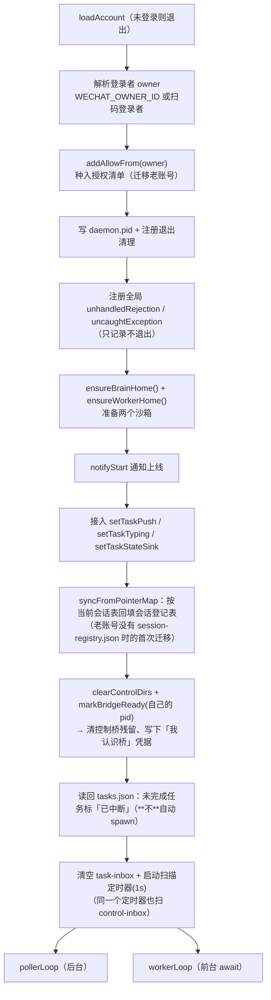
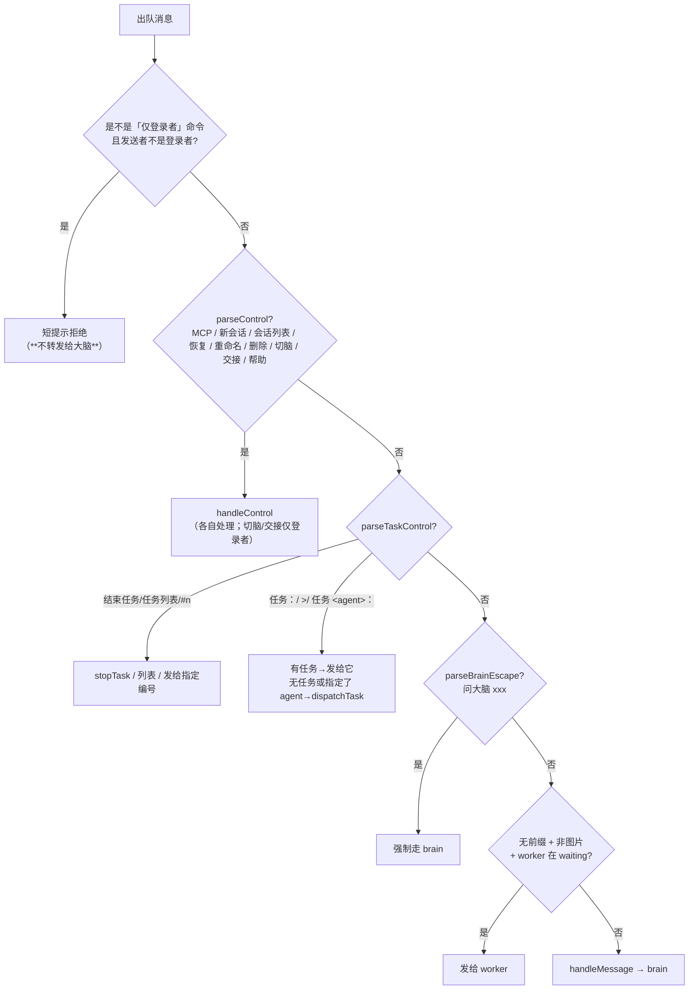
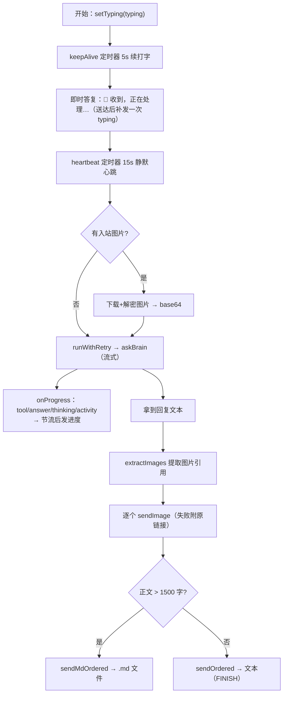
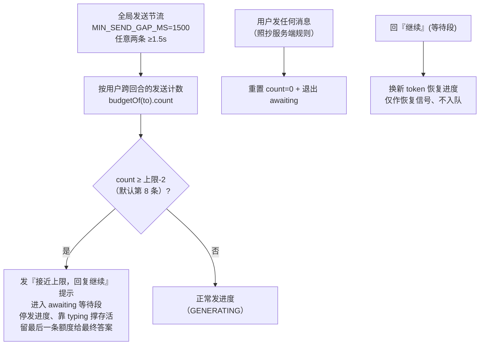

# 5. daemon（wemind）

> 上一页：[4. MCP Server](04-MCP-Server.md) ｜ 下一页：[6. ACP 大脑与沙箱](06-ACP-大脑与沙箱.md)
>
> **适用版本**：WeMind 1.2.0 ｜ **最后核对**：2026-10-28

daemon 是 WeMind 的「完全体」：一个脱离任何 IDE、自己长轮询收消息、调用常驻 AI 大脑生成回复、自动回发的后台进程。本章聚焦 daemon 本体（`index.ts`）的运行逻辑；大脑、worker、沙箱在后续章节展开。

## 5.1 模块全景

```
packages/wechat-daemon/src/
├── index.ts            # 主入口：poller/worker 双循环、消息路由、回合编排、发送管理、控制桥扫描
├── chat-commands.ts    # 命令表：解析 + 帮助**同表**驱动（无副作用模块）
├── acp-brain.ts        # 默认大脑：常驻 ACP 进程、严格会话恢复（→ 第 6 章）
├── agent-slot.ts       # brain/worker 的 agent 槽位（懒解析 + 记忆化，供热切换改写）
├── brain-switch.ts     # 运行时换大脑（预检/等在途回合结束/启动新大脑/回滚）（→ 第 6 章）
├── brain-agents.ts     # ACP agent 与解析（→ 第 6 章）
├── mcp-sandbox.ts      # brain 沙箱：MCP 隔离 + 记忆继承（→ 第 6 章）
├── worker-acp.ts       # 任务 worker 的 ACP 客户端（class WorkerConn）（→ 第 7 章）
├── worker-pool.ts      # worker 进程池：复用/回收/上限（→ 第 7 章）
├── worker-sandbox.ts   # worker 沙箱（→ 第 7 章）
├── task-manager.ts     # 任务表：编号/编号寻址/停止（→ 第 7 章）
├── task-store.ts       # 任务表写入磁盘 tasks.json（重启后续跑）（→ 第 7 章）
├── session-manager.ts  # 会话五条指令的实现层（→ 第 6 章）
├── session-registry.ts # 会话登记表（派生元数据：名字/标题/轮次）（→ 第 6 章）
├── handoff.ts          # 交接：摘要写入磁盘 + 作为前缀带上 + 答成才消费（→ 第 6 章）
├── control-bridge.ts   # CLI↔daemon 控制桥（请求/应答/.bridge 凭据）（→ 第 7 章）
├── pid-record.ts       # brain.pid / workers.pid.json 身份记录
├── manage.ts           # 多账号 + CLI（brain switch / session * / task-*）（→ 第 8、7 章）
├── image-reply.ts      # 从大脑回复提取图片引用
└── md-reply.ts         # 长回复转 .md 文件
```

## 5.2 启动流程（main）



两个关键防御：

- **全局异常处理器**：任何未捕获的 promise 拒绝/异常（多为瞬时网络 `fetch failed` 或回合内 send 被拒）只记录、不退出。此前的 `code=1` 静默崩溃就源于此类未捕获拒绝，会丢掉在途回合、把用户卡在心跳。
- **PID 文件**：写 `daemon.pid` 供管理命令精确定位停止；`exit`/`SIGINT`/`SIGTERM` 时清理，并 `killWorkerPool()` 收掉池里全部 worker（Windows 上子进程不随父进程退出，漏掉就是一堆孤儿 agent 进程）。

## 5.3 poller / worker 解耦

这是 daemon 内部最重要的架构（动机见 [2. 系统架构](02-系统架构.md#daemon-内部poller--worker-解耦)）。两个并发循环 + 一个内存队列 `msgQueue` + 唤醒回调 `wakeWorker`。

### pollerLoop —— 永不被大脑阻塞

```
while true:
  会话暂停中? → sleep 后 continue
  getUpdates(25s 长轮询)  ← 网络错误 catch + 2s 重试，不崩
  errcode -14? → pauseSession 1h
  更新游标 get_updates_buf
  过滤 USER 且 message_id > lastMessageId
  先登记本批所有最新 context_token（worker 发送时取最新）
  逐条：鉴权 → 提取文本/图片 → 重置发送配额 → 入队 → notifyWorker
```

poller 对每条消息**先鉴权再处理**，并把所有最新 token 实时写进 `state.contextTokens`，这样即使大脑在处理旧消息，新消息的 token 也不会丢。

### workerLoop —— 串行喂大脑

```
while true:
  会话暂停中? → sleep
  队列空? → 等 wakeWorker
  取出一条消息 → 消息路由（见 5.4） → handleMessage 或 发给 worker
```

worker 串行处理，尊重 ACP 单 session 串行约束。`token` 用消息自己携带的 `context_token`，`latestToken()` 取该用户最新缓存 token（仅作 `-2` 参数错误时的兜底）。

## 5.4 消息路由

每条出队消息按优先级判定去向：



三种「明确性」：`任务：`/`>` 强制发 worker、`问大脑` 强制发 brain、无前缀按 worker 状态分流。worker 只在 **waiting**（刚停下问你）时才默认接管无前缀消息；它埋头跑（running）时大脑照常可用。图片消息始终走 brain。

**命令层（1.2.0 起）**：解析与帮助**同表驱动**（`chat-commands.ts` 的 `COMMAND_SPECS`），中文与斜杠双轨、`/ai` 是统一入口前缀（`/ai` 列可选、`/ai brain X`、`/ai task X`），中文（`切换大脑`、`切换任务大脑`）与旧斜杠（`/brain`、`/worker`）是等价别名。`帮助`/`/help` 按角色裁剪（非登录者看不到「仅登录者」命令）。

**权限模型**：指令按**作用范围**分两档——**整个账号**（`MCP`/`加载`/`卸载` 换的是全账号的 MCP 集；`AI`/`切换大脑`/`切换任务大脑`/`交接` 换的是全账号的大脑）与**登录者自己的**（会话与任务类：按 `userId` 隔离，别人的会话永远不出现在你的列表里，任务也按人隔离）。其中四条大脑指令在代码里额外做成 **owner-only**（非登录者发只会得到一句短提示、**不转发给大脑**，避免它「意外回答」一条自己无权执行的命令）——这是**兜底校验**：微信平台只把消息发送给登录者本人，所以正常不会触发。`帮助` 对所有人开放。

「登录者」（owner）= **扫码登录这个 bot 的那个微信号**（`WECHAT_OWNER_ID` 可覆盖；启动时被种进 `allowFrom`，见 §5.2）。它跟「账号之间」没有关系——**每个账号各有自己的 daemon 与登录者，不存在能管别的账号的「主号」**；多账号下换大脑的范围与两个入口（微信 / 本机 CLI）的区别见 [6. ACP 大脑与沙箱](06-ACP-大脑与沙箱.md#多账号下的范围两个入口) 与 README 的「多账号管理」。

| 指令 | 作用 | 作用范围 |
|------|------|------|
| `MCP` / `列出 MCP` | 列出可选与已激活的 MCP | 整个账号 |
| `加载 <名>` / `load <名>` | 激活某 MCP（重启 ACP 进程生效） | 整个账号 |
| `卸载 <名>` / `unload <名>` | 移除某 MCP | 整个账号 |
| `切换大脑 [名]` · `/ai brain` · `/brain` | **热切换**对话大脑（§6.2） | 整个账号（仅登录者） |
| `切换任务大脑 [名]` · `/ai task` · `/worker` | 设默认任务大脑（**本次运行内一直生效**，不写入磁盘） | 整个账号（仅登录者） |
| `AI` / `AI 列表` · `/ai` | 列可选 agent + 当前对话大脑 / 默认任务大脑 | 整个账号（仅登录者） |
| `交接` · `/handoff` | 生成交接摘要（切走后第一条消息带上一次） | 整个账号（仅登录者） |
| `新会话 [名字]` · `/new` | 开启新 ACP 会话（可命名） | 登录者的会话 |
| `会话列表 [页]` · `/sessions` | 本人的会话（当前大脑），末尾提示其它大脑另有 N 条 | 登录者的会话 |
| `恢复会话 <序号\|名字\|id前缀>` · `/resume` | 严格恢复（失败不改当前会话） | 登录者的会话 |
| `重命名会话 <序号> <名字>` · `/rename` | 给登记表改名 | 登录者的会话 |
| `删除会话 <序号>` · `/delete` | 删登记项（当前会话被删则同时清当前会话记录） | 登录者的会话 |
| `帮助` · `/help` | 全部指令，按角色裁剪 | 全部 |

## 5.5 回合编排（handleMessage）

`handleMessage` 是处理一条「给大脑的消息」的完整编排，串起打字保活、即时答复、进度反馈、收图、调用大脑、重试、发图、长回复转文件。



进度消息分级（节流避免触发限流）：

| 进度 | 触发时机 |
|------|---------|
| `🤖 收到，正在处理…` | 即时答复（无图片时） |
| `🖼️ 收到 N 张图片，下载识别中…` | 有入站图片（兼作答复） |
| `🔧 步骤 N：…` | 工具调用（首条即发，其后每 ≥15s 一条，步骤号只在实际发出时递增） |
| `🤔 还在思考/检索中…` | 静默满 15s 第 1 次 |
| `⏳ 仍在处理中…（已 X 秒）` | 静默第 2 次起 |
| `✍️ 正在整理回复…` | 开始输出正文 |

「正在输入中」（typing）每 5 秒续发，**不计入**连续发送上限；每发出一条进度文本后会**立刻补发一次 typing**（文本消息会把客户端的「正在输入」顶掉，不补发的话快回合全程看不到指示）。

### 错误分类与重试

`classifyBrainError` 把大脑错误分三类，按类型重试：

| 类型 | 触发特征 | 最大尝试 | 失败提示 |
|------|---------|---------|---------|
| `backend` | `-32603` / overloaded / rate limit / 429 / 503 | 3 次 | 模型后端临时出错 |
| `timeout` | idle/no-first-frame/cap timeout | 2 次 | 处理超时被中断 |
| `other` | 其它 | 2 次 | 通用出错 |

## 5.6 连续发送上限管理（关键机制）

这是项目踩坑最深、也最巧妙的一处。

**问题**：iLink 限制 bot 在用户回复前能**连续发送的消息数**（实测约 10；超出服务端以 `ret=-2` 拒绝并丢消息）。重任务每 15s 发一条进度，6.5 分钟会发 20+ 条 → 第约 10 条后被拒，而**最终答案恰好排在最后被丢**。

**解法**（多个机制叠加）：



要点：

- **计数按用户、跨回合维护**（`budgetOf(to)`），只在该用户发来任何消息时重置 —— 照抄服务端「距上一条用户消息计数」的规则。这修正了「新任务从 0 计数撞上限」的 bug。
- 进度/中间消息用 `GENERATING`，仅最终答案用 `FINISH`（见 [3. 协议内核](03-iLink-协议内核.md#关键枚举)）。
- 最终答案占等待段预留的最后一条额度。

### 串行发送链

`sendOrdered` / `sendMdOrdered` 用一个 `replyChain` Promise 串联所有发送，保证多条消息（进度/答案）按入队顺序送达、不并发乱序，并在每条前补足 `MIN_SEND_GAP_MS` 间隔。

`reply` 内置错误恢复：遇 `ret=-2`（param_error）退避 1.5s 后换该用户最新缓存 token 重试一次（限流靠等待恢复，token 失效靠换 token）；遇可重试传输错误退避 1.5s 重试一次。

## 5.7 收发富媒体

- **收图**：poller 提取 `image_item` → `downloadImage` 下载解密 → `sniffMime` 嗅探 MIME → 作为 ACP image 块喂大脑。**前提是 agent 广告 `promptCapabilities.image:true`**（kiro/opencode 支持；DSH 官方 0.2.1-rc.2 实测为 false，带图会 `-32602`）。
- **发图**：`extractImages` 从大脑回复里提取 Markdown `` 或裸图片 URL → `resolveImageBytes` 下载/读取 → `sendImage` 发出，剩余文本另发。`image-reply.ts` 实现：下载带 15s 超时 + 浏览器 UA（规避图床热链 403）、10MB 上限；失败的图把原链接附文本发给用户（不静默丢图）。
- **收语音**：直接取 `voice_item.text`（微信侧已转写）当文本喂大脑，零依赖（无需 SILK 解码）。
- **发文件/视频**：core 的 `sendFile` 按扩展名自动判类型组装。

## 5.8 长回复转 .md（md-reply.ts）

当大脑最终回复正文超过阈值（`LONG_REPLY_THRESHOLD`，默认 1500 字，`WECHAT_REPLY_FILE_THRESHOLD` 覆盖）时，作为**单个 `.md` 文件**发送而非拆成多条文本 —— 规避连续发送上限、阅读完整。

`generateTitle` 由内容生成文件名（取首个 Markdown 标题或首个非空行，清洗为合法文件名）；`buildMdReply` 在内存里构造 buffer（正文无标题则前置一个 H1）。发文件失败时兜底回退为文本。

## 5.9 本地命令文件桥与控制桥

daemon 通过一个独立的扫描定时器（`WEMIND_TASK_SCAN_MS`，默认 1s，**不挂在 poller 上**避免被 25s 长轮询阻塞）扫描两个目录：

| 目录 | 方向 | 用途 |
|------|------|------|
| `task-inbox/*.json` | **单向**（CLI 派活，结果从微信回） | 本地终端派发/回复/结束任务 → `dispatch`/`reply`/`stop` |
| `control-inbox/*.json` | **双向**（daemon 写 `control-out/<id>.json` 应答） | 热切换大脑、会话四件套、任务列表/回话/停止、交接 —— CLI 要**当场知道成没成** |

**控制桥**（`control-bridge.ts`）让 CLI 与微信**走同一段代码**：`handleControlRequest` 调的就是微信指令用的那几个函数（会话类命令以**登录者**作为 userId——即「CLI 代表机主本人」，所以不经过「仅登录者」那道微信侧的门）。要点：

- **先删后做**：daemon 先 `unlink` 请求文件再执行（崩了不会重启后被重放）；`controlBusy` 保证一次只处理一条。
- **应答即答复**：`{ id, at, ok, text }`，`ok = !text.startsWith("❌")`；CLI 端 `ok=false` 时置退出码 1，脚本能判成败。超时（默认 30s，`WEMIND_CONTROL_TIMEOUT_MS`）如实报「没等到回复」。
- **`.bridge` 凭据**：daemon 启动时清空两个桥目录并写 `control-out/.bridge`（内容 = 自己的 pid）。CLI 据此判断对方是不是「认识桥的版本」——详见 [7. 远程任务 Worker](07-远程任务-Worker.md) §7.5。
- **安全边界**：请求字段只有 `target`（agent 名）/`ref`/`name`/`text`/`taskId`/`page`，**没有 `bin`/`args`/`shell` 的位置**（`parseControlRequest` 是唯一入口校验）。
- 启动时清空 `task-inbox/` 作废重启前残留命令（防重放）。

---

接下来：[6. ACP 大脑与沙箱](06-ACP-大脑与沙箱.md) 详解常驻大脑如何工作。
