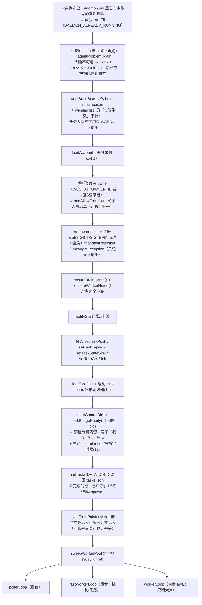
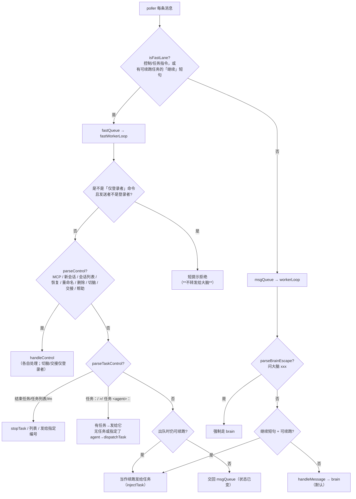
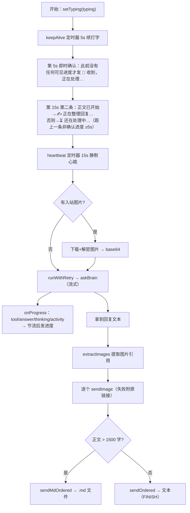
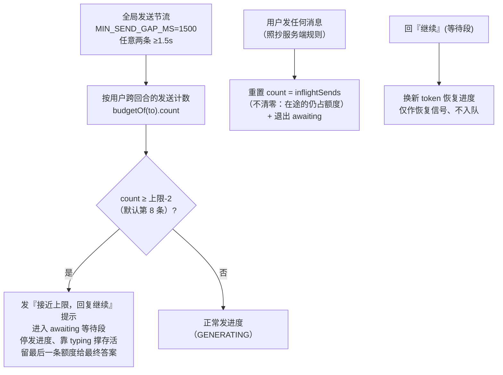

# 5. daemon（wemind）

> 上一页：[4. MCP Server](04-MCP-Server.md) ｜ 下一页：[6. ACP 大脑与沙箱](06-ACP-大脑与沙箱.md)
>
> **最后核对**：2026-11-05

daemon 是 WeMind 的「完全体」：一个脱离任何 IDE、自己长轮询收消息、调用常驻 AI 大脑生成回复、自动回发的后台进程。本章聚焦 daemon 本体（`index.ts`）的运行逻辑；大脑、worker、沙箱在后续章节展开。

## 5.1 模块全景

`src/` 是 **8 个一级目录 + 6 个二级目录**下的 63 个源文件（另有 60 个与源码同目录的测试）；下表按目录给出每个文件的职责。分层设计与迁移记录见 [`docs/设计文档/源码目录分层设计.md`](../设计文档/源码目录分层设计.md)。

```
packages/wechat-daemon/src/
├── cli.ts                    # bin 入口（wemind）：分发 daemon / _watchdog / 其余给 cli/manage
├── index.ts                  # 主入口 runDaemon：poller / 快车道 / 大脑三个循环、消息路由、回合编排、进度节流
├── daemon/                   # 微信侧本体：路由、控制、收件箱
│   ├── daemon-routing.ts     # 纯路由判定：快车道 / 控制与任务指令 / 错误分类与提示
│   ├── daemon-control.ts     # 微信控制指令与控制桥请求的分派（两入口共用实现）
│   ├── access.ts             # 发件人兜底鉴权（登录者 + allowFrom）
│   ├── control-inbox-runner.ts # 控制桥收件箱扫描（单条串行/过期不执行/失败必写应答）
│   ├── task-inbox-runner.ts  # 任务收件箱扫描（时间序/先删后做/出错回 ack）
│   └── messaging/            # 外发与回复
│       ├── send-pipeline.ts  # 外发管线：串行链、节流、连发预算、旧 token 挂起/补发、任务推送让位
│       ├── pending-push.ts   # 旧 token 期间失败外发的内存挂起队列（下一条消息到达后补发）
│       ├── poller-batch.ts   # 一批消息的计数重置与「全部做完」判定
│       ├── md-reply.ts       # 长回复转 .md 文件
│       ├── image-reply.ts    # 从大脑回复提取图片引用并决定能否发图
│       └── image-url.ts      # 回复里图片 URL 的识别与规整
├── acp/                      # 常驻大脑与协议
│   ├── acp-brain.ts          # 常驻 ACP 进程、严格会话恢复、beginSwitch/drainTurn/warmup（→ 第 6 章）
│   ├── brain-switch.ts       # 运行时换大脑（预检/等在途回合结束/启动新大脑/回滚）（→ 第 6 章）
│   ├── brain-check.ts        # wemind brain check 的真 ACP 握手
│   └── protocol/             # brain / worker 共用协议层
│       ├── acp-connection.ts # 帧处理、请求与回合超时、模型/模式、load 后回放静默（→ 第 6 章）
│       ├── acp-reverse.ts    # 反向请求应答器（权限默认拒绝；未知 method 回 -32601）
│       └── acp-quiet.ts      # 恢复会话后等回放帧安静（200ms 静默窗口 / 最多 3s）
├── agents/                   # agent 预设、配置状态与沙箱
│   ├── brain-presets.ts      # AcpAgentPreset 类型与 9 个内置预设（纯数据，无 IO）
│   ├── brain-agents.ts       # resolveAgent、agentProblem、派生配置落盘（→ 第 6 章）
│   ├── brain-config.ts       # brain.json 读写
│   ├── brain-state.ts        # brain-runtime.json：daemon 实际生效的大脑
│   ├── agent-slot.ts         # brain/worker 的 agent 槽位（懒解析 + 记忆化，供热切换改写）
│   ├── profile-model.ts      # 真实 profile 的默认模型读取与「缺 - id: acp」提示
│   ├── cline-credentials.ts  # 从 Cline providers.json 派生 CLINE_PROVIDER/CLINE_API_KEY
│   └── sandbox/              # 沙箱与 MCP
│       ├── mcp-sandbox.ts    # brain 沙箱：MCP 隔离 + 记忆继承（→ 第 6 章）
│       ├── worker-sandbox.ts # worker 沙箱（继承全量 MCP，排除 wechat）（→ 第 7 章）
│       ├── agent-mcp.ts      # MCP 激活集与按 agent 的挂载格式
│       └── sandbox-inherit.ts # 记忆/技能继承（junction/拷贝 + 继承清单）
├── tasks/                    # 任务（worker）
│   ├── worker-acp.ts         # 任务 worker 的 ACP 客户端（class WorkerConn）（→ 第 7 章）
│   ├── worker-pool.ts        # worker 进程池：复用/回收/上限（→ 第 7 章）
│   ├── task-manager.ts       # 任务表：编号/编号寻址/停止（→ 第 7 章）
│   ├── task-store.ts         # 任务表写入磁盘 tasks.json（重启后续跑）（→ 第 7 章）
│   └── task-inbox.ts         # 任务收件箱两个通道（task-inbox/ 命令 + task-out/ 答复）
├── sessions/                 # 会话
│   ├── session-manager.ts    # 会话五条指令的实现层（→ 第 6 章）
│   ├── session-registry.ts   # 会话登记表门面（改名/删除 + re-export store/view）（→ 第 6 章）
│   ├── registry-store.ts     # 登记表存储层：读写/裁剪/登记刷新
│   ├── registry-view.ts      # 登记表视图层：引用解析/名字校验/列表渲染
│   ├── session-map.ts        # 当前会话表 brain-sessions.json / worker-sessions.json（→ 第 6 章）
│   └── handoff.ts            # 交接：摘要写入磁盘 + 作为前缀带上 + 答成才消费（→ 第 6 章）
├── cli/                      # 本地 CLI
│   ├── manage.ts             # 参数解析、switch 分派、帮助文本
│   ├── account-commands.ts   # list / adopt / logout / delete / start（账号维度）
│   ├── process-lifecycle.ts  # brainRecord、整树停止、startDaemon/stopDaemon/deleteGuard
│   ├── cli-context.ts        # CLI 共用上下文：账号选择、daemon/控制桥存活、viaBridge
│   ├── cli-dispatch.ts       # CLI 子命令注册与分发
│   ├── watchdog-runner.ts    # 自带后台守护进程（崩溃重拉、stdout/err 并入 daemon.log）
│   ├── pm2-runner.ts         # pm2 runner（--runner pm2）
│   └── subcommands/          # 主题命令实现
│       ├── cli-brain.ts      # brain* 命令（配置 / 自检 / 热切换 / 交接）
│       ├── cli-login.ts      # 扫码登录（独立暂存目录 / 二维码 / 登记 / 解除暂停）
│       ├── cli-session.ts    # session* 命令（读登记表 / 写走控制桥）
│       └── cli-task.ts       # task* 命令（文件桥写入 + 答复文案）
├── ipc/                      # 进程间与文本协议
│   ├── control-bridge.ts     # CLI↔daemon 控制桥（请求/应答/.bridge 凭据）（→ 第 7 章）
│   ├── chat-command-specs.ts # 微信/CLI 指令表（类型 + 规格 + owner-only 判定）
│   └── chat-commands.ts      # 指令解析与帮助渲染（与指令表同表驱动）
└── shared/                   # 通用工具
    ├── debug-env.ts          # 摘除 VS Code 调试器注入的 NODE_OPTIONS
    ├── version.ts            # 版本号唯一来源（运行时读 package.json）
    ├── process/
    │   ├── pid-record.ts     # brain.pid / workers.pid.json 身份记录
    │   ├── proc-identity.ts  # 进程身份校验（isAlive / matchesMarkers 等）
    │   └── spawn-agent.ts    # 统一 spawn（Windows .cmd 经 shell + 逐参数引号）
    └── io/
        ├── atomic-json.ts    # 原子写 JSON（临时文件 + rename）
        ├── line-decoder.ts   # stdout 行解码（容错非 JSON 日志行）
        └── log-rotate.ts     # RotatingLog：逐块追加 + 运行中轮转
```

## 5.2 启动流程（`runDaemon()`）



两个关键防御：

- **全局异常处理器**：任何未捕获的 promise 拒绝/异常（多为瞬时网络 `fetch failed` 或回合内 send 被拒）只记录、不退出。此前的 `code=1` 静默崩溃就源于此类未捕获拒绝，会丢掉在途回合、把用户卡在心跳。
- **PID 文件**：写 `daemon.pid` 供管理命令精确定位停止；`exit`/`SIGINT`/`SIGTERM` 时清理，并 `killWorkerPool()` 收掉池里全部 worker（Windows 上子进程不随父进程退出，漏掉就是一堆孤儿 agent 进程）。

## 5.3 poller / worker 解耦

这是 daemon 内部最重要的架构（动机见 [2. 系统架构](02-系统架构.md#daemon-内部poller--worker-解耦)）。三个并发循环 + 两个内存队列（`msgQueue` / `fastQueue`）+ 两个唤醒回调（`wakeWorker` / `wakeFast`）。

### pollerLoop —— 永不被大脑阻塞

```
while true:
  会话暂停中? → sleep 后 continue
  getUpdates(25s 长轮询)  ← 网络错误 catch + 2s 重试，不崩
  errcode -14? → pauseSession 1h
  更新游标 get_updates_buf
  过滤 USER 且 message_id > lastMessageId
  先登记本批所有最新 context_token（worker 发送时取最新）
  逐条：鉴权 → 提取文本/图片 → 重置发送配额 → 按 isFastLane 分拣到 fastQueue / msgQueue → 唤醒对应循环
```

poller 对每条消息**先鉴权再处理**，并把所有最新 token 实时写进 `state.contextTokens`，这样即使大脑在处理旧消息，新消息的 token 也不会丢。

一批消息的收尾走 `poller-batch.ts` 的 `finishPollBatch()`：**先唤醒两个处理器，再 `saveState`**。顺序刻意如此——磁盘满/权限错误让持久化抛错时，只记一行 `save state failed`，已经入队的消息照常处理；反过来的话处理器会一直睡到用户下一条消息。

### fastWorkerLoop —— 控制/任务快车道

```
while true:
  会话暂停中? → sleep
  队列空? → 等 wakeFast
  取出一条消息 → handleControl / 任务路由（见 5.4）
```

控制指令与任务指令不经过大脑，**不该排在一条十几分钟的大脑回合后面**（否则「结束任务」「任务列表」「#2 继续」都会被饿死）。poller 入队时用 `isFastLane()` 分拣：`parseControl` / `parseTaskControl` 命中，或「继续」类短句且当时确实有可续跑任务。快车道出队时会再复核那类短句——状态已变（任务刚结束）就交回 `msgQueue`，保持「到出队才最终判定」的旧语义。命令之间串行保序，只与大脑并发；发送仍走同一条 `replyChain` 和连发额度，不会乱序。

切脑 / 会话 / 交接虽然也在快车道，但它们要操作同一个 ACP 连接，仍会在 ACP 门口等当前回合结束——那是语义要求，不是排队阻塞。

### workerLoop —— 串行喂大脑

```
while true:
  会话暂停中? → sleep
  队列空? → 等 wakeWorker
  取出一条大脑消息 → handleMessage（见 5.4）
```

worker 串行处理，尊重 ACP 单 session 串行约束。`token` 用消息自己携带的 `context_token`，`latestToken()` 取该用户最新缓存 token（仅作 `-2` 参数错误时的兜底）。

## 5.4 消息路由

每条出队消息按优先级判定去向。路由分两段：**poller 先分拣队列**（快车道 / 大脑），快车道内部再按「控制 → 任务」判定。



三种「明确性」：`任务：`/`>`/`#n 正文` 强制发任务、`问大脑` 强制发 brain、**无前缀默认走 brain**；只有裸「继续 / 接着跑 / continue」这类短句、且存在可续跑任务（有 waiting，或没有活跃任务时存在 interrupted）才交给任务侧（`shouldResumeTask()`，2026-11-02 起）；多条可续跑任务时会回编号清单让你指明，不替你选。任务出完结果后不会再接管日常消息。**图片的归属要分两个队列看**：`msgQueue` 一侧由 `shouldResumeInBrainQueue()` 判，带图（`imageCount > 0`）一律给 brain；但 `isFastLane()` **只看文本**——一条「继续」+ 图片会进 `fastQueue`，出队后按续跑 `injectTask` 只带文本，**图片被静默丢弃**（已知边界，2026-11-05 核对代码确认）。要带图就别用「继续」这种短句。

**命令层（1.2.0 起）**：解析与帮助**同表驱动**（`chat-commands.ts` 的 `COMMAND_SPECS`），中文与斜杠双轨、`/ai` 是统一入口前缀（`/ai` 列可选、`/ai brain X`、`/ai task X`），中文（`切换大脑`、`切换任务大脑`）与旧斜杠（`/brain`、`/worker`）是等价别名。`帮助`/`/help` 按角色裁剪（非登录者看不到「仅登录者」命令）。

**权限模型**：指令按**作用范围**分两档——**整个账号**（`MCP`/`加载`/`卸载` 换的是全账号的 MCP 集；`AI`/`切换大脑`/`切换任务大脑`/`交接` 换的是全账号的大脑）与**登录者自己的**（会话与任务类：按 `userId` 隔离，别人的会话永远不出现在你的列表里，任务也按人隔离）。其中四条大脑指令在代码里额外做成 **owner-only**（非登录者发只会得到一句短提示、**不转发给大脑**，避免它「意外回答」一条自己无权执行的命令）——这是**兜底校验**：微信平台只把消息发送给登录者本人，所以正常不会触发。`帮助` 对所有人开放。

「登录者」（owner）= **扫码登录这个 bot 的那个微信号**（`WECHAT_OWNER_ID` 可覆盖；启动时被种进 `allowFrom`，见 §5.2）。它跟「账号之间」没有关系——**每个账号各有自己的 daemon 与登录者，不存在能管别的账号的「主号」**；多账号下换大脑的范围与两个入口（微信 / 本机 CLI）的区别见 [6. ACP 大脑与沙箱](06-ACP-大脑与沙箱.md#多账号下的范围两个入口) 与 README 的「多账号管理」。

| 指令 | 作用 | 作用范围 |
|------|------|------|
| `MCP` / `列出 MCP` / `/mcp` / `mcp list` | 列出可选与已激活的 MCP | 整个账号 |
| `加载 <名>` / `load <名>` | 激活某 MCP（激活集真变了才重启 ACP 进程；切脑中先等切换结束） | 整个账号 |
| `卸载 <名>` / `unload <名>` | 移除某 MCP | 整个账号 |
| `切换大脑 [名]` · `/ai brain` · `/brain` | **热切换**对话大脑（§6.2） | 整个账号（仅登录者） |
| `切换任务大脑 [名]` · `/ai task` · `/worker` | 设默认任务大脑（**本次运行内一直生效**，不写入磁盘） | 整个账号（仅登录者） |
| `AI` / `AI 列表` · `/ai` | 列可选 agent + 当前对话大脑 / 默认任务大脑 | 整个账号（仅登录者） |
| `交接` · `/handoff` | 生成交接摘要（切走后第一条消息带上一次） | 整个账号（仅登录者） |
| `新会话 [名字]` · `/new` | 开启新 ACP 会话（可命名） | 登录者的会话 |
| `会话列表 [页]` · `/sessions` | 本人的会话（当前大脑），末尾提示其它大脑另有 N 条 | 登录者的会话 |
| `恢复会话 <序号\|名字\|id前缀>` · `/resume` | 严格恢复（失败不改当前会话） | 登录者的会话 |
| `重命名会话 <序号\|名字> <新名字>` · `/rename` | 给登记表改名；旧名字带空格时用引号括起来（`"旧 名字"` / `“旧 名字”` / `「旧 名字」`） | 登录者的会话 |
| `删除会话 <序号>` · `/delete` | 删登记项（当前会话被删则同时清当前会话记录） | 登录者的会话 |
| `帮助` · `/help` | 全部指令，按角色裁剪 | 全部 |

## 5.5 回合编排（handleMessage）

`handleMessage` 是处理一条「给大脑的消息」的完整编排，串起打字保活、延迟确认、进度反馈、收图、调用大脑、重试、发图、长回复转文件。



进度消息分级（节流避免触发限流）：

| 进度 | 触发时机 |
|------|---------|
| `🤖 收到，正在处理…` | 回合满 5s，且此前没有任何可见进度；有图片时用图片提示代替 |
| `🖼️ 收到 N 张图片，下载识别中…` | 有入站图片（兼作确认） |
| `🔧 步骤 N：…` | 工具调用（首条即发，其后每 ≥15s 一条，步骤号只在实际发出时递增）；文案优先用 purpose，否则从 `rawInput` 的 command/路径/query 提取并截断 60 字 |
| `🤔 还在思考/检索中…` | 静默满 15s 第 1 次 |
| `⏳ 仍在处理中…（已 X 秒）` | 静默第 2 次起 |
| `⏳ 还在处理中…` | 回合满 15s、正文尚未开始，且距上一条非确认进度 ≥5s |
| `✍️ 正在整理回复…` | 第 15s 第二条时正文已开始（否则该条为 `⏳ 还在处理中…`）；15s 之后不再补发第三条固定提示 |

三档按**最终答案发出时间**分（不是 Agent 首字时间）：`<5s` 只发最终答案；`5–15s` 第 5s 发确认；`≥15s` 第 5s 确认、第 15s 第二条。工具步骤/心跳/图片/重试提示都算「已有可见进度」：5s 前有进度就不发确认，第 15s 第二条要求距上一条非确认进度 ≥5s（不满足则跳过，不延后补发）。最终答案开始发送或回合失败时，两个定时器都会取消，不会在答案后再补进度。

「正在输入中」（typing）每 5 秒续发，**延迟确认和等待期间一直有指示**，且**不计入**连续发送上限；每发出一条进度文本后会**立刻补发一次 typing**（文本消息会把客户端的「正在输入」顶掉，不补发的话快回合全程看不到指示）。

### 错误分类与重试

`brainFailurePlan` 决定一次大脑失败要不要重试、重试几次；`brainErrorMessage` 给用户一句能照做的提示：

| 类型 | 触发特征 | 最大尝试 | 失败提示 |
|------|---------|---------|---------|
| `provider：…` | 余额/额度不足、密钥/鉴权、计费、模型不存在（**永久错误**，`providerIssue()` 认，与任务侧同一张关键字表） | **1 次** | `这次没答上来：<原因>。这类问题重试不会好——把账号/模型处理好后，把消息再发一次就行`（其中「密钥/鉴权」「模型不可用」两类追加一句：刚在本机改过登录态或模型配置的，还要重启一次 daemon（`wemind stop && wemind start`）才会读到） |
| `backend` | `-32603` / overloaded / rate limit / 429 / 503 | 3 次 | 模型后端临时出错 |
| `timeout` | idle/no-first-frame/cap timeout | 2 次 | 处理超时被中断 |
| `other` | 其它 | 2 次 | 通用出错 |

为什么要单列 provider 一类：这类错误（如 DeepSeek 的 `Insufficient Balance`）被 agent 包成 `-32603 ... turn failed: …`，只按协议错误码看会当成「后端瞬时错误」——于是白重试 3 次，而**每次重试都要先冷启动一个 agent 进程**，最后给用户的还是「稍后把消息再发一次」这种没用的建议。判定**限流优先**（`rate limit`/`per minute`/`overloaded` 等一律不算 provider 问题，仍走 backend 重试），与任务侧同一口径。

## 5.6 连续发送上限管理（关键机制）

这是项目踩坑最深、也最巧妙的一处。

**问题**：iLink 限制 bot 在用户回复前能**连续发送的消息数**（实测约 10；超出服务端以 `ret=-2` 拒绝并丢消息）。重任务每 15s 发一条进度，6.5 分钟会发 20+ 条 → 第约 10 条后被拒，而**最终答案恰好排在最后被丢**。

**解法**（多个机制叠加）：



要点：

- **计数按用户、跨回合维护**（`budgetOf(to)`），只在该用户发来任何消息时重置 —— 照抄服务端「距上一条用户消息计数」的规则。重置**不是清零**，而是 `count = inflightCount(from)`：上一回合还没上线路的发送（`replyChain` 里排着的、正在补发的）仍会落在这条消息之后、占新窗口额度（`index.ts` 的 `b.count = sends.inflightCount(from)`）。这修正了「新任务从 0 计数撞上限」的 bug，也防「误以为额度还满、最终答案被限流丢掉」。
- 进度/中间消息用 `GENERATING`，仅最终答案用 `FINISH`（见 [3. 协议内核](03-iLink-协议内核.md#关键枚举)）。
- 最终答案占等待段预留的最后一条额度。
- **图片也占额度**：每张图计一条，并走同一条 `replyChain`；额度不够时不再发图，改为在最终文字里附原链接（不抢最终答案的最后一条）。
- **任务推送让位**：大脑回合已到「上限-2」时，`setTaskPush` 不抢最后一条额度，先延后；回合结束后还有额度就立刻发，否则转 `pending-push` 等用户下一条消息补发。

### 串行发送链

这些发送编排在 `send-pipeline.ts` 的 `SendPipeline` 里（`index.ts` 只注入真实发送函数与账号）：`sendOrdered` / `sendMdOrdered` 用一个 `replyChain` Promise 串联所有发送，保证多条消息（进度/答案）按入队顺序送达、不并发乱序，并在每条前补足 `minGapMs` 间隔。类可注入假的发送函数与可控时钟，`send-pipeline.test.ts` 覆盖串行、预算、挂起补发与让位。

`reply` 内置错误恢复：遇 `ret=-2`（param_error）退避 1.5s 后换该用户最新缓存 token 重试一次（限流靠等待恢复，token 失效靠换 token）；遇可重试传输错误退避 1.5s 重试一次。

**重启后的旧 token 与挂起补发**：`state.contextTokens` 是从磁盘恢复的，daemon 启动后里面还是上次运行留下的 `context_token`，而新 token 只有该用户发来下一条消息时才到。这段时间里「不在某个回合内」的外发——任务结果（`setTaskPush`）与 CLI 指令答复（`sendNotice`）——必然 `ret=-2 (prepare failed)`，重试仍是同一个旧 token。这类「必须送达」的发送带一个 `onError`：**只在该用户本进程还没发过消息时**把失败的外发按收件人挂进 `pending-push.ts` 的内存队列（每人上限 20 条、超出丢最旧）；一旦本进程收到过该用户的消息（`freshTokenUsers`），之后的 `-2` 就当作限流、不再挂起——否则会把过时的答复拖到用户下一条消息，反而更乱。poller 在本批消息的计数重置**全部做完之后**调用 `flushHeldPushes`（每个发件人一次，用该用户最新的 token）：补发也算这条消息之后的连发数，所以要占额度，而且不能放在逐条处理里——同一批里后一条消息的 reset 会把补发的计数抹掉。补发量受两重限制：**每轮最多 5 条**、且**不越过本回合留给答复的额度**（`CONSEC_SEND_LIMIT - 2 - 已发数`，不够就先留在队列里）；剩下的留给后续消息。补发先进 `replyChain`，排在该批消息触发的进度/答案之前。另外，重置计数不再直接清零：已经进了 `replyChain`、会在本条消息之后才上线路的发送（上一回合没发完的、正在补发的）仍占新窗口额度，重置时按 `inflightSends` 把它们算进来——否则本回合会误以为额度还满，把最终答案挤到限流上。补发仍失败（任何原因——传输错误也说明没送达）就重新挂起，同一条最多补发 `PENDING_PUSH_MAX_TRIES=3` 次，之后放弃并记日志——防一条永远被服务端拒绝的内容每次发消息都拖着 `replyChain`。回合内的普通回复（进度/答案）不挂起——它们本来就带着刚到的 token；长回复的 `.md` 文件路径（`sendMdOrdered`）与图片（`sendImageOrdered`）也走 `replyChain`，发送失败时最终文字会兜底或附原链接；图片不能像文本那样挂起补发（没有可重放的文本），但同样计入连发额度并给最终文字留最后一条。队列只在内存里，daemon 再重启一次就丢（任务结果仍保留在 `tasks.json`）。

## 5.7 收发富媒体

- **收图**：poller 提取 `image_item` → `downloadImage` 下载解密 → `sniffMime` 嗅探 MIME → 作为 ACP image 块喂大脑。**两个方向**的下载都走 core 的 `readBodyWithLimit()`：收图（CDN 密文）上限 20MB，发图（大脑回复里的图片链接）上限 10MB；边读边计大小，超限立即取消（不把超大响应整个读进内存），`content-length` 只作提前拒绝的提示。**前提是预设的 `images` 字段为真**（`supportsImages()` 读 `agent-slot` 里该 agent 的 `images`，不是 `initialize` 回包——代码不解析 `agentCapabilities`；kiro/opencode 支持，DSH 官方 0.2.1-rc.2 实测不支持，预设关掉了它）。图片用不了时（全部下载失败 / 大脑不支持）由 `planImageTurn()` 决定：**有文字就只按文字回答**（答复前注明图片被忽略），**没文字才直接拒绝**——不会拿空 prompt 白问一回合，也不会连文字一起丢。
- **发图**：`extractImages` 从大脑回复里提取 Markdown `` 或裸图片 URL → `resolveImageBytes` 下载/读取 → `sendImage` 发出，剩余文本另发。`image-reply.ts` 实现：下载带 15s 超时 + 浏览器 UA（规避图床热链 403）、10MB 上限；失败的图把原链接附文本发给用户（不静默丢图）。URL 逐跳过安全闸（`image-url.ts` 的 `assertPublicHttpUrl`）：非 http(s)、本机/私网/CGNAT/链路本地/组播（含 IPv6 与 `::ffff:` 映射）以及解析到这些地址的域名都拒绝；重定向手动跟随、每跳复查、最多 3 跳——防大脑输出被提示注入成内网 SSRF。本地文件绝对路径不受影响（那是大脑自己就能读的文件）。
- **收语音**：直接取 `voice_item.text`（微信侧已转写）当文本喂大脑，零依赖（无需 SILK 解码）。
- **发文件**：daemon 只用 `sendFile` 发**长回复转成的 `.md`**（`kind: "file"`）。core 的 `sendFile` 本身按扩展名自动判 image/video/file，但 daemon 侧**没有**发视频或任意文件的入口（也没有对应微信指令）。

## 5.8 长回复转 .md（md-reply.ts）

当大脑最终回复正文超过阈值（`LONG_REPLY_THRESHOLD`，默认 1500 字，`WECHAT_REPLY_FILE_THRESHOLD` 覆盖）时，作为**单个 `.md` 文件**发送而非拆成多条文本 —— 规避连续发送上限、阅读完整。

`generateTitle` 由内容生成文件名（取首个 Markdown 标题或首个非空行，清洗为合法文件名）；`buildMdReply` 在内存里构造 buffer（正文无标题则前置一个 H1）。发文件失败时兜底回退为文本。

## 5.9 本地命令文件桥与控制桥

daemon 通过两个独立的扫描定时器（`WEMIND_TASK_SCAN_MS`，默认 1s，**不挂在 poller 上**避免被 25s 长轮询阻塞）分别扫描两个目录：

| 目录 | 方向 | 用途 |
|------|------|------|
| `task-inbox/*.json` | **双向**（命令在 `task-inbox/`，答复在 `task-out/<id>.json`：`{id, at, ok, text}`） | 本地终端派发/回复/结束任务 → `dispatch`/`reply`/`stop`；答复要等起进程有结果才写，所以 `wemind task` 的等待上限是 30s |
| `control-inbox/*.json` | **双向**（daemon 写 `control-out/<id>.json` 应答） | 热切换大脑、会话命令、交接 —— CLI 要**当场知道成没成**；任务命令走 `task-inbox/`，不经过这里 |

**控制桥**（`control-bridge.ts`）让 CLI 与微信**走同一段代码**：`handleControlRequest` 调的就是微信指令用的那几个函数（会话类命令以**登录者**作为 userId——即「CLI 代表机主本人」，所以不经过「仅登录者」那道微信侧的门）。要点：

- **先删后做**：daemon 先 `unlink` 请求文件再执行（崩了不会重启后被重放）；`controlBusy` 保证一次只处理一条。
- **过期不执行**：请求带 `expiresAt`（CLI 的等待截止）；daemon 扫到已过期的请求只写一条「已超时、未执行」应答，不执行。`session new` / `resume` 在 ACP 操作队列里拿到执行权后还会再查一次截止——排队期间 CLI 可能已经放弃。
- **与微信回合串行**：`askBrain` / `newSession` / `resumeSession` 在 `acp-brain.ts` 里共用一条操作队列，控制桥与微信回合不会同时碰同一个 ACP 进程；切脑的 drain 也把排队中的操作算在内。
- **应答即答复**：`{ id, at, ok, text }`，`ok = !text.startsWith("❌")`；CLI 端 `ok=false` 时置退出码 1，脚本能判成败。超时（默认 30s，`WEMIND_CONTROL_TIMEOUT_MS`）如实报「没等到回复」；`brain.switch` / `brain.handoff` 按各自的长耗时放宽（见 `controlTimeoutMs`）；`session.unpause` 是登录后的尽力而为（上限 3s），旧 daemon 不认识它也不会卡住登录。
- **应答生命周期**：CLI 读到应答即删；daemon 每秒扫描时清掉超过 1 小时没人读的旧应答（CLI 崩溃/放弃留下的），长期运行不会无限堆积。
- **`.bridge` 凭据**：daemon 启动时清空两个桥目录并写 `control-out/.bridge`（内容 = 自己的 pid）。CLI 据此判断对方是不是「认识桥的版本」——详见 [7. 远程任务 Worker](07-远程任务-Worker.md) §7.5。
- **安全边界**：请求字段只有 `target`（agent 名）/`ref`/`name`/`page`/`expiresAt`，**没有 `bin`/`args`/`shell` 的位置**（`parseControlRequest` 是唯一入口校验）。请求/应答 id 只允许 `[A-Za-z0-9._-]`（不含 `..`/盘符）——`control-out/<id>.json` 与 `task-out/<id>.json` 都由它拼成，不校验就能借 `../` 覆盖账号数据。
- 启动时 `clearTaskDirs()` **同时清空 `task-inbox/` 与 `task-out/`**：作废重启前残留命令（防重放），也清掉没人读的旧答复。

---

接下来：[6. ACP 大脑与沙箱](06-ACP-大脑与沙箱.md) 详解常驻大脑如何工作。
