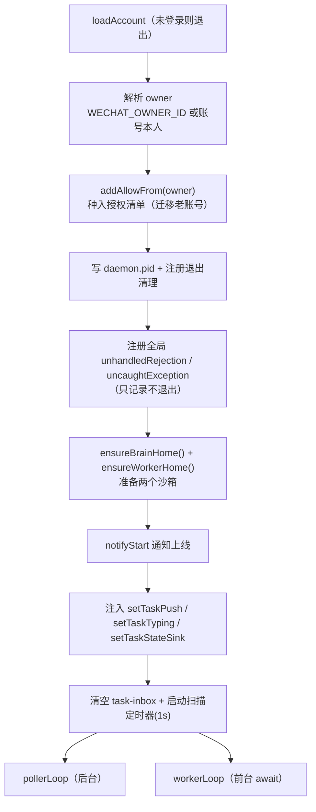
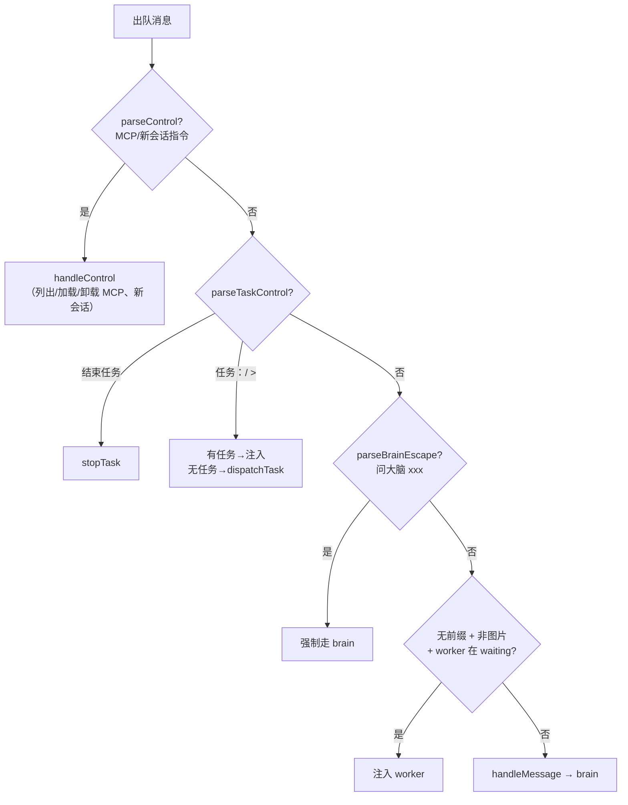
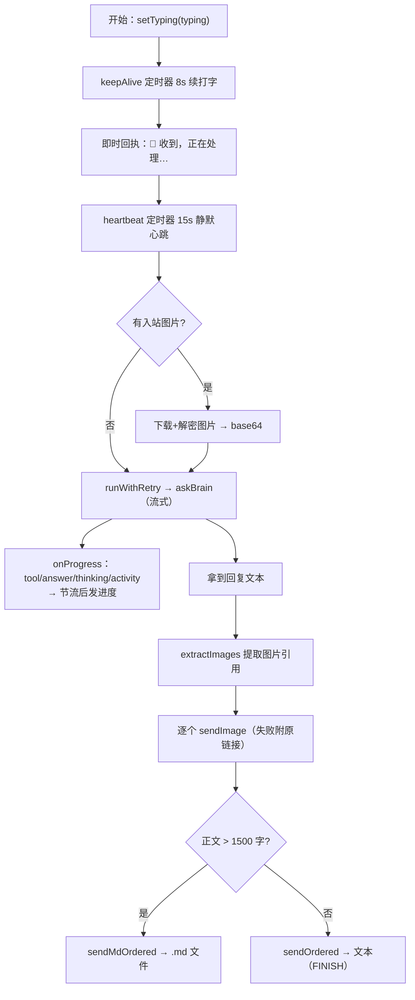
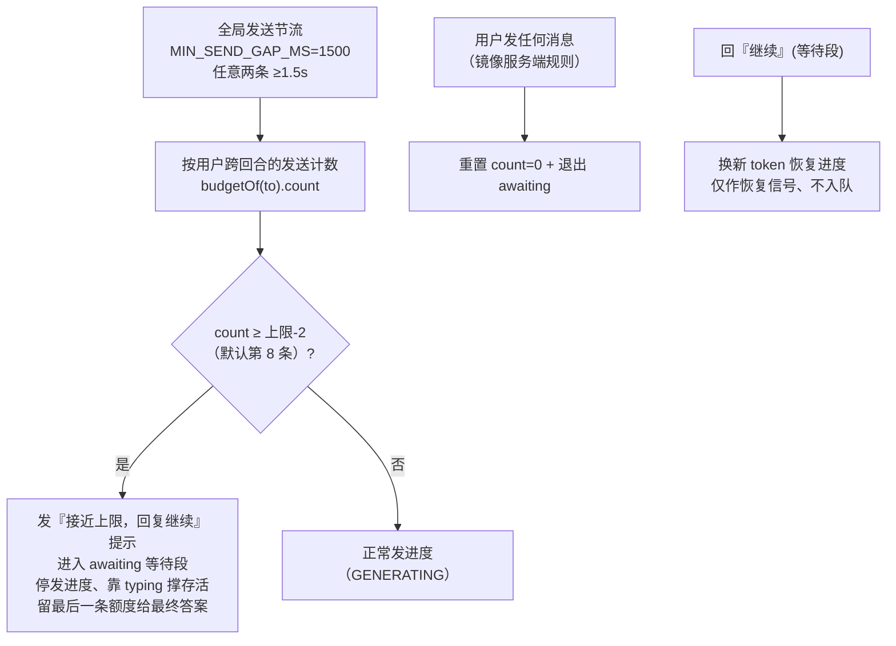

# 5. 守护进程 Daemon（@wemind/wechat-daemon）

> 上一页：[4. MCP Server](04-MCP-Server.md) ｜ 下一页：[6. ACP 大脑与沙箱](06-ACP-大脑与沙箱.md)

daemon 是 WeMind 的「完全体」：一个脱离任何 IDE、自己长轮询收消息、调用常驻 AI 大脑生成回复、自动回发的后台进程。本章聚焦 daemon 本体（`index.ts`）的运行逻辑；大脑、worker、沙箱在后续章节展开。

## 5.1 模块全景

```
packages/wechat-daemon/src/
├── index.ts            # 主入口：poller/worker 双循环、消息路由、回合编排、发送管理
├── acp-brain.ts        # 默认大脑：常驻 ACP 进程（→ 第 6 章）
├── brain-agents.ts     # ACP agent 预设与解析（→ 第 6 章）
├── mcp-sandbox.ts      # brain 沙箱：MCP 隔离 + 记忆继承（→ 第 6 章）
├── worker-acp.ts       # 任务 worker 的 ACP 客户端（→ 第 7 章）
├── worker-sandbox.ts   # worker 沙箱（→ 第 7 章）
├── task-manager.ts     # 任务状态机（→ 第 7 章）
├── manage.ts           # 多账号 + 本地任务管理 CLI（→ 第 8、7 章）
├── image-reply.ts      # 从大脑回复提取图片引用
└── md-reply.ts         # 长回复转 .md 文件
```

## 5.2 启动流程（main）



两个关键防御：

- **全局异常处理器**：任何未捕获的 promise 拒绝/异常（多为瞬时网络 `fetch failed` 或回合内 send 被拒）只记录、不退出。此前的 `code=1` 静默崩溃就源于此类未捕获拒绝，会丢掉在途回合、把用户卡在心跳。
- **PID 文件**：写 `daemon.pid` 供管理命令精确定位停止；`exit`/`SIGINT`/`SIGTERM` 时清理。

## 5.3 poller / worker 解耦

这是 daemon 内部最重要的架构（动机见 [2. 系统架构](02-系统架构.md#daemon-内部poller--worker-解耦)）。两个并发循环 + 一个内存队列 `msgQueue` + 唤醒回调 `wakeWorker`。

### pollerLoop —— 永不被大脑阻塞

```
while true:
  会话暂停中? → sleep 后 continue
  getUpdates(25s 长轮询)  ← 网络错误 catch + 2s 重试，不崩
  errcode -14? → pauseSession 1h
  更新游标 get_updates_buf
  过滤 USER 且 message_id > lastMessageId
  先登记本批所有最新 context_token（worker 发送时取最新）
  逐条：鉴权 → 提取文本/图片 → 重置发送配额 → 入队 → notifyWorker
```

poller 对每条消息**先鉴权再处理**，并把所有最新 token 实时写进 `state.contextTokens`，这样即使大脑在处理旧消息，新消息的 token 也不会丢。

### workerLoop —— 串行喂大脑

```
while true:
  会话暂停中? → sleep
  队列空? → 等 wakeWorker
  取出一条消息 → 消息路由（见 5.4） → handleMessage 或 注入 worker
```

worker 串行处理，尊重 ACP 单 session 串行约束。`token` 用消息自己携带的 `context_token`，`latestToken()` 取该用户最新缓存 token（仅作 `-2` 参数错误时的兜底）。

## 5.4 消息路由

每条出队消息按优先级判定去向：



三种「明确性」：`任务：`/`>` 强制发 worker、`问大脑` 强制发 brain、无前缀按 worker 状态分流。worker 只在 **waiting**（刚停下问你）时才默认接管无前缀消息；它埋头跑（running）时大脑照常可用。图片消息始终走 brain。

控制指令（`parseControl`）：

| 指令 | 作用 |
|------|------|
| `MCP` / `列出 MCP` | 列出可选与已激活的 MCP |
| `加载 <名>` / `load <名>` | 激活某 MCP（重启 ACP 进程生效） |
| `卸载 <名>` / `unload <名>` | 移除某 MCP |
| `新会话` / `重置` / `/new` | 开启新 ACP 会话（清空多轮上下文） |

## 5.5 回合编排（handleMessage）

`handleMessage` 是处理一条「给大脑的消息」的完整编排，串起打字保活、即时回执、进度反馈、收图、调用大脑、重试、发图、长回复转文件。



进度消息分级（节流避免触发限流）：

| 进度 | 触发时机 |
|------|---------|
| `🤖 收到，正在处理…` | 即时回执（无图片时） |
| `🖼️ 收到 N 张图片，下载识别中…` | 有入站图片（兼作回执） |
| `🔧 步骤 N：…` | 工具调用（首条即发，其后每 ≥15s 一条，步骤号只在实际发出时递增） |
| `🤔 还在思考/检索中…` | 静默满 15s 第 1 次 |
| `⏳ 仍在处理中…（已 X 秒）` | 静默第 2 次起 |
| `✍️ 正在整理回复…` | 开始输出正文 |

「正在输入中」（typing）每 8 秒续发，**不计入**连续发送上限。

### 错误分类与重试

`classifyBrainError` 把大脑错误分三类，按类型重试：

| 类型 | 触发特征 | 最大尝试 | 失败提示 |
|------|---------|---------|---------|
| `backend` | `-32603` / overloaded / rate limit / 429 / 503 | 3 次 | 模型后端临时出错 |
| `timeout` | idle/no-first-frame/cap timeout | 2 次 | 处理超时被中断 |
| `other` | 其它 | 2 次 | 通用出错 |

## 5.6 连续发送上限管理（关键机制）

这是项目踩坑最深、也最巧妙的一处。

**问题**：iLink 限制 bot 在用户回复前能**连续发送的消息数**（实测约 10；超出服务端以 `ret=-2` 拒绝并丢消息）。重任务每 15s 发一条进度，6.5 分钟会发 20+ 条 → 第约 10 条后被拒，而**最终答案恰好排在最后被丢**。

**解法**（多个机制叠加）：



要点：

- **计数按用户、跨回合维护**（`budgetOf(to)`），只在该用户发来任何消息时重置 —— 镜像服务端「距上一条用户消息计数」的规则。这修正了「新任务从 0 计数撞上限」的 bug。
- 进度/中间消息用 `GENERATING`，仅最终答案用 `FINISH`（见 [3. 协议内核](03-iLink-协议内核.md#关键枚举)）。
- 最终答案占等待段预留的最后一条额度。

### 串行发送链

`sendOrdered` / `sendMdOrdered` 用一个 `replyChain` Promise 串联所有发送，保证多条消息（进度/答案）按入队顺序送达、不并发乱序，并在每条前补足 `MIN_SEND_GAP_MS` 间隔。

`reply` 内置错误恢复：遇 `ret=-2`（param_error）退避 1.5s 后换该用户最新缓存 token 重试一次（限流靠等待恢复，token 失效靠换 token）；遇可重试传输错误退避 1.5s 重试一次。

## 5.7 收发富媒体

- **收图**：poller 提取 `image_item` → `downloadImage` 下载解密 → `sniffMime` 嗅探 MIME → 作为 ACP image 块喂大脑（大脑 `promptCapabilities.image:true`，能「看」图）。
- **发图**：`extractImages` 从大脑回复里提取 Markdown `` 或裸图片 URL → `resolveImageBytes` 下载/读取 → `sendImage` 发出，剩余文本另发。`image-reply.ts` 实现：下载带 15s 超时 + 浏览器 UA（规避图床热链 403）、10MB 上限；失败的图把原链接附文本发给用户（不静默丢图）。
- **收语音**：直接取 `voice_item.text`（微信侧已转写）当文本喂大脑，零依赖（无需 SILK 解码）。
- **发文件/视频**：core 的 `sendFile` 按扩展名自动判类型组装。

## 5.8 长回复转 .md（md-reply.ts）

当大脑最终回复正文超过阈值（`LONG_REPLY_THRESHOLD`，默认 1500 字，`WECHAT_REPLY_FILE_THRESHOLD` 覆盖）时，作为**单个 `.md` 文件**发送而非拆成多条文本 —— 规避连续发送上限、阅读完整。

`generateTitle` 由内容生成文件名（取首个 Markdown 标题或首个非空行，清洗为合法文件名）；`buildMdReply` 在内存里构造 buffer（正文无标题则前置一个 H1）。发文件失败时兜底回退为文本。

## 5.9 本地命令文件桥

daemon 通过一个独立的扫描定时器（`WEMIND_TASK_SCAN_MS`，默认 1s，**不挂在 poller 上**避免被 25s 长轮询阻塞）扫描 `task-inbox/*.json`，把本地 CLI 写入的命令分发到任务管理器（`dispatch`/`reply`/`stop`）。这是「本地终端入口」的服务端半边，详见 [7. 远程任务 Worker](07-远程任务-Worker.md#本地双入口文件桥)。

启动时清空 `task-inbox/` 作废重启前残留命令（防重放）。

---

接下来：[6. ACP 大脑与沙箱](06-ACP-大脑与沙箱.md) 详解常驻大脑如何工作。
