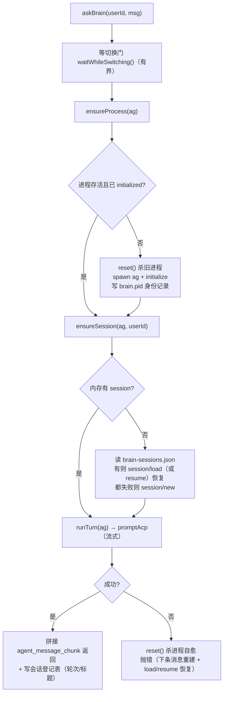
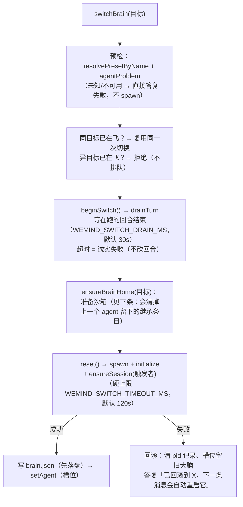

# 6. ACP 大脑与沙箱

> 上一页：[5. daemon](05-daemon.md) ｜ 下一页：[7. 远程任务 Worker](07-远程任务-Worker.md)
>
> **最后核对**：2026-11-09 ｜ 代码以当前分支为准。

daemon 的「大脑」是一个常驻的 AI agent 子进程，通过 ACP 协议驱动。本章讲清大脑的进程生命周期、会话管理、MCP 沙箱与记忆继承，以及如何换成别的 agent。

## 6.1 什么是 ACP

ACP（Agent Client Protocol）是一个通用协议：**JSON-RPC 2.0 over stdio**（每行一个 JSON 消息），由 Zed 提出，kiro-cli、Gemini CLI 等多家 agent CLI 都已支持。它天生为「外部程序控制 agent」设计。

daemon 使用 ACP 的一个**最小方法集**；不同 agent 的可用能力不同：

| 方法 | 作用 | 注意 |
|------|------|------|
| `initialize` | 握手 | **WeMind 只置 `initialized = true`，从不解析回包里的 `agentCapabilities`**——`load`/`resume`、图片、`acpMcpServers`/`mcpDelivery` 全部取自 `brain-presets.ts` 的预设字段（见下条） |
| `session/new` | 新建会话 | 绝对 `cwd`；可传 `mcpServers` |
| `session/load` | 按 sessionId 恢复会话 | **不是所有 agent 都实现**（DSH 返回 `-32601`） |
| `session/resume` | 恢复持久会话 | DSH 用这个；恢复日志但不回放旧更新 |
| `session/prompt` | 发一轮提问 | 图片能力看预设的 `images` 字段（不是 `initialize` 回包） |
| `session/update`（通知） | 流式回包：`agent_message_chunk`（正文）、`agent_thought_chunk`（思考）、`tool_call`/`tool_call_update`（工具进度） | committed-only agent 可能整段提交；`tool_call` 首帧报 start、终态 `tool_call_update` 报 end，同一 `toolCallId` 的终态只报一次 |
| `session/request_permission`（反向请求） | agent 请求权限 | 客户端内置应答器：**默认 yolo**，自动选择 `allow_once` / `allow_always`；设 `WEMIND_ACP_AUTO_ALLOW=0` 恢复逐次拒绝（`cancelled`）；接入前仍建议验证 |

> ⚠️ **能力来自预设字段，不是 `initialize` 回包**：`acp-brain.ts` 发出 `initialize` 后只置 `initialized = true`，**从不解析** `agentCapabilities`。`restore`（`loadSession`/`sessionResume`）、`images`、`acpMcpServers`、`mcpDelivery` 都写在 `brain-presets.ts` 的 `ACP_AGENT_PRESETS` 里，来源是接入时的**探针实测**。因此接新 agent 必须人工读一次 `initialize`（`scripts/acp-probe.mjs`）并把结论写进预设——代码不会自动适配（详见 [AGENTS.md §4.2](../../AGENTS.md)）。

「接入一个新 agent」主要是告诉 WeMind「怎么把它以 ACP 模式启动」；协议层能复用，但**能力差异要按 agent 补**（见 §6.6）。

## 6.2 常驻 ACP 客户端（acp-brain.ts）

`acp-brain.ts` 维护一个常驻的 ACP agent 进程，是当前大脑（未配置时 `auto` 探测 opencode/cline/qoder/gemini/deepseek/kiro）。相比每条消息 spawn 一次，它的优势：原生多轮记忆、暖进程（约 3s vs 冷启动约 6s）、回复从 `agent_message_chunk` 拼接（天然无 ANSI、无工具旁白；committed-only agent 只发一段）。

**「当前是哪个 agent」来自槽位，不是模块常量**（1.2.0 起）：`agent-slot.ts` 的 `getAgent("brain")` 懒解析 + 记忆化，`setAgent` 供热切换改写；`acp-brain.ts` 的每个过程**显式接收** `ag`（`ensureProcess(ag)` / `ensureSession(ag, userId)`；模型与 prompt 超时分别调用共用协议层的 `applyAcpModel(host, ag, sid)` / `promptAcp(host, params, timeouts)`）——入口取一次、过程内不再读槽位，所以「握手中途换 agent」在结构上不可能发生。心跳与首帧超时也改为**每回合现算**（`firstFrameMs(ag)`、回合内的 `heartbeatMsValue`），此前它们 import 期定死，切到 DSH 会继续用旧值。

**与 worker 共用的协议层**：帧分类（响应/反向请求/`session/update` 的进度与文本拼接）、请求超时、`session/prompt` 的首帧/空闲/硬上限、`session/set_config_option` / `session/set_mode`、`load` 后的回放静默，都在 `acp-connection.ts`。brain 只保留常驻单例、按用户会话映射与切脑门；worker 只保留每任务连接、`worker-sessions.json` 与进程池协作。这样「改协议要记得同步两份」的范围缩到进程生命周期与会话持久化。

### 进程生命周期



### 三重超时（`promptAcp`）

`session/prompt` 用专门的超时策略，只要还在出帧就不打断（避免误杀「慢但在干活」的长查询）：

| 超时 | 默认 | env | 含义 |
|------|------|-----|------|
| 首帧 | 25s | `WECHAT_BRAIN_FIRST_FRAME_MS` | prompt 发出后一直没出过帧 → 判「开局即卡死」，快速放弃 |
| 空闲 | 120s | `WECHAT_BRAIN_IDLE_MS` | 多久没收到任何帧才算卡死（重任务单次慢抓取可静默较久） |
| 硬上限 | 900s（15min） | `WECHAT_BRAIN_CAP_MS` | 单回合总时长上限（实测重任务约 6.5min） |

> 首帧超时只对「一个帧都没收到」生效；一旦有帧，判据换成 idle。接 committed-only/慢启动 agent 时，**不要盲目把首帧调到大于 idle**；应先看它是否发 thought/tool 帧，再决定调 idle 还是心跳。

失败即 `reset()`（按 PID 杀进程树：Windows 用 `taskkill /T /F`），下条消息重建并尝试 `session/load` / `session/resume` 恢复上下文 —— 大脑这层有自己的「崩了重建且尽量不丢历史」。

**stdout 增量解码**：brain / worker / `brain check` 三个 ACP 客户端共用 `line-decoder.ts` 的 `LineDecoder`（`StringDecoder` + 行缓冲），不直接用 `Buffer.toString()` 拼字符串——UTF-8 多字节字符跨 chunk 时后者会插入 U+FFFD，中文回复被静默损坏。进程重建时 `reset()` 丢弃半截行与未完成的多字节序列。

### 会话管理

- **每用户一个 ACP session**，映射持久化到 `brain-sessions.json`（键 `<agent>:<userId>`，按大脑分开存：切换 agent 后各自的会话互不覆盖，切回去仍能恢复），跨进程重建保上下文。这张**当前会话表是「当前是哪个会话」的唯一权威**。
- 另有**会话登记表** `session-registry.json`（`session-registry.ts`）：每个成功回合记录 `turns+1` 与首条用户消息的标题（`titleOf`，剥掉交接前缀）、`lastUsedAt` 刷新；每 (agent,userId) 上限 50 条（`MAX_ENTRIES_PER_KEY`），裁剪分两轮——**先淘汰未命名的**，再淘汰命名过的，都是最旧优先。**「不淘汰当前会话」是有条件的**：`capEntries(keep)` 的保护集默认是空数组，只有 `upsertEntry` 自动把「本次写入的那条」放进去；`acp-brain` 的三个调用点（`touchEntry` / `markUsed` / 恢复后校准）都**不传**当前会话 id，所以补登记/刷新**别的**会话时，当前会话仍可能被淘汰（已知边界，2026-11-05 核对）。daemon **启动时**按当前会话表回填一次（`syncFromPointerMap`，把功能上线前就存在的老会话补齐——运行中删掉它不会自动重建，下次启动才补）。它只是**派生元数据**——坏了最多导致「列表空」，写失败只记日志（不拖垮回合）。
- 会话管理指令（微信与 CLI 同源，实现层 `session-manager.ts`）：`新会话 [名字]` / `会话列表 [页]` / `恢复会话 <序号|名字|id前缀>` / `重命名会话 <序号|名字> <新名字>`（旧名字带空格时用引号括起来） / `删除会话 <序号>`；CLI 为 `wemind session new|list|resume|rename|delete`。
- **`恢复会话` 是严格恢复**：`resumeSession(userId, sessionId)` 按该 agent 支持的方式试 `session/load` → `session/resume`，**都失败就如实报错、不回退 `session/new`、不改当前会话记录**（宁可报错，也不要「假恢复」）；成功才写当前会话记录 + 刷新登记表。**恢复成功后的模型设置（`session/set_config_option`）失败只记日志，不算恢复失败**——否则会白丢刚恢复的上下文。目标已是当前会话时直接回「当前就在这条会话上」（省一次往返）。
- `会话列表` 只列**本人 + 当前大脑**的会话，末尾提示「另有 N 条属于其它大脑的会话，切回该大脑后可恢复」。
- `删除会话` 只删 WeMind 的登记（若是当前会话则同时清当前会话记录，下条消息自然开新的）；回复会写明「agent 自己那份历史记录不在 WeMind 手里」——`session/delete` 不是 ACP 通用能力（2026-10-29 实测：opencode/qoder 有、DSH 无 `-32601`；实现仍不依赖它）。
- `newSession(userId)`：丢弃旧 session（含磁盘映射），重建全新会话（对应微信指令「新会话」）。
- **ACP 操作串行**：`askBrain` / `newSession` / `resumeSession` 共用一条操作队列（同一时刻只有一个在跑）。微信回合与控制桥是两条独立入口，没有这道门时 `session/new` 会插进 `session/prompt` 中间；切脑的 `drainTurn` 把排队中的操作也计入在途。
- `restart()`：重启 ACP 进程（重建后 `load`/`resume` 恢复）。MCP 激活集变更走 `restartForMcpChange()`：**只有激活集真的变了才重启**（加载已激活的、卸载未激活的都不重启），且**切换进行中先等切换结束**（有界），不会把正在预热的新大脑杀在半路。

### 运行时换大脑（brain-switch.ts）

1.2.0 起换大脑不需要重启 daemon：微信 `切换大脑 [名]` / `/ai brain` / `/brain`，CLI `wemind brain switch <agent 名|auto>`（`--worker` 则是设默认任务大脑，只改**进程内**状态、不写入磁盘）。`brain-switch.ts` 的流程：



- **先落盘、再换槽位**：成功才写 `brain.json`，所以失败退回**无需撤销**；顺序不能反——先 `setAgent` 再写盘的话，写盘失败会留下「槽位是新大脑、答复却说已退回」的撒谎状态。
- **等在途回合结束，而不是丢弃**：切换请求到达时有回合在跑 → 等它跑完（默认 30s）再换；超时就如实报「切换失败」，绝不静默打断用户正在等的那条回复。
- **切换期间到达的用户消息**在 `askBrain` 入口等切换门（有界），因此全程**只 spawn 一次**新进程（既没有「启动新大脑时先起一个、消息又起一个」的双起，也不会拿旧 agent 答新消息）。
- **`WEMIND_BRAIN` 陷阱**：环境变量优先级高于 `brain.json`，所以命令式切换在进程内生效并写入磁盘，但**重启后若 env 还在，会回到 env 指的大脑**——答复里有警告，别把 env 写进 profile。
- **沙箱本身不需要「撤销」**：切换失败时 `brain.json` 没写、槽位仍是旧大脑，所以不必回滚磁盘上的任何东西。`direct` 不写文件，更无回滚。但 `sandbox` 的 `ensureBrainHome(newAgent)` **并非纯增量**：`sandbox-inherit.ts` 读 `.wemind-inherited.json` 清单，把**上一个 agent** 有、新 agent 不要的 `inheritDirs`（符号链接）与 `inheritFiles`（普通文件）清掉再链入新的（真实目录里的内容不动，只动生成副本里的链接/副本）。所以换 agent 后不会留着上一个 agent 的 `skills`/`AGENTS.md`。
- 已知窄窗口：`reset()` → 新进程写 pid 记录之间约 1s 内执行 `wemind stop`，可能漏杀新起的 ACP 子进程（与既有 `/加载` 触发 `restart()` 同类，不是新引入的形态）。

### 多账号下的范围、两个入口

**换大脑是账号级的**：一个 daemon（= 一个账号）同一时刻只有一个活跃对话大脑，切它**不影响任何别的账号**——多账号就是多个 daemon，各有自己的 `brain.json`、会话表、沙箱与进程树（见 [8. 数据存储与多账号](08-数据存储与多账号.md)）。

| | 微信 `切换大脑 X` | 本机 CLI `wemind brain switch X [<key\|label>]` |
| --- | --- | --- |
| 作用对象 | **消息进来的那个账号**（daemon 是哪个就切哪个） | **任意账号**（省略 = 默认账号）；`--worker`（设默认任务大脑）走另一条桥命令 `brain.worker` |
| 谁能做 | 仅该账号**登录者**（微信平台只发送登录者本人的消息；代码里另有兜底校验：非登录者会被短提示拒绝、不进大脑，见 [5. daemon](05-daemon.md) §5.4 的权限模型） | 能在本机写 `~/.wemind/<key>/control-inbox/` 的人（= 机主）；不走微信、也不经微信侧「只认登录者」那道门 |
| daemon 在跑 | 进程内热切换（上面的流程） | 经控制桥转给**同一个** `switchBrain`；CLI 超时自动放大到 等在途回合结束+启动新大脑+15s，`brain.handoff` 也按回合硬上限放大（默认 915s） |
| daemon 没跑 | —（没有 daemon 就没有微信侧） | `brain switch` 退化为「只写该账号的 `brain.json` + 注明下次启动生效」；`--worker` 必须先有 daemon（这个设置只存在进程内） |
| 写入磁盘 | 成功才写该账号的 `brain.json` | 同上（同一段代码） |

- CLI 侧**没有跨账号批量**：要切多个账号就逐个写 `key`/`label`；`brain set` / `unset` / `check` / `handoff` 同样按账号寻址（省略 = 默认账号）。
- 控制桥**只接受 agent 名与纯数据**，所以 `brain switch` 带 `--bin`/`--args`/`--extra-args`/`--shell`/`--model` 会被直接拒绝——那是 `brain set` 的活（配置变更，只写入磁盘）。带这些字段的配置改完，**daemon 在跑、认桥时可用 `wemind brain switch <同名 agent>` 当场应用**（`sameAgent()` 按 name/bin/args/model 判「是不是同一个」——改过就算一次真切换），否则重启 daemon；`--shell` 不在判据里，只能重启。安全边界见 [7. Worker](07-远程任务-Worker.md) §7.5。
- `WEMIND_BRAIN` 压过命令式切换这一条，对**每个账号各自**成立。

### 多账号下哪些共享、哪些隔离

`direct` 模式的**目标**就是让微信侧与终端使用同一份 Agent 配置/技能/记忆/会话库，因此这些数据跨 WeMind 账号共享是预期行为，不是遗漏：

| 数据 | `direct` | `sandbox` |
| --- | --- | --- |
| Agent 配置、技能、记忆、会话库 | 同一 OS 用户共享真实 home | 按账号复制/选择性继承 |
| token、state、会话指针、tasks、overlay、workspace、日志 | 按账号隔离 | 按账号隔离 |
| `brain-mcps.json`（MCP 激活集） | 不存在；MCP 由 Agent 真实配置决定 | 按账号隔离 |
| `codex` / `pi` / `qoder` 仍读真实路径的部分 | 与终端一致，接受 | 只能尽量减少，不能假装完全隔离 |

**同一台机器、多个账号由不同的人使用**时，不能用 `direct` 共享同一 OS 用户；应使用不同 OS 用户/VM，或显式 `sandbox`。同一个人自用多账号不受影响。

### 进程身份（pid-record.ts）

`brain.pid` 不再是裸整数，而是 **JSON 身份记录**（`{pid, agent, bin, args, shell, state, startedAt, writtenAt}`），worker 侧是 `workers.pid.json` **身份记录**（单条时是对象、多条时是数组，读侧都认）。原因：`cli/process-lifecycle.ts`（原 `manage.ts`）过去用**配置里**的 agent 算进程特征串（bin+args）来判定/杀进程，有三种情况会失效——① `wemind brain set X` 不带 `--restart`（配置已改、旧 agent 进程还在跑，`list` 显示「已停止」、`stop` 跳过不杀；1.2.0 起 `brain set` 对纯 agent 名会当场应用，这种「配置与进程不一致」已少见，但带 `--bin` 的改动、或 daemon 没跑时改配置仍会出现）；② 热切换窗口内；③ **多任务/多 agent 并存**（多 worker 之后是常态）。现在按记录里**起进程时真实用的** bin/args 算，缺失时回退配置（兼容旧账号）；旧版 CLI 读新格式会拿到 `NaN` → 显示「已停止」且**不杀**（安全侧）。

### 进度回调与「可发图」提示

`onProgress` 把 `session/update` 帧翻译成进度事件（`tool`/`answer`/`thinking`/`activity`）给 daemon 上报。工具调用分两个阶段上报（`tool` 携带 `phase: "start" | "end"`）：`tool_call` 首帧报 start；该 `toolCallId` 的终态（`status` 为 `completed`/`failed`/`cancelled`，且不是首帧自身）报 end，同一终态只报一次；缺少 `toolCallId` 时退回用 `title` 作为去重键；没有 `toolCallId` 也没有 `title` 的帧直接忽略。人类可读描述优先取 `rawInput.__tool_use_purpose`。daemon 用这两类事件发进度：**默认发文本「步骤 N」**；`WECHAT_TOOL_PROGRESS_ITEMS=1` 才发结构化 item（`TOOL_CALL_START=11` / `TOOL_CALL_RESULT=12`，微信客户端目前不渲染，见 [5. daemon](05-daemon.md#收发富媒体与消息类型)）。

> **心跳注意**：`index.ts` 每 `HEARTBEAT_DEFAULT_MS`（15s）检查 `lastProgressAt`，只有 `session/update` 帧会刷新它。纯推理/committed-only 的 agent 长时间无帧时，会连续发「还在思考」，占微信约 10 条连发额度。
>
> 实际间隔由 `heartbeatMsValue` 现算，**三层可覆盖**（优先级从高到低）：`WECHAT_BRAIN_HEARTBEAT_MS` env → 配置里的 `heartbeatMs`（DSH 已设为 60s）→ `HEARTBEAT_DEFAULT_MS`（15s）。接新 agent 时优先在 agent 里设 `heartbeatMs`，而不是让用户配 env。

每个会话首轮会带上一段「可发图」系统提示，告诉大脑：需要发图时用 Markdown ``，并提示**服务器从中国大陆下载图片**，优先选可直链下载的源（如 `raw.githubusercontent.com`），避开被墙或带热链保护的图床。该提示只影响「发图」；「收图」取决于 agent 的 `image` 能力。

## 6.3 brain 的工作模式与 MCP（runtime.ts / mcp-sandbox.ts / mcp-adapters.ts）

默认 `homeMode=direct`：`agentRuntime("brain", ag)` 直接返回 Agent 的真实配置目录，WeMind 不写任何配置、不注入 `homeEnvVar`/预设 env。技能、记忆、模型、权限、MCP、会话库都与终端共用；真实配置里的微信 MCP 只告警、不阻止启动（`warnForbiddenNativeMcp`）。

`sandbox` 是显式隔离选项：使用 `BRAIN_HOME` / `<账号>/brain-home`，由 adapter 复制设置基底，并按 `inheritDirs` / `inheritFiles` 选择性继承技能/记忆。WeMind 自己生成的 sandbox MCP 集永久排除 `wechat`（否则 bot 用同一 token 长轮询、与 daemon 抢消息）。`direct` 下 `加载/卸载 MCP` 原样转给 Agent，由它自己改配置。

### MCP 适配器分层

MCP **文件格式**知识集中在 `agents/sandbox/mcp-adapters.ts` 的 `McpAdapter` 接口，brain / worker 只负责「算激活集 / 全量集与排除集」，不再按 agent 名或格式写分支：

| 实现（按文件格式） | 文件形状 | 读写 | 设置继承 |
|---|---|---|---|
| `jsonMcpServers` | `{ mcpServers: {...} }` | 读/写同一套 JSONC 逻辑，保留同文件其它键 | `sandbox` 模式复制真实 `settings/`（跳过 `mcp.json`） |
| `jsonMcpNested` | `{ mcp: { servers: {...} } }` | 写入时默认补 `permission=allow`（用户显式配置优先） | `sandbox` 复制真实 `opencode.json(c)` 并剔除 `mcp` 段后重建基底 |
| `tomlMcpServers` | `[mcp_servers.*]` | **只读**；写入直接报错 | 不参与 |

名称描述的是**文件格式**，不是 Agent：多个 Agent 可以共用同一种格式，adapter 本身不认识 agent 名。

`mcpCatalogPath()` / `mcpConfigPath()` 也由该模块统一：前者支持 `WEMIND_MCP_CATALOG` 覆盖，后者按 agent 的 `mcpConfigFile` 拼配置目录。新增 agent 时先复用或新增 adapter，不要在 `mcp-sandbox.ts` / `worker-sandbox.ts` 里加格式分支。

### MCP 策略：direct 交给 Agent / sandbox 默认空

`direct`（默认）下 MCP 完全由 Agent 自己的真实配置决定：

- 文件式 Agent（kiro / opencode / qoder / cline / gemini / pi）由 Agent 启动时读自己的配置文件，WeMind 不写、不删、不注入。
- `acpMcpServers` 的 Agent（DSH / Claude Code / Copilot / Codex）同样由自己读真实配置：DSH 读 profile YAML、Claude Code 读 `~/.claude.json`、Copilot 读 `mcp-config.json`、Codex 读 `config.toml`（同名时原生优先）。WeMind **不重发 catalog**，只把微信侧 overlay 的 `mcp.extra` 补进会话、减去 `mcp.disable`。
- 微信里的 `加载 / 卸载 MCP` 在 direct 下**原样转给 Agent**（按普通消息进大脑），由 Agent 自己决定是否/如何改配置。WeMind 不维护 direct 的激活集。
- Agent 真实配置里出现微信 MCP 时**只告警、不阻止启动**（`warnForbiddenNativeMcp`）：WeMind 不替用户剥离，风险由用户判断。WeMind 自己生成的集合（sandbox / ACP 下发）仍永久排除 `wechat`。

`sandbox` 下 brain **默认不加载任何 MCP**（既快又安全，内置工具如 web_search 仍可用）。需要某个 MCP 时，在微信里发指令（daemon 拦截、不进 brain）：

| 指令 | 作用 |
|------|------|
| `MCP` / `列出 MCP` / `/mcp` / `mcp list` | 列出可选（来自该 agent 的 catalog）与当前已激活 |
| `加载 <名>` / `load <名>` | 加入激活集（`wechat` 永久禁止） |
| `卸载 <名>` / `unload <名>` | 移除 |

`sandbox` 下加载/卸载后 daemon 重启 ACP 进程以按新配置重载，下一条消息生效。**只有激活集真的变了才重启**（重复加载/卸载未激活项不会白杀一次进程）；**切脑进行中先等切换结束再重启**；**正在生成的回合不打断**——重启排到当前回合结束（`pendingReload`）。激活集持久化在 `<账号>/brain-mcps.json`，结构 `{version:2, active:{"<agent>":[...]}}`；**只影响该 agent、且只影响之后由 WeMind 新建的 brain 会话**。切到另一个 agent 用它自己的集合（没加载过就是空），切回来恢复原集合。终端自己开的会话不受影响。

**catalog 按 agent 各自约定、从该 agent 的「真实」配置目录读**（`mcpCatalogPath()` 用 `realHome`）：kiro 是 `~/.kiro/settings/mcp.json`，opencode 是 `~/.config/opencode/opencode.json` 的 `mcp.servers`，qoder 是 `~/.qoder/settings.json` 的 `mcpServers`，cline 是 `~/.cline/data/settings/cline_mcp_settings.json`，gemini 是 `~/.gemini/settings.json`（JSONC），pi 是 `~/.pi/agent/mcp.json`（kiro 格式 `{mcpServers}`），DSH 是 `profiles/<profile>/cordis.patch.yml` 的 `@deepseek-ai/dsh-mcp-client` 条目；Claude Code / Copilot / Codex 分别读 `~/.claude.json` / `~/.copilot/mcp-config.json` / `~/.codex/config.toml`（WeMind 只读解析，用于列表、指标与微信检测）。`WEMIND_MCP_CATALOG` 可覆盖成任意路径，**只影响可选清单与「加载」候选**，不改 Agent 自己实际加载的文件。**只有 `sandbox` 才写副本**：`加载 <名>` 把定义写进账号沙箱或随 ACP 下发，真实配置文件一律不动；文件式副本写前剔除微信 MCP，`mcpDelivery: "acp"` 的 Agent（DSH / Claude Code / Copilot / Codex）副本里的 MCP 条目**全部剥离**、由 WeMind 按激活集注入；overlay 写入时也拒绝微信 MCP 定义。**不要跨 agent 借配置文件。** 微信侧 overlay 的 `mcp.extra` 扩充可选目录，`mcp.disable` 最后生效；sandbox 的 worker 同样支持两者。

### 记忆/规则/技能共享（direct / sandbox-inherit）

这里**不是某个 Agent 或操作系统的自动继承功能**，是 WeMind 自己实现的：

- `direct`（默认）：Agent 直接读真实目录，没有 WeMind 链接/副本；技能、记忆、规则、会话与终端是同一份。
- `sandbox`：`sandbox-inherit.ts` 按预设的 `inheritDirs` / `inheritFiles` 选择性链接/复制，并写 `.wemind-inherited.json` 清单；换 agent 时清掉上一个 agent 留下的继承项。
- Windows 无 symlink 权限时回退复制；**副本不保证双向同步**，日志会告警。manifest 的清理阶段只删链接/文件，不删已有复制目录（避免误删 Agent 自建数据）。

### settings 处理

`direct` 下 WeMind **不碰任何 settings 文件**：Agent 用自己完整的真实设置。只有为「微信侧免逐次审批」下发的 `envDefaults`（如 `DSH_PERMISSION_MODE=danger-full-access`）和从 Agent 凭据文件派生的凭证环境变量仍会注入；父进程显式设置的同名变量优先。MCP 也完全由 Agent 自己加载（DSH 读 profile YAML、Claude Code 读 `~/.claude.json`、Copilot 读 `mcp-config.json`、Codex 读 `config.toml`）；`activeMcpServers(ag, rt)` 在 direct 只返回 `overlay.mcp.extra`，**不会重发真实 catalog**。sandbox 下 `mcpDelivery: "acp"` 的 Agent 才按 brain 激活集下发——**必须传正在启动的那个 agent 与 runtime**。

`sandbox` 才生成副本：`settingsBase` 型 Agent（如 gemini）按 `settingsStrip` 剥离必须由 WeMind 控制的键（默认 `mcpServers` / `enabledPlugins` / `providers` / `model`；gemini 只剥 `mcpServers`，保留用户 `model` / `security`），再由 adapter 的 `stripSettings()` 剥掉该格式的 MCP 段，并强制 `general.enableAutoUpdate=false`；MCP 由 adapter 的 `writeCatalog()` 权威覆盖同一文件里的 MCP 段。

`ensureBrainHome()` 的顺序是：`direct` 直接返回（不写任何文件）→ `sandbox` 才执行同步非 MCP 设置 → `linkRealKnowledge` → `syncCredentials` → `stripWechatFromConfigCopy` → 生成 MCP 文件 → `applySettingsDefaults` → kiro v3 权限。`syncProfilePatch` 对 DSH 的真实 `profiles/<名>/cordis.patch.yml`：provider/模型条目原样复制；`mcpDelivery: "acp"` 时剥离**全部** MCP 条目（集合改由 ACP 注入），否则只剔除微信 MCP 条目（真实文件不动）。

> 换模型/权限后旧 ACP 会话可能仍绑旧配置，需要新会话或 `wemind config reload`。真实配置变化由 `configFingerprint()` 在下一轮开始前发现：它哈希 `settingsBase` / `mcpConfigFile` / `catalogFile` / profile 一层文件 / overlay（跳过 Agent 自己高频写的会话/历史文件）。**没有 `homeEnvVar` 的 Agent 返回空指纹**（无法热重载，改完重启 daemon）；`direct` 与 `sandbox` 都盯真实配置，sandbox 在下次 spawn 时重新复制。`wemind config reload` 会让 brain 重建进程，有回合在跑时排到回合结束再重启。

## 6.4 可配置的 agent（brain-presets.ts / brain-agents.ts）

大脑通过 ACP 驱动，未配置时默认 `auto`（按 `opencode → cline → qoder → gemini → deepseek → kiro` 探测已安装者）。**多数原生 ACP agent 可以零代码接入**（加 agent/环境变量）；但若它缺 `session/load`、会发反向请求、没有 activity 帧或图片能力不同，就需要协议层适配（见 §6.6）。

### AcpAgentPreset 与解析

`AcpAgentPreset` 描述一个 agent：`bin`/`binWin`（二进制名）、`requiresBins`（除 bin 外还必须在 PATH 上解析到的运行时，如 `pi-acp` 需要 `pi` 本体；缺失时 `agentProblem()` 直接报安装提示，不等 `session/new` 才炸）、`args`（进入 ACP 模式的参数）、`homeEnvVar`（配置目录环境变量名，**仅 sandbox** 注入）、`shell`（是否经 shell 启动）、`env`（**仅 sandbox** 强制注入的环境变量）、`envDefaults`（**默认值**环境变量：父进程已设同名变量时不覆盖，用于审批开关；direct 也注入）、`sessionMode`（会话建立/恢复后经 `session/set_mode` 切到的模式，免审批用；`WEMIND_ACP_SESSION_MODE=0` 可关）、`model`（默认模型：用于会话建立后经 `session/set_config_option` 下发）、`realProfile`（该 agent 的用户层 profile 名——`sandbox` 模式复制真实的 `profiles/<名>/cordis.patch.yml` 并剥离其中的 MCP 条目，其余 provider/模型条目原样；DSH 优先用户写的 `- id: acp`，否则 `agent-default-model`，目前只有 DSH 用：`"acp"`）、`realHome`（真实配置目录；catalog、指纹与 sandbox 继承的来源）、`inheritDirs`/`inheritFiles`（**仅 sandbox** 的记忆/技能继承来源）、`fallbackBinPaths`（不在 PATH 时的兜底绝对路径）、`configSubdir`（agent 配置目录相对沙箱根的子路径：kiro 空=根、opencode `opencode`、gemini `.gemini`、cline `cline`、claude-code `claude`）、`settingsBase`（**仅 sandbox**：以真实设置为基底并剥离 MCP/插件/providers）、`credentialFiles`/`identityFiles`（**仅 sandbox** 的登录态同步，后者内容不同即覆盖）、`credentialEnv`（从 agent 自己的凭据文件派生 env；仅父进程未显式提供时，如 Cline 的 `CLINE_PROVIDER`/`CLINE_API_KEY`；direct 也生效）、`kiroEngine`（kiro：按 `--agent-engine` / `acp.agentEngine` / CLI 主版本判 v2/v3——`acp --help` 说两者都没设时默认 v2，CLI ≥3 默认 v3 为假设/待实测；v3 剔 v2 参数并写沙箱的 `settings/permissions.yaml`）、`isolateSessions`（DSH：**仅 `sandbox`** 用 `--patch` 把会话 root 指到账号数据目录；`direct` 下使用真实会话库）。此外还有 `restore` / `images` / `acpMcpServers`（纯能力）/ `mcpDelivery`（sandbox 托管投递方式）/ `modelArg` / `replayOnLoad` / `firstFrameMs`（首帧超时覆盖）/ `heartbeatMs`（静默期心跳间隔覆盖）/ `settingsStrip` / `settingsDefaults` / `mcpFormat` / `mcpConfigFile` / `catalogFile` 等字段（按 agent 覆盖协议能力与沙箱约定）；完整字段表见 [接入其它-ACP-Agent.md](../接入方案/接入其它-ACP-Agent.md) §4。三个 spawn 点（`acp-brain.ts`、`worker-acp.ts`、`brain-check.ts`）统一用 `agentEnv()` 合并环境变量（`direct` 时保留父进程 env、`envDefaults` 与只读凭据桥接，但不注入 `homeEnvVar` / 预设 `env`），并在起进程前调 `prepareAgent(ag)` 落盘派生配置（目前是 DSH 在 `sandbox` 下的 `--patch` 文件）。

内置 agent：

| 预设名 | agent | 类型 | 状态 | 启动 |
|------|-------|------|------|------|
| `kiro` | kiro-cli | 原生 ACP | ✅ 已实测（v2 2.37.1 真机；v3 探针级 2026-11-03） | v2：`kiro-cli acp --trust-all-tools`；v3：`kiro-cli acp --agent-engine v3`（v3 拒绝 v2 信任参数；免审批写沙箱 `settings/permissions.yaml` 的 allow-all），`KIRO_HOME` |
| `deepseek` | DeepSeek Harness `dsh` | 原生 ACP | ✅ 已内置/已实测（prompt/resume/MCP；`load` ❌、`image` ❌）；**`sandbox` 下会话 root 隔离**（0.2.1-rc.3，2026-11-03；`direct` 下用真实 `~/.dsh` 会话库） | `dsh --profile acp`；`sandbox` 额外加 `--patch "<账号目录>/agent-sessions/deepseek/session-root-<role>.patch.yml"` 并令 `DSH_HOME` 指向沙箱（见 [接入-DeepSeek](../接入方案/接入-DeepSeek.md)） |
| `opencode` | OpenCode | 原生 ACP | ✅ 已实测 | `opencode acp`，`XDG_CONFIG_HOME` |
| `qoder` | Qoder CLI `qodercli` | 原生 ACP | ✅ 已内置/已实测（load/resume/图片/MCP） | `qodercli --acp --yolo`，`QODER_CONFIG_DIR`（见 [接入-Qoder](../接入方案/接入-Qoder.md)） |
| `cline` | Cline CLI `cline` | 原生 ACP | ✅ 已内置/已实测（loadSession ✅ / 图片 ❌（`images:false`，ACP prompt 只保留 text 块）；自定义 provider 需 `CLINE_PROVIDER`+`CLINE_API_KEY`） | `cline --acp --auto-approve true`，`CLINE_DIR`/`CLINE_DATA_DIR`/`CLINE_MCP_SETTINGS_PATH`（见 [接入-Cline](../接入方案/接入-Cline.md)） |
| `gemini` | Gemini CLI | 原生 ACP | ✅ 已内置/已实测（0.66.0 探针 + 真机 E2E 2026-11-01：load/图片/MCP/yolo；load 后异步回放历史 → `replayOnLoad`；`set_config_option` ❌，模型走 `--model`） | `gemini --acp --approval-mode yolo --skip-trust`；`direct` 不注入 `GEMINI_CLI_HOME`、用真实 `~/.gemini`，`sandbox` 才指向沙箱根、配置目录 `<它>/.gemini`；MCP 在配置目录 `settings.json` 的 `mcpServers`；`settingsBase` 只剥 `mcpServers`、`.env` + OAuth 凭据同步（仅 `sandbox`）、`skills/`+`GEMINI.md` 继承（见 [接入-Gemini](../接入方案/接入-Gemini.md)） |
| `claude-code` | Claude Code | 需适配器 | ✅ 探针级实测 + 真机微信单轮 E2E（2026-10-31；重启续聊/MCP/任务待复测） | 全局 `claude-agent-acp`（`npm i -g @agentclientprotocol/claude-agent-acp`，Node ≥22；免审批走 `session/set_mode bypassPermissions`，适配器不解析 CLI flag；Windows `claude-agent-acp.cmd`） |
| `codex` | OpenAI Codex | 需适配器（ACP 项目维护，非 OpenAI 官方） | ✅ 已内置/已实测（探针级 + 真机 E2E：worker 与 brain 通道均通；load/图片/set_mode/set_config_option ✅；**stdio MCP ✅**，2.5.0 与 2.6.0 均复测模型实际调用 fake MCP；旧结论 `mcpCapabilities.acp=false` 是误读） | `codex-acp`（npm 包 `@agentclientprotocol/codex-acp`，**全局安装**，当前基线 **2.6.0**；Windows 上是 `codex-acp.cmd`；免审批 `INITIAL_AGENT_MODE=agent-full-access` + `session/set_mode`，见 [接入-Codex](../接入方案/接入-Codex.md)） |
| `pi` | pi coding agent | 需适配器（社区 `pi-acp`） | ✅ 已内置/探针级实测 + 真机 E2E（2026-11-01：brain、热切换、微信任务）；load/图片/工具调用 ✅、0 反向请求 | `pi-acp`（`npm i -g pi-acp`）+ `requiresBins: ["pi"]`（pi 本体 `npm i -g @earendil-works/pi-coding-agent` 并先登录）；`direct` 不注入 `PI_CODING_AGENT_DIR`、用真实目录，`sandbox` 才指向沙箱根、MCP 走 `<沙箱根>/mcp.json`；免审批无需开关；`settingsDefaults: { quietStartup: true }` 关掉 pi-acp 当消息发出来的启动信息（用户显式设过则保留），见 [接入-pi](../接入方案/接入-pi.md) |
| `copilot` | GitHub Copilot CLI | 原生 ACP | ✅ 探针级实测（1.0.107，Windows，2026-11-09；WeChat E2E 待验证）；强杀后 `session/load` 和 stdio MCP 调用通过；图片模型支持待实测 | `copilot --acp --no-auto-update --allow-all-tools`；`COPILOT_HOME` 沙箱同步 `config.json`、`skills/`、`copilot-instructions.md`；MCP 经 ACP 激活集；不在 `AUTO_PROBE_ORDER`，需显式选择（见 [接入-Copilot](../接入方案/接入-Copilot.md)） |

两类区别：**原生 ACP**（CLI 自带 ACP 模式，直接起）vs **需适配器**（CLI 本身不实现 ACP，要起一个桥接进程）。`auto` 只在 6 个原生预设中探测（`opencode → cline → qoder → gemini → deepseek → kiro`）；三个适配器（`claude-code` / `codex` / `pi`）及原生 ACP `copilot` 不参与（安装不代表已登录，误选会让机器启动失败），只能显式选用。

**内置预设默认免审批**（2026-10-30 起，各用自己官方的机制）：kiro v2 `--trust-all-tools`（v3 不使用：引擎判定见帮助；v3 写沙箱 `settings/permissions.yaml` 的 allow-all，真实设置已有则保留用户规则）、gemini `--approval-mode yolo --skip-trust`、qoder `--yolo`、cline `--auto-approve true`、Copilot `--allow-all-tools`（不启用 `--allow-all`）、opencode `direct` 用用户真实配置、`sandbox` 写 `opencode.json` 的 `"permission": "allow"`（`opencode acp` 不接受 `--auto`）、DSH `DSH_PERMISSION_MODE=danger-full-access`（`envDefaults`：daemon 进程同名变量优先，可收紧）、claude-code / codex 会话建立后 `session/set_mode`（`bypassPermissions` / `agent-full-access`；`WEMIND_ACP_SESSION_MODE=0` 关闭，会话回包的 `availableModes` 不含目标值时会跳过）、pi 无需任何开关（官方默认不逐次审批，没有要切的 `session/set_mode`）。WeMind 侧权限应答器默认 yolo：`session/request_permission` 自动选 `allow_once` / `allow_always`；设 `WEMIND_ACP_AUTO_ALLOW=0` 恢复拒绝。

### 选择与覆盖

三档优先级（`resolveAgentFor(cfg, role)`）：**环境变量 > 账号 `brain.json` > `auto`**。角色（`brain` / `worker`）决定读哪些键：worker 键的优先级是 env `WEMIND_WORKER_BRAIN` → env `WEMIND_BRAIN` → 文件 `cfg.worker?.agent ?? cfg.agent`。

| 层 | 内容 | 用途 |
|----|------|------|
| 环境变量 | `WEMIND_BRAIN` / `_BIN` / `_ARGS` / `_HOME_ENV` / `_SHELL` / `_INHERIT` / `_REAL_HOME` / `_INHERIT_DIRS` / `KIRO_CLI_BIN`；worker 侧 `WEMIND_WORKER_BRAIN` | 一次性覆盖（临时试别的 agent，别写进 profile） |
| 账号配置 | `<数据目录>/brain.json`：`{ agent, bin?, args?, extraArgs?, shell?, homeEnvVar?, model?, worker?: {…}, presets?: { <agent 名>: {…} } }` | **持久选择**，任何入口重启都复现 |
| `auto` | 未配置时按 `opencode → cline → qoder → gemini → deepseek → kiro` 探测第一个可用 agent | 缺省兜底 |

- **`presets` 段（1.2.0 新增）**：按**agent 名**保存启动覆盖（`--bin`/`--args`/`--extra-args`/`--shell`/`homeEnvVar`/`model`）。因为顶层那几个字段是「当前 agent 的覆盖」，切走再切回就会丢（典型：DSH 的 `--bin <绝对路径>`）——换 agent 时旧覆盖自动迁进 `presets[旧 agent]`，同一 agent 再次 `set` 时沿用未给出的字段。
- **`worker` 段**：默认任务大脑（`{agent, bin?, args?, extraArgs?, shell?, homeEnvVar?, model?}`，与顶层同字段；`model` 同样在会话建立/恢复后经 `session/set_config_option` 下发）。它也带 `presets` 查找上下文——`agentConfigFor("worker")` 会把顶层的 `presets` 带进 worker 段，否则「有 `worker.agent` 时 `presets[agent]` 查不到」、`--bin` 之类覆盖会静默失效。
- 切换用 CLI：`wemind brain set <agent 名|auto> [--bin X] [--args "…"] [--extra-args "…"] [--model X|auto] [--restart]`、`wemind brain unset`、`wemind brain`（查看，「生效」行含 `model=`）、`wemind brain check`（真起进程跑 ACP 握手）、**`wemind brain switch <agent 名|auto> [--worker]`（运行时换大脑，见 §6.2）**。`brain set` 现在是**读-改-写**（早期版本是整体覆盖，会把 `worker`/`presets` 段抹掉），并且**在 daemon 在跑且认控制桥时，纯 agent 名会立刻当场应用（不用重启）**（等价 `brain switch`：先启动新大脑、成功才写入磁盘）；带 `--bin`/`--args`/`--extra-args`/`--shell`/`--model` 时只写入磁盘——控制桥刻意不接受这些字段（安全边界，见 §7.5），但其中 `--bin`/`--args`/`--extra-args`/`--model` 的改动可由随后的 `wemind brain switch <同名 agent>` 当场应用（判据见上一条），否则重启 daemon。`--args` 是**整段替换**（漏掉 `acp` 这类模式参数会导致「进程起得来、不实现 ACP」）；`--extra-args` 追加在末尾，适合只加开关（解析出的 args 里没有该 agent 的 ACP 模式标记时，`wemind brain` / `brain set` 只**警告**不阻止，自定义 `--bin` 时跳过）。`--model` 指定默认模型（格式 `["provider 路由","模型名"]`，如 `'["deepseek-account","deepseek-flash"]'`），会话建立后经 `session/set_config_option` 下发一次（显式覆盖以它为准）；解析优先级「本段 > `presets[agent 名]` > 真实 profile 的默认 > 预设兜底」，其中「真实 profile 的默认」由 `profile-model.ts` 读（**优先用户自己写的 `- id: acp`，否则 `agent-default-model`**）。`--model auto`（或 `default`）= **跟随真实 profile 的默认**——DSH 读 `~/.dsh/profiles/acp/cordis.patch.yml`（值由用户自己的 DSH 配置决定），读不到就**不下发**（`auto` **不**回退预设值：DSH 会用它自己的默认 `deepseek-official/deepseek-v4-flash`，仍需 `DEEPSEEK_API_KEY`）；只有**没写** `model` 的默认情形、读不到时才落到预设的 `deepseek-account/deepseek-flash` 兜底。**WeMind 不替 agent 合成配置**：profile 里缺 `- id: acp` 时只由 `wemind brain` 给出可粘贴的片段、让用户补到真实文件（§4.14 的纪律）。daemon 没跑（或跑的是不认桥的旧版）时同样是「写入磁盘 + 下次启动生效」，答复会写明。
- **启动即校验**：daemon 起来时先解析并校验二进制；不可用则 `[wemind/wechat-daemon][ERROR] FATAL 大脑不可用：…` 并以退出码 78 退出（后台守护进程据此停止自动重启，不再每 5s 刷屏）；未知 agent 名也不再静默回退 kiro。

| 环境变量 | 作用 |
|----------|------|
| `WEMIND_BRAIN` | 选 agent（默认 `auto`） |
| `WEMIND_BRAIN_BIN` | 覆盖二进制 |
| `WEMIND_BRAIN_ARGS` | 覆盖启动参数（空格分隔、整段替换） |
| `WEMIND_BRAIN_EXTRA_ARGS` | 追加启动参数（空格分隔，拼在预设参数之后） |
| `WEMIND_ACP_SESSION_MODE` | 覆盖/关闭预设的 `sessionMode`（`0`/`false`/`off`/`no` 关闭，其它非空值 = 该 modeId） |
| `WEMIND_BRAIN_HOME_ENV` | 覆盖配置目录环境变量名 |
| `WEMIND_BRAIN_SHELL` | 是否经 shell 启动（npx/.cmd 类在 Windows 需要） |
| `WEMIND_BRAIN_INHERIT` | 是否继承记忆（默认 1） |
| `WEMIND_BRAIN_REAL_HOME` | 覆盖被继承的真实配置目录 |
| `WEMIND_BRAIN_INHERIT_DIRS` | 覆盖继承的子目录清单 |
| `WEMIND_HOME_MODE` | 一次性覆盖账号 `homeMode`（`direct` / `sandbox`；持久值在 `runtime.json`） |
| `KIRO_CLI_BIN` | 旧的 kiro 专用覆盖（仍兼容） |

### 接入新 agent 的两种方式

**方式 A（写入磁盘持久，推荐）**：`wemind brain set <agent 名>`；仅临时覆盖才用环境变量：

```powershell
$env:WEMIND_BRAIN_BIN      = "acme-agent"
$env:WEMIND_BRAIN_ARGS     = "serve --acp"
$env:WEMIND_BRAIN_HOME_ENV = "ACME_HOME"
```

**方式 B（加 agent，长期）**：在 `ACP_AGENT_PRESETS` 加一条 → `npm run build` → `wemind brain set acme`。

### 跨 agent 的限制

- **对话/工具是通用的**，但**能力不是统一的**：`load`/`resume`、image、MCP 传输、反向请求都要按 agent 确认；
- **动态挂 MCP依赖该 agent 的配置约定**：kiro/opencode/qoder/pi/gemini 写各自配置文件（gemini 是配置目录 `settings.json` 的 `mcpServers`）；DSH 与 Claude Code 走 ACP `mcpServers`；`catalog` 也按 agent 各自读取，**不要跨 agent 借文件**；
- **记忆继承**按 agent 实际布局配置：目录式用 `inheritDirs`，单文件（如 `CLAUDE.md`/`GEMINI.md`）用 `inheritFiles`；完全不适用时留空；只继承记忆/技能/规则，不连带继承可能自带 MCP 的插件目录（如 Claude Code 的 `plugins/`）；
- 不支持 ACP 的对象（直接调 OpenAI/Anthropic HTTP API）走不了这条路，需要另写「API 适配器」；**仓库当前没有 `Brain` 接口抽象**，得先抽接口（尚未实现）。

### 验证接入

启动 daemon 后给 bot 发消息，看 `~/.wemind/<key>/daemon.log` 应出现 `[wemind/wechat-daemon/acp] spawn ...` → `initialized` → `session/new` 或 `load`/`resume` → `session/prompt` → `prompt ok`。也可 `wemind brain` 看解析结果、`wemind brain check` 真起一个进程跑 ACP 握手（`initialize` + `session/new`；**预设声明了 `sessionMode` 时还会再发一次 `session/set_mode`**，失败不判失败，只在结论里附 `modeNote`「免审批模式可能不可用…」——验证 claude-code / codex 时这一步最关键；默认 60s，冷启动慢的 agent 仍可能误报）。

## 6.5 大脑 vs worker 的配置与工作区对比

| | brain（对话） | worker（任务） |
|---|--------------|----------------|
| 配置 home | 默认 `direct`：直接用 Agent 真实 home，WeMind 不注入 `homeEnvVar`；`sandbox` 才是 `BRAIN_HOME` | 默认 `direct`：直接用 Agent 真实 home；`sandbox` 才是 `WORKER_HOME` |
| 工作区 cwd | `<账号>/workspace/brain`（或 `session-cwd.json` 记录） | `--cwd` > `WEMIND_WORKER_CWD` > `<账号>/workspace/worker` |
| MCP 策略 | `direct`：Agent 真实配置全量（`acpMcpServers` 型只额外补 overlay，不重发 catalog）；`sandbox`：默认空，按 agent 持久激活；WeMind 生成的集合永久排除 `wechat` | `direct`：Agent 真实配置全量（同上，只额外补 overlay）；`sandbox`：真实 catalog + overlay extra − `wechat` − `WEMIND_WORKER_MCP_EXCLUDE` − `disabled:true` − overlay disable（完整公式见 [07](07-远程任务-Worker.md)） |
| 为何不同 | 对话助手，有人在旁逐个加载 | 无人值守跑任务，需开箱即用的完整能力 |
| 记忆/skills/settings | `direct` 直接用真实 home；`sandbox` 才按 `inheritDirs`/`inheritFiles` 复制 | 相同 |
| 会话恢复 | 每用户一个 session；load/resume | 单任务 session；load/resume |

worker 沙箱详见 [7. 远程任务 Worker](07-远程任务-Worker.md#worker-沙箱)。

## 6.6 能力差异与接入检查（重要）

> 这一节是 2026-10-24 补的：kiro/opencode 能「零代码」不代表所有 ACP agent 都能。接入前逐条打勾。

| 检查项 | 怎么看 | 不满足时的影响 | 处置 |
|---|---|---|---|
| `session/load` | 探针实测（`scripts/acp-probe.mjs`）；回包里的 `agentCapabilities` 代码不读 | 不支持 → `-32601` → 当前代码新建会话，**丢多轮上下文** | 预设写 `restore: "resume"` 用 `session/resume` 兜底，再失败才 `new` |
| `session/resume` | 同上：实测 + 预设字段 | 也没有 → 无法自愈恢复 | 接受「重启即新会话」，或换 agent |
| `image` | 探针带图跑一次 prompt；结论写进预设的 `images` | 预设 `images: false` → `planImageTurn()` 按「有文字只按文字答、无文字才拒绝」处理；即便漏到 `askBrainTurn`，也只会附一句「当前大脑不支持图片」而不带图 | 友好拒绝，或换 agent |
| MCP 传输 | 探针传非空 `mcpServers` 实测；结论写进预设的 `acpMcpServers`，sandbox 托管时再配 `mcpDelivery: "acp"` | 不支持 ACP MCP → 动态 MCP 不可用 | 走 agent 自己配置文件，或先不做 |
| 反向请求 | 跑一次 prompt，记录 `method`+`id` | 不应答 → 挂到超时 | 应答器已在 `acp-reverse.ts` 统一（brain/worker/`brain check` 共用），一般无需再写 |
| 正文粒度 | 看 `agent_message_chunk` 数量 | committed-only → 心跳刷屏、首帧慢 | 调 `firstFrameMs` + `heartbeatMs`（静默期心跳间隔） |
| Windows 入口 | `Get-Command` / 实际文件 | `.cmd` 未经 shell → 启动失败 | 用 `spawnAgent()`（内部经 shell），`binWin` 写实际文件名 |

**已实测反例（DSH 0.2.1-rc.2）**：无 `load`、有 `resume`、`image:false`、`mcp.http:true`。详见 [接入-DeepSeek](../接入方案/接入-DeepSeek.md) 附录。

---

接下来：[7. 远程任务 Worker](07-远程任务-Worker.md) 看如何把漫长任务交给微信遥控。

> **日志格式（2026-11-11 起）**：运行日志统一由 `core/logging.ts` 的 `createLogger(scope)` 输出，格式为 `[wemind/<scope>][INFO|WARN|ERROR|DEBUG] …`，全部写 stderr（MCP 的 stdout 仍是 JSON-RPC 通道）；CLI 用户输出走 stdout 的 `print()`，不加前缀、不加级别。本文正文中的日志样例可能省略了级别标记，实际每行都有。`wemind log --errors` 精确认 `[ERROR]/[WARN]` 标记，升级前写入的旧日志仍按关键词兼容。`WEMIND_LOG_LEVEL=debug` 才输出 DEBUG（目前没有 debug 调用点，属预留级别）。
