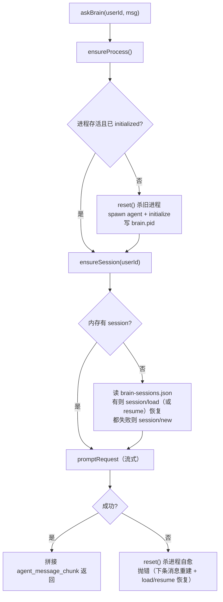

# 6. ACP 大脑与沙箱

> 上一页：[5. 守护进程 Daemon](05-守护进程-Daemon.md) ｜ 下一页：[7. 远程任务 Worker](07-远程任务-Worker.md)
>
> **适用版本**：WeMind 1.0.1 ｜ **最后核对**：2026-10-24 ｜ 代码以当前 `main` 为准。

daemon 的「大脑」是一个常驻的 AI agent 子进程，通过 ACP 协议驱动。本章讲清大脑的进程生命周期、会话管理、MCP 沙箱与记忆继承，以及如何换成别的 agent。

## 6.1 什么是 ACP

ACP（Agent Client Protocol）是一个通用协议：**JSON-RPC 2.0 over stdio**（每行一个 JSON 消息），由 Zed 提出，kiro-cli、Gemini CLI 等多家 agent CLI 都已支持。它天生为「外部程序控制 agent」设计。

daemon 使用 ACP 的一个**最小方法集**；不同 agent 的可用能力不同：

| 方法 | 作用 | 注意 |
|------|------|------|
| `initialize` | 握手，返回 `agentCapabilities` | 看 `sessionCapabilities`、`promptCapabilities.image`、`mcpCapabilities` |
| `session/new` | 新建会话 | 绝对 `cwd`；可传 `mcpServers` |
| `session/load` | 按 sessionId 恢复会话 | **不是所有 agent 都实现**（DSH 返回 `-32601`） |
| `session/resume` | 恢复持久会话 | DSH 用这个；恢复日志但不回放旧更新 |
| `session/prompt` | 发一轮提问 | 图片需 `image:true` |
| `session/update`（通知） | 流式回包：`agent_message_chunk`（正文）、`agent_thought_chunk`（思考）、`tool_call`/`tool_call_update`（工具进度） | committed-only agent 可能整段提交 |
| `session/request_permission`（反向请求） | agent 请求权限 | 当前客户端不应答，会挂起；接入前必须验证 |

「接入一个新 agent」主要是告诉 WeMind「怎么把它以 ACP 模式启动」；协议层能复用，但**能力差异要按 agent 补**（见 §6.6）。

## 6.2 常驻 ACP 客户端（acp-brain.ts）

`acp-brain.ts` 维护一个常驻的 ACP agent 进程，是当前大脑（未配置时 `auto` 探测 kiro/opencode/gemini/deepseek）。相比每条消息 spawn 一次，它的优势：原生多轮记忆、暖进程（约 3s vs 冷启动约 6s）、回复从 `agent_message_chunk` 拼接（天然无 ANSI、无工具旁白；committed-only agent 只发一段）。

### 进程生命周期



### 三重超时（promptRequest）

`session/prompt` 用专门的超时策略，只要还在出帧就不打断（避免误杀「慢但在干活」的长查询）：

| 超时 | 默认 | env | 含义 |
|------|------|-----|------|
| 首帧 | 25s | `WECHAT_BRAIN_FIRST_FRAME_MS` | prompt 发出后一直没出过帧 → 判「开局即卡死」，快速放弃 |
| 空闲 | 120s | `WECHAT_BRAIN_IDLE_MS` | 多久没收到任何帧才算卡死（重任务单次慢抓取可静默较久） |
| 硬上限 | 900s（15min） | `WECHAT_BRAIN_CAP_MS` | 单回合总时长上限（实测重任务约 6.5min） |

> 首帧超时只对「一个帧都没收到」生效；一旦有帧，判据换成 idle。接 committed-only/慢启动 agent 时，**不要盲目把首帧调到大于 idle**；应先看它是否发 thought/tool 帧，再决定调 idle 还是心跳。

失败即 `reset()`（按 PID 杀进程树：Windows 用 `taskkill /T /F`），下条消息重建并尝试 `session/load` / `session/resume` 恢复上下文 —— 大脑这层有自己的「崩了重建且尽量不丢历史」。

### 会话管理

- **每用户一个 ACP session**，映射持久化到 `brain-sessions.json`（`userId → sessionId`），跨进程重建保上下文。
- `newSession(userId)`：丢弃旧 session（含磁盘映射），重建全新会话（对应微信指令「新会话」）。
- `restart()`：重启 ACP 进程（MCP 激活集变更后调用，重建后 `load`/`resume` 恢复）。

### 进度回调与「可发图」提示

`onProgress` 把 `session/update` 帧翻译成进度事件（`tool`/`answer`/`thinking`/`activity`）给 daemon 上报。每个工具调用只上报一次（`seenTools` 去重），优先取 `rawInput.__tool_use_purpose` 作为人类可读描述。

> **心跳注意**：`index.ts` 每 15s 检查 `lastProgressAt`，只有 `session/update` 帧会刷新它。纯推理/committed-only 的 agent 长时间无帧时，会连续发「还在思考」，占微信约 10 条连发额度；接入时要单独调心跳。

每个会话首轮会注入一段「可发图」系统提示，告诉大脑：需要发图时用 Markdown ``，并提示**服务器从中国大陆下载图片**，优先选可直链下载的源（如 `raw.githubusercontent.com`），避开被墙或带热链保护的图床。该提示只影响「发图」；「收图」取决于 agent 的 `image` 能力。

## 6.3 brain 的 MCP 沙箱（mcp-sandbox.ts）

大脑跑在一个独立沙箱（`BRAIN_HOME`，默认 `<数据目录>/brain-home`，由预设的 `homeEnvVar` 指向），目的有三：

1. **隔离** —— 大脑的配置/会话与你本机日常用的 agent 分开；
2. **杜绝回环** —— 默认不加载 `wechat` 自身 MCP（否则 bot 用同一 token 长轮询、与 daemon 抢消息）；
3. **可选 MCP 注入** —— 对话中按需加载。

### 默认空 MCP + 对话式动态加载

brain 沙箱**默认不加载任何 MCP**（既快又安全，内置工具如 web_search 仍可用）。需要某个 MCP 时，在微信里发指令（daemon 拦截、不进 brain）：

| 指令 | 作用 |
|------|------|
| `MCP` / `列出 MCP` | 列出可选（来自该 agent 的 catalog）与当前已激活 |
| `加载 <名>` / `load <名>` | 加入激活集（`wechat` 永久禁止） |
| `卸载 <名>` / `unload <名>` | 移除 |

加载/卸载后 daemon 重启 ACP 进程以按新沙箱配置重载，下一条消息生效。激活集持久化在 `brain-mcps.json`；**catalog 按 agent 各自约定读取**：kiro 是 `settings/mcp.json`，opencode 是 `opencode.json` 的 `mcp.servers`，DSH 走 ACP `mcpServers`（无文件式 catalog 时用 `WEMIND_MCP_CATALOG`）。**不要跨 agent 借配置文件。**

### 记忆/规则/技能继承（mirrorRealKiro）

为了让微信里的大脑和你日常使用读到**同样的记忆、规则、技能**，沙箱用目录 junction（Windows）/ symlink 把 agent 真实配置目录里的「知识/记忆」类子目录链进沙箱。

- kiro 预置继承：`steering` / `memories` / `skills` / `agents` / `powers` / `tasks` / `extensions`；
- 已是链接 → 不动；空的真实目录 → 删掉改建 junction；**非空真实目录（如 kiro 自建脚手架）→ 补拷缺失文件**（不删已有）。

### settings 继承（syncSettings）

`settings/` 里**除 `mcp.json` 外**的文件（尤其 `cli.json`，含 `chat.defaultModel` —— 决定大脑用哪个模型！）会同步进沙箱。**只有 `mcp.json` 隔离 curated**（防 `wechat` 回环），`sessions`（brain 自有会话）保持沙箱本地。

> 一个被修复的坑：早期 brain 沙箱缺 `chat.defaultModel`，大脑用 kiro 默认模型而非用户配置的模型，导致「同样任务比直接用 kiro 问题多」。修复后继承真实 settings。**注意：换模型后旧 ACP 会话可能仍绑旧模型，需在微信发「新会话」重建。**

`ensureBrainHome()` 启动时按顺序执行：`syncSettings` → `applySandbox`（写 curated mcp.json；`mcpViaAcp` 预设如 DSH 跳过文件，改由 `activeMcpServers()` 转成 ACP 声明随 `session/new|resume` 下发）→ `mirrorRealKiro` → `syncCredentialFile`。

## 6.4 可配置的 agent（brain-agents.ts）

大脑通过 ACP 驱动，未配置时默认 `auto`（按 `kiro → opencode → gemini → deepseek` 探测已安装者）。**多数原生 ACP agent 可以零代码接入**（加预设/环境变量）；但若它缺 `session/load`、会发反向请求、没有 activity 帧或图片能力不同，就需要协议层适配（见 §6.6）。

### AcpAgentPreset 与解析

`AcpAgentPreset` 描述一个 agent：`bin`/`binWin`（二进制名）、`args`（进入 ACP 模式的参数）、`homeEnvVar`（配置目录环境变量名）、`shell`（是否经 shell 启动）、`realHome`/`inheritDirs`（记忆继承来源）。

内置预设：

| 预设 | agent | 类型 | 状态 | 启动 |
|------|-------|------|------|------|
| `kiro` | kiro-cli | 原生 ACP | ✅ 已实测 | `kiro-cli acp --trust-all-tools`，`KIRO_HOME` |
| `opencode` | OpenCode | 原生 ACP | ✅ 已实测 | `opencode acp`，`XDG_CONFIG_HOME` |
| `deepseek` | DeepSeek Harness `dsh` | 原生 ACP | ✅ 已内置/已实测（prompt/resume/MCP；`load` ❌、`image` ❌） | `dsh --profile acp`，`DSH_HOME`（见 [接入-DeepSeek](../接入-DeepSeek.md)） |
| `gemini` | Gemini CLI | 原生 ACP | ⚠️ 未实测 | `gemini --experimental-acp`，`GEMINI_CLI_HOME` |
| `claude-code` | Claude Code | 需适配器 | ⚠️ 未实测 | `npx -y @zed-industries/claude-code-acp` |
| `codex` | OpenAI Codex | 需适配器 | ⚠️ 未实测 | `codex-acp`（社区适配器） |

两类区别：**原生 ACP**（CLI 自带 ACP 模式，直接起）vs **需适配器**（CLI 本身不说 ACP，要起一个桥接进程）。

### 选择与覆盖

三档优先级（`resolveAgent()`）：**环境变量 > 账号 `brain.json` > `auto`**。

| 层 | 内容 | 用途 |
|----|------|------|
| 环境变量 | `WEMIND_BRAIN` / `_BIN` / `_ARGS` / `_HOME_ENV` / `_SHELL` / `_INHERIT` / `_REAL_HOME` / `_INHERIT_DIRS` / `KIRO_CLI_BIN` | 一次性覆盖（临时试别的 agent，别写进 profile） |
| 账号配置 | `<数据目录>/brain.json`：`{ agent, bin?, args?, shell?, homeEnvVar? }` | **持久选择**，任何入口重启都复现 |
| `auto` | 未配置时按 `kiro → opencode → gemini → deepseek` 探测第一个可用预设 | 缺省兜底 |

- 切换用 CLI：`wemind brain set <预设|auto> [--bin X] [--args "…"] [--restart]`、`wemind brain unset`、`wemind brain`（查看）、`wemind brain check`（真起进程跑 ACP 握手）。
- **启动即校验**：daemon 起来时先解析并校验二进制；不可用则 `[wemind/wechat-daemon] FATAL 大脑不可用：…` 并以退出码 78 退出（看门狗据此停止自动重启，不再每 5s 刷屏）；未知预设名也不再静默回退 kiro。

| 环境变量 | 作用 |
|----------|------|
| `WEMIND_BRAIN` | 选预设（默认 `auto`） |
| `WEMIND_BRAIN_BIN` | 覆盖二进制 |
| `WEMIND_BRAIN_ARGS` | 覆盖启动参数（空格分隔） |
| `WEMIND_BRAIN_HOME_ENV` | 覆盖配置目录环境变量名 |
| `WEMIND_BRAIN_SHELL` | 是否经 shell 启动（npx/.cmd 类在 Windows 需要） |
| `WEMIND_BRAIN_INHERIT` | 是否继承记忆（默认 1） |
| `WEMIND_BRAIN_REAL_HOME` | 覆盖被继承的真实配置目录 |
| `WEMIND_BRAIN_INHERIT_DIRS` | 覆盖继承的子目录清单 |
| `KIRO_CLI_BIN` | 旧的 kiro 专用覆盖（仍兼容） |

### 接入新 agent 的两种方式

**方式 A（落盘持久，推荐）**：`wemind brain set <预设>`；仅临时覆盖才用环境变量：

```powershell
$env:WEMIND_BRAIN_BIN      = "acme-agent"
$env:WEMIND_BRAIN_ARGS     = "serve --acp"
$env:WEMIND_BRAIN_HOME_ENV = "ACME_HOME"
```

**方式 B（加预设，长期）**：在 `ACP_AGENT_PRESETS` 加一条 → `npm run build` → `wemind brain set acme`。

### 跨 agent 的限制

- **对话/工具是通用的**，但**能力不是统一的**：`load`/`resume`、image、MCP 传输、反向请求都要按 agent 确认；
- **动态 MCP 注入依赖该 agent 的配置约定**：kiro/opencode 写各自配置文件；DSH 走 ACP `mcpServers`；`catalog` 也按 agent 各自读取，**不要跨 agent 借文件**；
- **记忆继承**仅适用于「配置目录 + 目录式记忆」的 agent；记忆为单文件（如 `CLAUDE.md`/`GEMINI.md`）的用 `inheritFiles`；完全不适用时留空；
- 不支持 ACP 的对象（直接调 OpenAI/Anthropic HTTP API）走不了这条路，需要另写「API 适配器」；**仓库当前没有 `Brain` 接口抽象**，得先抽接口（尚未实现）。

### 验证接入

启动 daemon 后给 bot 发消息，看 `~/.wemind/<key>/daemon.log` 应出现 `[wemind/wechat-daemon/acp] spawn ...` → `initialized` → `session/new` 或 `load`/`resume` → `session/prompt` → `prompt ok`。也可 `wemind brain` 看解析结果、`wemind brain check` 真起一个进程跑 ACP 握手（`initialize` + `session/new`；默认 60s，冷启动慢的 agent 仍可能误报）。

## 6.5 大脑 vs worker 的沙箱对比

| | brain（对话） | worker（任务） |
|---|--------------|----------------|
| 沙箱目录 | `BRAIN_HOME` | `WORKER_HOME` |
| MCP 策略 | 默认空，对话中按需加载 | 继承全量（仅排除 `wechat`） |
| 为何不同 | 对话助手，有人在旁逐个加载 | 无人值守跑任务，需开箱即用的完整能力 |
| 记忆/settings 继承 | 相同（mirrorRealKiro + syncSettings） | 相同 |
| 会话恢复 | 每用户一个 session；load/resume | 单任务 session；load/resume |

worker 沙箱详见 [7. 远程任务 Worker](07-远程任务-Worker.md#worker-沙箱)。

## 6.6 能力差异与接入检查（重要）

> 这一节是 2026-10-24 补的：kiro/opencode 能「零代码」不代表所有 ACP agent 都能。接入前逐条打勾。

| 检查项 | 怎么看 | 不满足时的影响 | 处置 |
|---|---|---|---|
| `session/load` | `initialize` / 实测 | 不支持 → `-32601` → 当前代码新建会话，**丢多轮上下文** | 用 `session/resume` 兜底，再失败才 `new` |
| `session/resume` | `initialize.sessionCapabilities` | 也没有 → 无法自愈恢复 | 接受「重启即新会话」，或换 agent |
| `image` | `initialize.promptCapabilities.image` | false → 带图 `prompt` 报 `-32602` | 在 `askBrain` 前拦截，或换 agent |
| MCP 传输 | `mcpCapabilities` + 实测 | 不支持 ACP MCP → 动态 MCP 不可用 | 走 agent 自己配置文件，或先不做 |
| 反向请求 | 跑一次 prompt，记录 `method`+`id` | 不应答 → 挂到超时 | 加 `session/request_permission` 应答器 |
| 正文粒度 | 看 `agent_message_chunk` 数量 | committed-only → 心跳刷屏、首帧慢 | 调 `firstFrameMs` + `heartbeatMs` |
| Windows 入口 | `Get-Command` / 实际文件 | `.cmd` 未经 shell → 启动失败 | `shell:true`，`binWin` 写实际文件名 |

**已实测反例（DSH 0.2.1-rc.2）**：无 `load`、有 `resume`、`image:false`、`mcp.http:true`。详见 [接入-DeepSeek](../接入-DeepSeek.md) 附录。

---

接下来：[7. 远程任务 Worker](07-远程任务-Worker.md) 看如何把漫长任务交给微信遥控。
