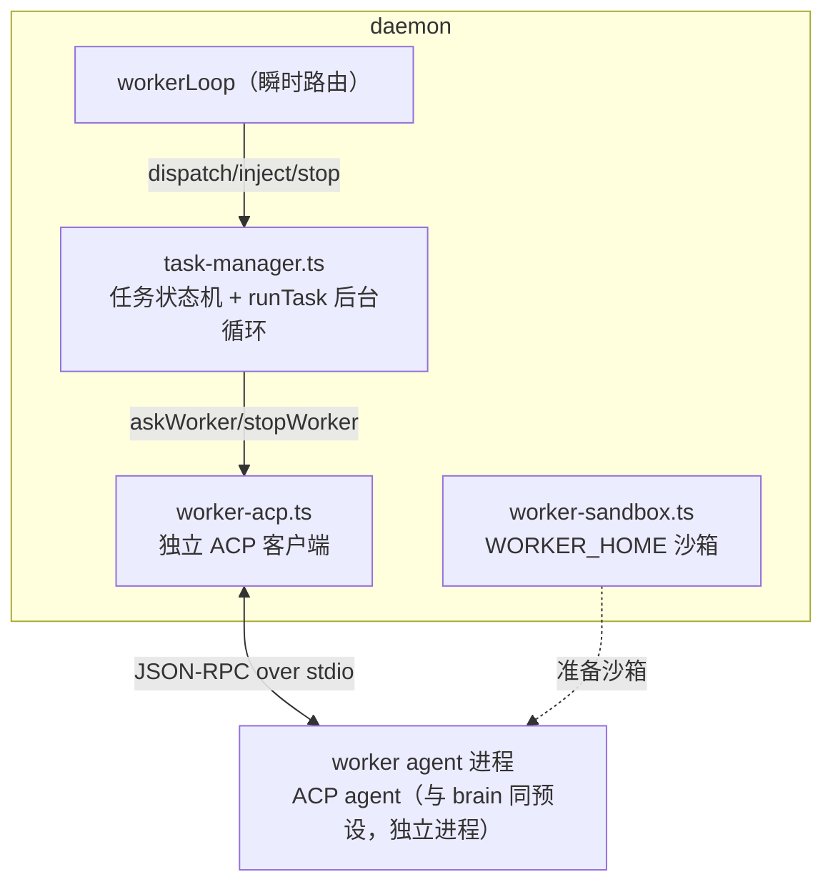
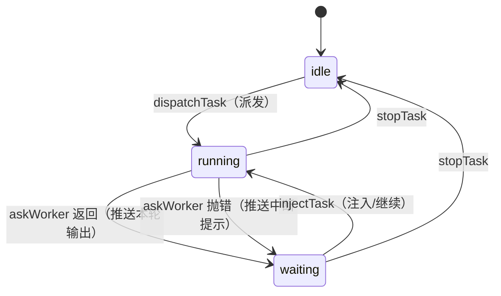
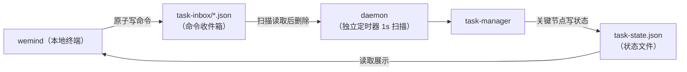

# 7. 远程任务 Worker

> 上一页：[6. ACP 大脑与沙箱](06-ACP-大脑与沙箱.md) ｜ 下一页：[8. 数据存储与多账号](08-数据存储与多账号.md)
>
> **适用版本**：WeMind 1.0.1 ｜ **最后核对**：2026-10-24

除了「对话大脑」，daemon 还能把**漫长任务**交给一个**受控的 ACP worker 进程**跑 —— 你在电脑上派发任务后离开，它在「需要你决策」（列方案让你选）或「中断」时把情况推到微信，你回一句就能让它续跑。这就是**远程 human-in-the-loop（人在回路）**。

## 7.1 设计动机与方案选型

**场景**：在电脑上跑一个很耗时的任务，希望在微信里随时查看进展、下达指令。

**关键约束**：用户手动开的交互式 agent 窗口**无法被外部控制**（stdin 被终端占用）。所以要可控，任务就得跑在一个「受控进程」里。

三种方案对比：

| 方案 | 做法 | 评价 |
|------|------|------|
| A | 任务跑在对话大脑里（brain 自己干活） | 简单，但重活阻塞对话、无法多任务（方案 C 的退化版） |
| B | 文件状态/命令桥 | 适合任务在无 ACP 能力的环境跑，但需任务侧改造、非实时 |
| **C** | **独立受控 ACP worker 进程** | 双向、实时、多轮、可重连、可多 worker（**已采用**） |

**为什么用 ACP**：ACP 天生为「外部程序控制 agent」设计，`session/prompt` 下发指令、`session/update` 实时回传、`session/load`（或 `resume`）断线续传。worker 本质就是把对话大脑那套 ACP 客户端能力复用到「第二个 agent 进程」上；**它同样受 agent 能力差异影响**（见 §6.6）。

## 7.2 核心模型：worker = 独立的多轮对话 agent

把 worker 看成一个独立的、跑在任务目录里的多轮对话 agent，它和对话大脑是两个互不干扰的 ACP 进程：

```
派发任务  = 给 worker 发第 1 个 prompt（任务描述）
一轮结束  = worker 这一轮 ACP 响应完成 → 把本轮输出推微信
微信回复  = 给 worker 发下一个 prompt（注入）→ 又一轮 → 再推送 …
任务中断  = worker 进程退出/超时 → 推微信告警 → 用户回「继续」→ session/load（或 resume）恢复后续跑
```

关键洞察：`askWorker(prompt)`「发一个 prompt、等这一轮结束、返回拼接文本」恰好就是「一轮」的天然单元。ACP 模式下 agent 每响应完一轮就明确进入「等待下一条指令」状态，daemon 一清二楚，无需抓屏猜测。

## 7.3 组件构成



### task-manager.ts —— 单任务状态机

维护单个活跃任务（MVP 单任务）的状态机：



- `running`：worker 正跑一轮。此时用户来消息 → 暂存为 `pendingInject`（只留最近一条），回执「已记下，等这步跑完处理」。
- `waiting`：等用户注入。收到即转 `running`。若有暂存的 `pendingInject` 直接消费。
- `runTask` 是后台异步循环：`askWorker` → 推送 `🤖【任务】<输出>` → typing 保活（每 8s）→ 等注入 → 续跑。**绝不在 `workerLoop` 里 await 它**，否则长任务会阻塞 poller 入队（含用户的注入回复）。

依赖注入（task-manager 不直接碰发送层/文件，保持可测）：`setTaskPush`（推送文本，走 daemon 的 `sendOrdered` + 最新 token）、`setTaskTyping`（发打字状态）、`setTaskStateSink`（落盘 `task-state.json`）。

### worker-acp.ts —— 独立 ACP 客户端

约 70% 复制自 `acp-brain.ts`，差异：

| 项 | brain | worker |
|---|-------|--------|
| 进程 | 全局单例 1 个 | 独立单例 1 个（与 brain 并存） |
| 会话 | 每用户一 session | 单任务一 session（固定 key=`task`） |
| 持久化 | `brain-sessions.json` | `worker-sessions.json` |
| cwd | `BRAIN_HOME` 沙箱 | **任务工作目录**（`WEMIND_WORKER_CWD`，默认主目录） |
| 沙箱 home | `BRAIN_HOME`（默认空 MCP） | `WORKER_HOME`（继承全量 MCP 除 wechat） |
| 超时 | idle 120s / cap 15min / 首帧 25s | idle 180s / cap 30min / 首帧 30s（更宽松） |

`setWorkerCwd(cwd?)` 设置「下次 spawn 用的 cwd」（本地命令派发可指定终端当前目录）；子进程 cwd 在 spawn 时固定，故 cwd 在派发（首轮）生效。中断恢复靠 `reset()` 后下次 `ensureSession` 走 `session/load`（不支持时 `session/resume`/`new`）。

### worker 沙箱

`WORKER_HOME`（默认 `<数据目录>/worker-home`）。与 brain 沙箱**策略相反**：worker 是无人值守的任务执行机，继承 catalog 的**全量 MCP**（仅排除 `wechat` 防回环，外加 `WEMIND_WORKER_MCP_EXCLUDE`，跳过 `disabled:true` 的）—— 因为没人在旁边逐个加载工具，任务需要开箱即用的完整能力。落盘方式按 agent：kiro/opencode 由 `applyWorkerSandbox` 写沙箱配置文件；`mcpViaAcp` 预设（DSH）不写文件，由 `workerMcpServers()` 转成 ACP 声明随 `session/new|resume` 下发。记忆/技能（`mirrorRealKiro`）与 settings（`syncSettings`，含模型/信任）继承与 brain 一致。

> worker 沙箱代码与 brain 沙箱有少量重复（`mirrorRealKiro`/`syncSettings`），刻意复制以隔离演进、不动已稳定的 brain 沙箱。

## 7.4 微信入口：消息路由

worker 的微信侧路由在 `workerLoop` 内（详见 [5. 守护进程 Daemon](05-守护进程-Daemon.md#消息路由)）。指令集：

| 你发的消息 | 去向 |
|-----------|------|
| `任务：xxx` / `>xxx` | 明确发 worker：无任务则**启动**，有任务则**注入/追加** |
| `问大脑 xxx` | 明确发对话大脑（worker 正等你时也能临时插话） |
| `结束任务` / `停止任务` | 终止当前 worker 任务 |
| worker 刚问你后，直接回（无前缀） | 注入 worker（最自然的决策回复） |
| worker 埋头跑时，直接发（无前缀） | 走对话大脑（任务不受影响） |

行为约定：

- worker 只在 **waiting**（刚停下问你）时才默认接管无前缀消息；它埋头跑时大脑照常可用。
- worker 每轮输出带 `🤖【任务】` 标记；跑一轮期间持续「正在输入中」（不占连续发送上限）。
- 中断靠 `session/load`（不支持时 `resume`/`new`）恢复 —— 回「继续」即从中断处续跑。
- 进度默认安静（只在轮次结束/中断/派发回执推文字），`WEMIND_WORKER_PROGRESS=1` 可开全程进度。

**「继续」语义消歧**：daemon 里「继续」有两个含义 —— 连续发送上限的等待段恢复（`budgetOf.awaiting`）vs 注入 worker。判定顺序保证两者不互相吞掉。

## 7.5 本地双入口（文件桥）

除微信外，worker 任务还有一个**本地终端入口**，与微信并列管同一任务。适合开任务时贴长描述/指定工作目录，或专注电脑工作不想掏手机时。

### 为什么需要本地入口

- **本地派发**能指定工作目录 cwd（微信入口做不到），默认取终端当前目录，对标本地直接开 kiro 的体验；
- **不依赖微信**，纯本地也能看状态、回复、结束。

### 文件桥机制

CLI（`wemind`）与 daemon 是两个独立进程，用轻量文件桥通信（不引入 socket/端口）：



- **命令方向**：CLI 原子写（临时文件 + rename）命令文件 → daemon 定时扫描（按时间戳升序）→ 调 task-manager → 删文件。
- **状态方向**：daemon 在派发/每轮/waiting/停止时原子写 `task-state.json` → CLI 读并显示。
- daemon 启动清空 `task-inbox/` 防重放；CLI 写命令前预检 daemon 存活（读 `daemon.pid` + 探活）。

### 本地命令

| 命令 | 作用 |
|------|------|
| `task "<描述>" [--cwd <目录>] [<key\|label>]` | 派发任务（默认 cwd=终端当前目录） |
| `task-status [<key\|label>]` | 查看状态 + 轮次 + 最近输出（读 `task-state.json`） |
| `task-reply "<内容>" [<key\|label>]` | 回复/注入当前任务（`task-reply 继续` = 续跑） |
| `task-stop [<key\|label>]` | 结束当前任务 |

两个入口最终都汇到同一套 task-manager，微信侧行为不变。

## 7.6 安全

worker 指向真实目录 + `--trust-all-tools` → 微信回复即可驱动它在你电脑上全权操作（含 shell/写文件）。安全闸：

- **微信侧**：靠 `allowFrom` 发件人授权清单兜底（poller 已对所有消息鉴权）；
- **本地侧**：能写 `task-inbox/` = 本机当前用户 = 机主，无需额外鉴权；
- `wechat` MCP 在 worker 沙箱**永久禁止**，防回环抢连接。

## 7.7 局限

- **不接管手动窗口**：任务必须跑在受控 worker 里。
- **单 session 串行**（ACP 限制）：一个 worker 同时只跑一个任务；多任务需多 worker（MVP 单任务）。
- **连续发送上限**：worker 进展回传同样占微信约 10 条上限（但一轮通常只推 1 条，几乎不触发）。
- worker 与 brain 双 ACP 进程对本机资源/网络有压力。

## 7.8 配置项

| 变量 | 默认 | 说明 |
|------|------|------|
| `WEMIND_WORKER_CWD` | 用户主目录 | worker 默认工作目录（本地 `task --cwd` 覆盖） |
| `WEMIND_WORKER_IDLE_MS` | 180000 | 单轮空闲超时 |
| `WEMIND_WORKER_CAP_MS` | 1800000 | 单轮硬上限（30min） |
| `WEMIND_WORKER_FIRST_FRAME_MS` | 30000 | 首帧超时 |
| `WEMIND_WORKER_PROGRESS` | `0` | 是否推全程文字进度 |
| `WEMIND_WORKER_HOME` | `<数据目录>/worker-home` | worker 沙箱目录 |
| `WEMIND_WORKER_MCP_EXCLUDE` | `wechat` | 不继承的 MCP（`wechat` 强制排除） |
| `WEMIND_TASK_SCAN_MS` | 1000 | daemon 扫描本地命令收件箱间隔 |

## 7.9 测试覆盖

`task-manager.test.ts`（vitest）mock 掉 `worker-acp`，覆盖状态机：派发 → waiting → 注入续跑 → stop、二次派发被拒、中断推送「继续」提示、running 期间暂存 pendingInject、cwd 透传、状态 sink（running→waiting→idle）。

---

接下来：[8. 数据存储与多账号](08-数据存储与多账号.md) 梳理所有落盘文件与多账号机制。
