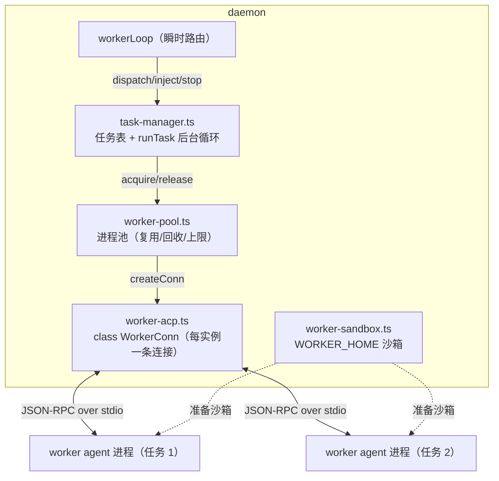
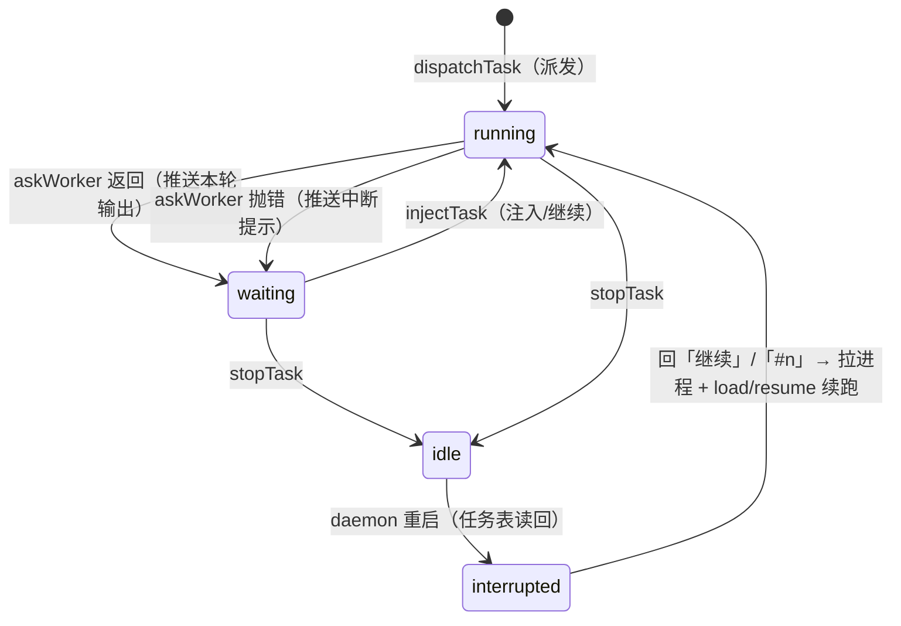
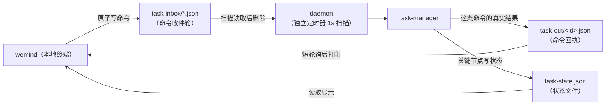
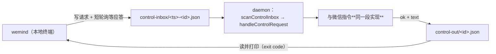

# 7. 远程任务 Worker

> 上一页：[6. ACP 大脑与沙箱](06-ACP-大脑与沙箱.md) ｜ 下一页：[8. 数据存储与多账号](08-数据存储与多账号.md)
>
> **适用版本**：WeMind 1.2.0 ｜ **最后核对**：2026-10-28

除了「对话大脑」，daemon 还能把**漫长任务**交给**受控的 ACP worker 进程**跑 —— 你在电脑上派发任务后离开，它在「需要你决策」（列方案让你选）或「中断」时把情况推到微信，你回一句就能让它续跑。这就是**远程 human-in-the-loop（人在回路）**。

1.2.0 起任务侧从「单任务单例」升级为**多任务 + 进程池**：每条任务一条独立 ACP 连接，agent 在派发时决定（`任务 <预设>：正文`），进程常驻复用、空闲回收，任务中断后**重启可续跑**。

## 7.1 设计动机与方案选型

**场景**：在电脑上跑一个很耗时的任务，希望在微信里随时查看进展、下达指令。

**关键约束**：用户手动开的交互式 agent 窗口**无法被外部控制**（stdin 被终端占用）。所以要可控，任务就得跑在一个「受控进程」里。

三种方案对比：

| 方案 | 做法 | 评价 |
|------|------|------|
| A | 任务跑在对话大脑里（brain 自己干活） | 简单，但重活阻塞对话、无法多任务（方案 C 的退化版） |
| B | 文件状态/命令桥 | 适合任务在无 ACP 能力的环境跑，但需任务侧改造、非实时 |
| **C** | **独立受控 ACP worker 进程** | 双向、实时、多轮、可重连、可多 worker（**已采用**） |

**为什么用 ACP**：ACP 天生为「外部程序控制 agent」设计，`session/prompt` 下发指令、`session/update` 实时回传、`session/load`（或 `resume`）断线续传。worker 本质就是把对话大脑那套 ACP 客户端能力复用到「第二个及以后的 agent 进程」上；**它同样受 agent 能力差异影响**（见 §6.6）。

## 7.2 核心模型：一条任务 = 一个独立的多轮对话 agent

把每条 worker 看成独立的、跑在任务目录里的多轮对话 agent；它与对话大脑（以及彼此）是互不干扰的 ACP 进程：

```
派发任务  = 给该 worker 发第 1 个 prompt（任务描述）
一轮结束  = 这一轮 ACP 响应完成 → 把本轮输出推微信
微信回复  = 给它发下一个 prompt（注入）→ 又一轮 → 再推送 …
任务中断  = 进程退出/超时 → 推微信告警 + 任务标「已中断」→ 用户回「继续」→
            session/load（或 resume）恢复后续跑；接不上则如实说明
```

关键洞察：`askWorker(prompt)`「发一个 prompt、等这一轮结束、返回拼接文本」恰好就是「一轮」的天然单元。ACP 模式下 agent 每响应完一轮就明确进入「等待下一条指令」状态，daemon 一清二楚，无需抓屏猜测。

**为什么是进程池而不是「一条任务一个临时进程」**：ACP agent 的冷启动要几秒到几十秒（`initialize` + `session/new` + 沙箱准备），任务往往是「派发 → 等很久 → 来回几轮」的节奏。进程跑完即杀会让每一轮都付一次冷启动；常驻复用则把成本摊到第一次。代价是内存——用**并发上限 + 空闲上限 + 空闲回收**三把闸控制（见 §7.3、§7.8）。

## 7.3 组件构成



### task-manager.ts —— 任务表（多任务）

维护 `Map<编号, Task>`，每条任务：

```ts
Task = {
  编号: number;            // 按用户单调递增、不复用、跨重启不归零
  userId: string;          // 归属人（多用户编号互不相撞）
  agent: string;           // 预设名（派发时定；默认 = 默认任务大脑）
  status: "running" | "waiting" | "interrupted";
  conn: WorkerConn | null; // 进程池里那条连接
  sessionKey: string;      // `<agent>:task-<编号>@<userId>`
  turns: number; startedAt: number; lastOutput: string; cwd?: string;
}
```



- `running`：正跑一轮。此时该用户来消息 → 暂存为 `pendingInject`（只留最近一条），回执「已记下，等这步跑完处理」。
- `waiting`：等注入。收到即转 `running`；若有暂存的 `pendingInject` 直接消费。
- `interrupted`：**daemon 重启后的状态**（见 §7.4「重启后续跑」）。
- `runTask` 是后台异步循环：`askWorker` → 推送 `🤖【任务】<输出>` → typing 保活（每 5s）→ 等注入 → 续跑。**绝不在 `workerLoop` 里 await 它**，否则长任务会阻塞 poller 入队（含用户的注入回复）。

**无编号消息的归属顺序**（多任务下必须无歧义）：唯一在等的那条 → 唯一在跑的那条 → 0 条在跑且恰有 1 条「已中断」则续跑 → 否则回一份消歧清单（列出编号 + agent + 状态），让用户带编号重发。

**任务级指定 agent**：`任务 <预设>：正文`（冒号前必须是**已知预设名**，且整串锚定）永远**派发新任务**，不往在跑的任务里塞；冒号前不是预设名时**不当成指定 agent**——`任务 明天：去买菜` 整句仍是正文，照旧派给任务侧（想只跟大脑说话用「问大脑 …」）；`任务`/`任务：`（无预设）则走**默认任务大脑**，若已有任务就注入它。指定的 agent **只对这条任务生效**，不会改变「默认任务大脑」（要改默认用 `切换任务大脑` / CLI `--worker`）。

**默认任务大脑（本次运行内一直生效）**：`worker.agent ?? agent`（配置文件里的 `worker` 段优先，否则跟对话大脑同一个）。微信 `切换任务大脑 [名]` / `/ai task`、CLI `wemind brain switch <预设> --worker` 可在**进程内**改它，**不写 `brain.json`**（重启回到配置值，回执里写明）；若已有空闲进程属于别的 agent，会被重启以保证后续任务用新 agent。

依赖注入（task-manager 不直接碰发送层/文件，保持可测）：`setTaskPush`（推送文本，走 daemon 的 `sendOrdered` + 最新 token）、`setTaskTyping`（发打字状态）、`setTaskStateSink`（落盘 `task-state.json`）。

### worker-pool.ts —— 进程池

策略与 IO 分离：`planAcquire(poolState, agent, limits, now)` / `planReap(...)` 是**纯函数**（单独测），`acquire/release/drop/sweep/killAll/killIdle/poolSummary` 负责 IO。

取用顺序：**同 agent 的空闲命中** → **回收最旧空闲腾位** → spawn。三把闸：

| 闸 | 变量 | 默认 | 行为 |
|---|---|---|---|
| 并发任务数 | `WEMIND_MAX_WORKERS` | 3 | 超出时派发被拒并提示（不是排队） |
| 空闲进程数 | `WEMIND_IDLE_MAX` | 2 | 保留的池中空闲进程上限 |
| 空闲回收 | `WEMIND_WORKER_REAP_MS` | 300000（5min） | 空闲超时后杀掉该进程 |

> **命名坑**：空闲**进程**回收是 `WEMIND_WORKER_REAP_MS`；`WEMIND_WORKER_IDLE_MS` 是「单轮 prompt 空闲超时」。同名两义必然踩，所以没复用。
>
> 结束**在等你回复**的任务时**进程回池**（不杀）；结束**正在跑**的那条只能力杀——ACP 回合没法优雅取消（`task-manager.ts`：`waiting` → `release(conn)`，否则 `drop(conn)`）。「等你回复」的任务在结束前一直占着那条连接，所以它不进空闲池、也不受空闲回收影响。只有 `wemind stop` / daemon 进程退出才 `killAll()` 杀光整池（Windows 上子进程不会随父进程退出，漏掉就是一堆孤儿 agent 进程）。

### worker-acp.ts —— 独立 ACP 客户端（已类化）

`class WorkerConn`：每实例自己的 `child` / `sessionId` / `cwd` / `pid` 记录 / 进度回调，`createConn(ag, onSpawn)` 建一条连接。**模块级单例已全部下沉**——这是多任务并行的前提（在此之前 `child`/`taskSessions`/`pendingCwd` 都是模块级，物理上只能有一个 worker）。

与 brain 侧的差异：

| 项 | brain | worker |
|---|-------|--------|
| 进程 | 1 个（槽位里的当前大脑） | **N 个**（池，各自一条任务） |
| 会话 | 每用户一 session | 每任务一 session（键 `<agent>:task-<编号>@<userId>`） |
| 持久化 | `brain-sessions.json`（键 `<agent>:userId`） | `worker-sessions.json`（键 `<agent>:task-<编号>@<userId>`） |
| cwd | `BRAIN_HOME` 沙箱 | **任务工作目录**（`WEMIND_WORKER_CWD`，默认主目录；本地派发可用 `--cwd`） |
| 沙箱 home | `BRAIN_HOME`（默认空 MCP） | `WORKER_HOME`（继承全量 MCP 除 wechat） |
| 超时 | idle 120s / cap 15min / 首帧 25s | idle 180s / cap 30min / 首帧 30s（更宽松） |

子进程 cwd 在 spawn 时固定，故 cwd 在派发（首轮）生效。中断恢复靠 `reset()` 后下次 `ensureSession` 走 `session/load`（不支持时 `session/resume`）。

### worker 沙箱

`WORKER_HOME`（默认 `<数据目录>/worker-home`）。与 brain 沙箱**策略相反**：worker 是无人值守的任务执行机，继承 catalog 的**全量 MCP**（仅排除 `wechat` 防回环，外加 `WEMIND_WORKER_MCP_EXCLUDE`，跳过 `disabled:true` 的）—— 因为没人在旁边逐个加载工具，任务需要开箱即用的完整能力。落盘方式按 agent：kiro/opencode 由 `applyWorkerSandbox` 写沙箱配置文件；`mcpViaAcp` 预设（DSH）不写文件，由 `workerMcpServers()` 转成 ACP 声明随 `session/new|resume` 下发。记忆/技能（`mirrorRealKiro`）与 settings（`syncSettings`，含模型/信任）继承与 brain 一致。

> **同 agent 并发 = 两个终端在同一个配置目录里跑**：不同 agent 各有 `configSubdir`（天然隔离），但同一 agent 的两条任务共用同一个配置目录（会话/缓存文件是否互踩**待实测**）。
>
> worker 沙箱代码与 brain 沙箱有少量重复（`mirrorRealKiro`/`syncSettings`），刻意复制以隔离演进、不动已稳定的 brain 沙箱。

## 7.4 微信入口：消息路由

worker 的微信侧路由在 `workerLoop` 内（详见 [5. 守护进程 Daemon](05-守护进程-Daemon.md#消息路由)）。指令集：

| 你发的消息 | 去向 |
|-----------|------|
| `任务：xxx` / `>xxx` | 明确发 worker：无任务则**启动**，有任务则**注入/追加** |
| `任务 <预设>：xxx` | 用指定 agent **新开**一条任务（冒号前必须是不带空格的已知预设名；只影响这一条，不改默认任务大脑） |
| `#2 正文` / `/reply 2 正文` | 注入**第 2 条**任务（多任务并存时用它消歧） |
| `任务列表` / `/tasks` | 列编号 / agent / 状态 / 轮次 / 时长 / 最近输出 |
| `结束任务` / `结束全部任务` / `结束任务 2` | 结束任务（「等你回复」的回池；「正在跑」的力杀；被等的注入会被丢弃） |
| `问大脑 xxx` | 明确发对话大脑（worker 正等你时也能临时插话） |
| worker 刚问你后，直接回（无前缀） | 注入 worker（最自然的决策回复） |
| worker 埋头跑时，直接发（无前缀） | 走对话大脑（任务不受影响） |

行为约定：

- worker 只在 **waiting**（刚停下问你）时才默认接管无前缀消息；它埋头跑时大脑照常可用。
- 只有一条任务时无前缀消息直接注入它；**多任务并存**时必须带编号，否则回消歧清单。
- 任务编号**按用户单调递增、不复用**（避免「任务 2」在对话里指代漂移），且**跨重启不归零**（表在磁盘上）。
- worker 每轮输出带 `🤖【任务】` 标记；跑一轮期间持续「正在输入中」（不占连续发送上限）。
- 进度默认安静（只在轮次结束/中断/派发回执推文字），`WEMIND_WORKER_PROGRESS=1` 可开全程进度。
- **连发额度是按用户共享的**：N 条任务的进度 + 对话大脑的回复算同一份约 10 条额度；结果推送复用既有 `ret=-2` 退避。扛不住就调小 `WEMIND_MAX_WORKERS`。

### 重启后续跑（1.2.0）

任务表另存一份原子写的 `tasks.json`。daemon 启动时读回：

- **不自动 spawn**（3 个 agent 一起冷启动既重、也可能复现刚崩的原因）；
- 未完成的任务标为 **「已中断」**，在 `任务列表` 可见；
- 用户回「继续」/`#n` 才拉进程 + 按预设 `restore` 试 `session/load` → `session/resume` 续跑。

两条诚实失败必须照实说：① agent 不支持 load/resume 或该会话已被 agent 自己清理 →「这次接不上，请用文字重述」（不动登记与指针）；② 半截回合的副作用可能已发生（改到一半的文件）→ 续跑前提示「可能有重复动作，注意核对」。表损坏 → 降级为空表，**不阻塞启动**。

> **不做历史归档**：微信聊天记录本身就是每条任务输出的归档，另存历史收益低、维护面大。

**「继续」语义消歧**：daemon 里「继续」现在有三个可能含义 —— 连续发送上限的等待段恢复（`budgetOf.awaiting`）、注入在跑/在等的任务、**续跑已中断的任务**。判定顺序保证它们不互相吞掉。

## 7.5 双入口：task-inbox（派活） 与 控制桥（会话/大脑）

除微信外，worker 任务还有一个**本地终端入口**，与微信并列管同一任务。适合开任务时贴长描述/指定工作目录，或专注电脑工作不想掏手机时。

### 为什么需要本地入口

- **本地派发**能指定工作目录 cwd（微信入口做不到），默认取终端当前目录，对标本地直接开 kiro 的体验；
- **不依赖微信**，纯本地也能看状态、回复、结束。

### 文件桥机制（`task-inbox/` → `task-out/` → `task-state.json`）

CLI（`wemind`）与 daemon 是两个独立进程，用轻量文件桥通信（不引入 socket/端口）：



- **命令方向**：CLI 原子写（临时文件 + rename）命令文件 → daemon 定时扫描（按时间戳升序）→ 调 task-manager → 删文件。
- **回执方向**（1.2.0）：命令文件带 `ack` id，daemon 处理完写 `task-out/<id>.json {id, at, ok, text}`；CLI 短轮询后打印 `text`。**派发的回执等 `acquire` 之后才发**（池满/起不来是那时才知道的），所以 `wemind task` 说的「已派发」是真话——在此之前它只能猜，池满被拒会被报成「已派发任务 #2（opencode）」（上一条的编号，因为 `active` 本来就是 true）。**空 `text` 也是一种回执**（＝「已送达、无别的话」），CLI 据此立刻用自己的措辞；等不到回执（老版 daemon）则退回「已投递…」并附一句说明，不把「没等到」当成功。
- **状态方向**：daemon 在派发/每轮/waiting/停止时原子写 `task-state.json` → CLI 读并显示（顶层字段镜像最近一条任务，另带 `tasks` 数组，旧版 CLI 读不错）。
- daemon 启动清空 `task-inbox/` 与 `task-out/` 防重放；CLI 写命令前预检 daemon 存活（读 `daemon.pid` + **身份校验**）。
- 两侧共用 `task-inbox.ts`（目录、原子写、回执读写、清理），路径与格式只有一处定义。

### 控制桥（`control-inbox/` → `control-out/`）

task-inbox 的命令是**异步**的（派活/回复/结束，回执只回答「这条命令收下了没有、结果如何」，任务的活本身还在 worker 里跑）。但**切换大脑、开新会话、恢复会话**这类操作必须发生在 **daemon 进程里**（进程内的 ACP 连接、会话指针、任务表都是它的活状态），而且 CLI 需要**当场知道成没成**（要打印成功/失败、要给非零退出码）。于是另有双向的控制桥（`control-bridge.ts`）：



- **复用同一段代码**：`handleControlRequest` 调的就是微信指令走的那几个函数（`切换大脑` = `switchBrain`、`新会话` = `newSessionCmd`…），会话类命令以**登录者**作为 userId（CLI 代表机主本人）。
- **先删后做**：daemon 先 `unlink` 请求文件再执行（崩了不会重启后被重放）；`controlBusy` 保证一次只处理一条。
- **超时如实报**：CLI 短轮询默认 30s（`WEMIND_CONTROL_TIMEOUT_MS`）；`brain.switch` 自动放大到 `预热上限 + drain + 15s`，否则正确的长切换会被误报超时。超时/没等到 → 直接说「没等到回复」，**不假装成功**。
- **`.bridge` 凭据（升级期可用性）**：daemon 启动时把**自己的 pid** 写进 `control-out/.bridge`，并在启动时清空两个桥目录。CLI 拿它与 `daemon.pid` 比对——对不上说明 daemon 在跑**旧版本**（不认识桥），于是：**必须由 daemon 执行**的命令（`session new|resume`、`brain switch|worker|handoff`）**发出前**就拒绝并给出「`wemind stop <key> && wemind start <key>`」；**文件类**命令照常——`session rename|delete` 直接改登记表、`session list` 直接读登记表（附一行「按下次会用的那个大脑列」的说明）、`task-list` 读 `tasks.json`（只在 daemon 没跑时注明「上次快照」）。这把 30s～165s 的静默等待换成一句能照做的话。
- **安全边界**：请求里只有 `target`（**预设名**）/`ref`/`name`/`text`/`taskId`/`page`，**没有也不可能有 `bin`/`args`/`shell` 的位置**——就算被伪造（进程本就能写账号目录，task-inbox 同性质），最坏也只是「选一个已装的 agent 或清掉自己的会话」。`parseControlRequest` 是唯一入口校验。

### 本地命令

| 命令 | 作用 |
|------|------|
| `task "<描述>" [--cwd <目录>] [--agent <预设>] [<key\|label>]` | 派发任务（默认 cwd=终端当前目录） |
| `task-list [<key\|label>]` | 任务列表（编号/agent/状态/轮次/时长） |
| `task-status [<key\|label>]` | 任务概览（任务表有记录时与 `task-list` 同一份；表为空才退回读 `task-state.json` 快照） |
| `task-reply <编号> "<内容>" [<key\|label>]` | 回复/注入任务（编号也可写成 `"#2 继续"` 放在第一个参数里；不给编号 = 唯一那条） |
| `task-stop [<编号\|全部\|all>] [<key\|label>]` | 结束任务（不给编号 = 唯一那条，多条并存回消歧清单） |
| `brain switch <预设\|auto> [--worker]` | 热切换对话大脑 / 设默认任务大脑 |
| `session list\|new\|resume\|rename\|delete` | 会话管理（走控制桥） |
| `brain handoff` | 生成交接摘要 |

两个入口最终都汇到同一套 task-manager，微信侧行为不变。

## 7.6 安全

worker 指向真实目录 + `--trust-all-tools` → 微信回复即可驱动它在你电脑上全权操作（含 shell/写文件）。安全闸：

- **微信侧**：**平台只投递登录者本人的消息**（必须扫码登录该 bot 才能给它发消息）；代码里另有 `allowFrom` 登录者白名单兜底（默认拒绝、默认只放行登录者；poller 已对所有消息鉴权）。账号级指令（切脑/交接）由非登录者发会被短提示拒绝、不进大脑（兜底门）。
- **本地侧**：能写 `task-inbox/`（或 `control-inbox/`）= 本机当前用户 = 机主，无需额外鉴权；控制桥的额外约束是**只收预设名与纯数据**（§7.5），所以「本机用户」这个前提被伪造请求利用时，最坏也只是选一个已装的 agent。
- `wechat` MCP 在 worker 沙箱**永久禁止**，防回环抢连接。

## 7.7 局限

- **不接管手动窗口**：任务必须跑在受控 worker 里。
- **单 session 串行**（ACP 限制）：**一条任务**同时只跑一件事——多任务靠多条连接（进程池），不是靠一个 worker 分时。
- **同时运行的任务数有上限**（默认 3，`WEMIND_MAX_WORKERS`），超出直接拒绝（不排队）。
- **连续发送上限共享**：worker 进展回传与对话大脑共用同一份约 10 条额度（一轮通常只推 1 条，几乎不触发；多任务并发时才需要留意）。
- **资源占用**：池里每个进程都是一个完整 agent（内存/网络），靠空闲回收与上限约束。
- 中断续跑的可行性最终取决于各 agent 能否 `load`/`resume` 回该会话（**待实测**，见 §7.9 与 `docs/ai/recipes/run-e2e.md`）。

## 7.8 配置项

| 变量 | 默认 | 说明 |
|------|------|------|
| `WEMIND_WORKER_CWD` | 用户主目录 | worker 默认工作目录（本地 `task --cwd` 覆盖） |
| `WEMIND_WORKER_BRAIN` | — | **默认任务大脑**（预设名）。优先级：env → `brain.json` 的 `worker.agent ?? agent` → `auto` |
| `WEMIND_MAX_WORKERS` | 3 | 同时运行的**任务**数上限 |
| `WEMIND_IDLE_MAX` | 2 | 池中保留的**空闲** worker 进程数上限 |
| `WEMIND_WORKER_REAP_MS` | 300000 | 空闲 worker 进程回收时间（**不是**单轮空闲超时） |
| `WEMIND_WORKER_IDLE_MS` | 180000 | 单轮 prompt 空闲超时 |
| `WEMIND_WORKER_CAP_MS` | 1800000 | 单轮硬上限（30min） |
| `WEMIND_WORKER_FIRST_FRAME_MS` | 30000 | 首帧超时 |
| `WEMIND_WORKER_PROGRESS` | `0` | 是否推全程文字进度 |
| `WEMIND_WORKER_HOME` | `<数据目录>/worker-home` | worker 沙箱目录 |
| `WEMIND_WORKER_MCP_EXCLUDE` | `wechat` | 不继承的 MCP（`wechat` 强制排除） |
| `WEMIND_TASK_SCAN_MS` | 1000 | daemon 扫描 `task-inbox/` 与 `control-inbox/` 的间隔 |
| `WEMIND_CONTROL_TIMEOUT_MS` | 30000 | CLI 等 daemon 回话的上限（`brain switch` 自动放大） |

## 7.9 测试覆盖

- `task-manager.test.ts`：任务表 —— 派发/waiting/注入续跑/stop、**编号递增不复用**、多任务并存时无编号消息回消歧清单、`任务 <预设>：正文` 解析与预设路由、指定 agent 不改默认任务大脑（回归护栏）、上限拒绝、stop 单条/全部。
- `worker-pool.test.ts`：纯策略（`planAcquire`/`planReap`）—— 复用同 agent 空闲、回收最旧腾位、上限判定、空闲阈值。
- `pool-spawn.test.ts`：**真起进程**验池的行为——同 agent 第二次任务复用同一条连接（只 spawn 一次）、结束「等你回复」的任务时回池、回收后进程消失。
- `task-store.test.ts`：`tasks.json` 往返、损坏降级为空表、中断态标记、编号跨重启连续。
- `pid-record.test.ts`：`brain.pid`/`workers.pid.json` 的整数/JSON/数组三种形态兼容读。

**待实测**（先量再写结论）：同 agent 并发共用配置目录是否互踩；`taskkill /T /F` 杀池中特定进程的行为；被强杀后各 agent 能否恢复该任务会话。

---

接下来：[8. 数据存储与多账号](08-数据存储与多账号.md) 梳理所有落盘文件与多账号机制。