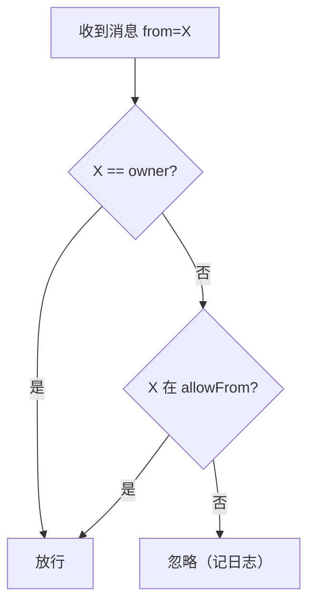

# 8. 数据存储与多账号

> 上一页：[7. 远程任务 Worker](07-远程任务-Worker.md) ｜ 下一页：[9. 配置项与环境变量](09-配置项与环境变量.md)
>
> **适用版本**：WeMind 1.0.1 ｜ **最后核对**：2026-10-24

本章梳理 WeMind 的全部落盘文件、目录布局，以及多账号机制和授权安全模型。

## 8.1 数据根目录

所有运行时状态保存在 **`~/.wemind/`** 下，**独立于代码仓库** —— 改名/重装/重新 clone 代码都不影响登录态。

- 根目录默认 `~/.wemind`，可用 `WEMIND_HOME` 覆盖；
- 每个账号一份独立子目录 `~/.wemind/<key>/`（默认账号 key 为 `default`）。

数据目录解析优先级（见 [3. 协议内核](03-iLink-协议内核.md#数据目录解析storeaccountts)）：

```
WECHAT_DATA_DIR（完整路径，最高优先级）
  > ~/.wemind/<WECHAT_ACCOUNT>（默认 WECHAT_ACCOUNT=default）
```

## 8.2 目录布局总览

```
~/.wemind/
├── accounts.json                 # 账号注册表（key → 元数据 + 默认账号）
├── .staging/                     # 登录暂存目录（manage login 用，归档后删）
└── <key>/                        # 每个账号一份独立子目录
    ├── account.json              # 登录凭证
    ├── state.json                # 长轮询游标 + context_token + 去重 id
    ├── allowFrom.json            # 授权发件人清单（安全闸）
    ├── qr_login.json             # 扫码登录临时态（登录后失效）
    ├── qrcode.png / qrcode.txt   # 二维码（PNG / 终端文本）
    ├── brain-sessions.json       # userId → ACP sessionId（对话大脑）
    ├── brain-mcps.json           # brain 当前激活的 MCP 集（默认空）
    ├── brain-home/               # brain 沙箱 KIRO_HOME（含 settings/mcp.json、会话记录）
    ├── worker-sessions.json      # 单任务 ACP sessionId（worker）
    ├── worker-home/              # worker 沙箱 KIRO_HOME（继承全量 MCP 除 wechat）
    ├── task-inbox/               # 本地命令收件箱（CLI 写、daemon 扫描后删）
    ├── task-state.json           # 任务状态快照（供 task-status 读）
    ├── daemon.log                # 运行日志（各账号独立，避免文件锁竞争）
    ├── wrapper.pid               # wrapper 看门狗进程 pid
    ├── daemon.pid                # daemon 本体进程 pid
    ├── brain.pid                 # 对话大脑 ACP 进程 pid
    └── worker.pid                # worker ACP 进程 pid
```

## 8.3 文件清单速查

| 文件/目录 | 写入者 | 内容/用途 |
|-----------|--------|-----------|
| `account.json` | core | Bot Token、botId、userId、baseUrl（POSIX 权限 600；Windows 明文，见安全说明） |
| `state.json` | core | 长轮询游标 `updatesBuf`、各会话 `context_token`、去重用 `lastMessageId` |
| `allowFrom.json` | core | 授权发件人 userId 清单（`{version, allowFrom[]}`） |
| `qr_login.json` / `qrcode.*` | mcp/manage | 扫码登录临时态与二维码（登录后即失效） |
| `brain-sessions.json` | acp-brain | `userId → ACP sessionId`，重启后 `session/load`/`session/resume` 恢复（agent 不支持则新建） |
| `brain-mcps.json` | mcp-sandbox | brain 当前激活的 MCP 集（默认空） |
| `brain-home/` | mcp-sandbox | brain 沙箱（agent 配置 + curated MCP + 记忆 junction + 会话落盘；kiro 即 `KIRO_HOME`，opencode 即 `XDG_CONFIG_HOME`） |
| `worker-sessions.json` | worker-acp | worker 单任务 sessionId，重启后续传 |
| `worker-home/` | worker-sandbox | worker 沙箱（全量 MCP 除 wechat + 记忆/技能/settings 含模型） |
| `task-inbox/*.json` | manage（CLI） | 本地任务命令（dispatch/reply/stop），daemon 扫描后删 |
| `task-state.json` | daemon | 任务状态快照，供 `task-status` 读 |
| `*.pid` | 各进程 | 进程 pid，供管理命令精确停止整条链 |
| `daemon.log` | wrapper | 运行日志（前缀 `[wemind/wechat-daemon]`，子系统加后缀：`/acp`、`/worker`、`/task`、`/watchdog`、`/wrapper`） |

**重置技巧**：

- 删 `account.json` + `state.json` = 退出登录重新扫码；
- 删 `brain-sessions.json` + `brain-home/sessions/` = 清空对话记忆。

## 8.4 多账号机制

支持登录多个微信账号，每个账号完全隔离（不同 token、不同目录、各跑一个 daemon、互不冲突）。

### key vs label

- **key**：由微信 botId 派生的唯一标识（`deriveAccountKey` 净化 botId，如 `feead781eb44@im.bot` → `feead781eb44`），也是目录名，系统据它区分。当前 iLink 接口不返回昵称/微信号，故用 botId。
- **label**：人类可读别名（可改、可重复）。

管理命令多数可用 key 或 label 选择账号（label 唯一匹配时）。

### 账号注册表

`~/.wemind/accounts.json` 记录所有账号：

```jsonc
{
  "default": "feead781eb44",
  "accounts": {
    "feead781eb44": {
      "key": "feead781eb44",
      "botId": "feead781eb44@im.bot",
      "userId": "...",
      "baseUrl": "https://ilinkai.weixin.qq.com",
      "label": "工作号",
      "addedAt": 1718000000000
    }
  }
}
```

### 管理命令（wemind）

```
wemind <command>
```

| 命令 | 作用 |
|------|------|
| `login [--label 名] [--start]` | **一条命令完成扫码登录**：自刷新二维码 + 自动归档（`--start` 顺带启动 daemon） |
| `list` | 列出账号、别名、botId、运行状态 |
| `start <key\|label>` | 启动某账号的 daemon |
| `logout <key\|label>` | 停 daemon + 通知下线 + 清凭证（保留目录，可重登） |
| `delete <key\|label>` | 停 daemon + 删除目录 + 移除注册 |
| `label <key\|label> <新别名>` | 改别名 |
| `set-default <key\|label>` | 设默认账号 |
| `adopt <key> [--label 名]` | 把已存在的账号目录登记进注册表 |
| `allowlist <key\|label>` | 查看授权用户清单 |
| `allow <key\|label> <userId>` | 授权某用户 |
| `revoke <key\|label> <userId>` | 撤销授权 |
| `task` / `task-reply` / `task-status` / `task-stop` | 本地任务管理（见 [7. Worker](07-远程任务-Worker.md)） |

### 登录流程（login）

`login` 在终端里完成全流程：自动生成二维码（**过期自动刷新**、终端 ANSI 渲染 + 自动打开 PNG）→ 你用要登录的微信扫码确认 → 写入 `.staging/` 暂存 → 按 botId 归档（`finalizeStaging`：重命名到 `<key>/` + 登记注册表 + 把扫码者 userId 加入 allowFrom 配对授权）→ `--start` 顺带启动该账号 daemon。

整条命令在终端跑，二维码原生渲染、过期自动换、不怕过期。

## 8.5 授权与安全

由于 daemon 大脑是 `--trust-all-tools`（任何能给 bot 发消息的人都能让 AI 在你电脑上执行任意工具），**发件人授权是核心也是唯一的安全闸**。

### 授权模型

鉴权 = **账号本人（owner，始终允许，安全兜底）** 或 **在 allowFrom 清单中**。



- `owner` 默认是登录账号本人 userId，可用 `WECHAT_OWNER_ID` 覆盖。
- **配对授权（pairing）**：扫码登录者的 userId 在 `finalize`/`adopt` 时自动加入 allowFrom；daemon 启动也会把账号本人种入（自动迁移老账号）。所以现有账号**无需任何手动配置**即可工作。
- daemon 每条消息实时读取清单（增删即时生效，无需重启）。
- 可多用户共用一个 bot：用 `allow <key> <userId>` 授权他人。

### 安全注意事项

- ⚠️ **不要关掉发件人授权这道闸**：它是 `--trust-all-tools` 下唯一的防护。
- 凭证 `account.json` 含 Bot Token：POSIX 设权限 600；**Windows 上 chmod 无效、明文存放**，需用文件夹权限或磁盘加密保护 `~/.wemind/` 目录（启动会有一次性告警）。
- allowFrom 文件损坏时 fail-closed（全员锁死），不会误放行。
- 隐私：消息经腾讯 iLink 渠道与本地 AI 流转，涉及对话内容外发，请自行评估。

## 8.6 自启全部账号

`scripts/run-all-daemons.ps1` 读注册表，为每个已登记账号起一条独立的 daemon 链（各账号单实例守卫，重复运行安全）。Windows 启动文件夹的 VBS 指向它，开机自动拉起所有账号。详见 [10. 部署与运维](10-部署与运维.md)。

---

接下来：[9. 配置项与环境变量](09-配置项与环境变量.md) 是所有 env 的速查表。
