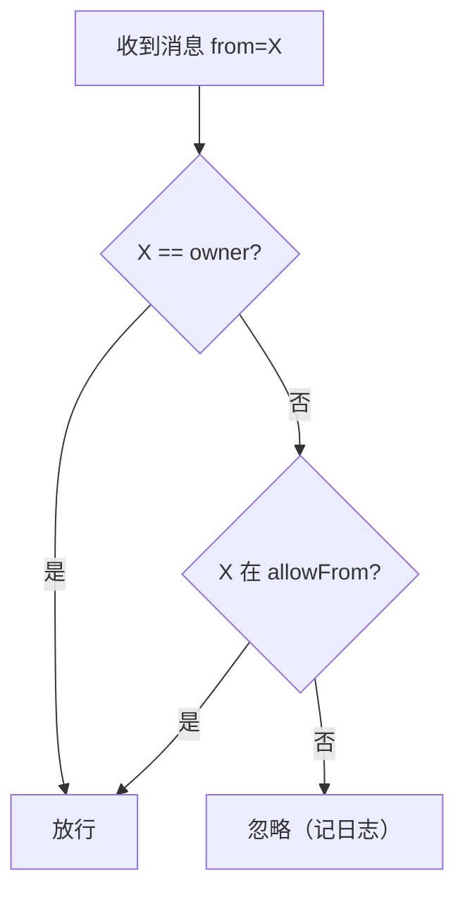

# 8. 数据存储与多账号

> 上一页：[7. 远程任务 Worker](07-远程任务-Worker.md) ｜ 下一页：[9. 配置项与环境变量](09-配置项与环境变量.md)
>
> **适用版本**：WeMind 1.2.0 ｜ **最后核对**：2026-10-28

本章梳理 WeMind 的全部写入磁盘文件、目录布局，以及多账号机制和授权安全模型。

## 8.1 数据根目录

所有运行时状态保存在 **`~/.wemind/`** 下，**独立于代码仓库** —— 改名/重装/重新 clone 代码都不影响登录态。

- 根目录默认 `~/.wemind`，可用 `WEMIND_HOME` 覆盖；
- 每个账号一份独立子目录 `~/.wemind/<key>/`（默认账号 key 为 `default`）。

数据目录解析优先级（见 [3. 协议内核](03-iLink-协议内核.md#数据目录解析storeaccountts)）：

```
WECHAT_DATA_DIR（完整路径，最高优先级）
  > ~/.wemind/<WECHAT_ACCOUNT>（默认 WECHAT_ACCOUNT=default）
```

## 8.2 目录布局总览

```
~/.wemind/
├── accounts.json                 # 账号注册表（key → 元数据 + 默认账号）
├── .staging/                     # 登录暂存目录（manage login 用，归档后删）
└── <key>/                        # 每个账号一份独立子目录
    ├── account.json              # 登录凭证
    ├── state.json                # 长轮询游标（读到哪了）+ context_token + 去重 id
    ├── allowFrom.json            # 登录者白名单（兜底校验）
    ├── qr_login.json             # 扫码登录临时态（登录后失效）
    ├── qrcode.png / qrcode.txt   # 二维码（PNG / 终端文本）
    ├── brain.json                # 持久大脑选择（agent / presets 启动覆盖 / worker 默认任务大脑）
    ├── brain-sessions.json       # <agent>:userId → ACP sessionId（对话大脑，按 agent 分开存）
    ├── session-registry.json     # 会话登记表（会话列表用：名字/标题/轮次/最近使用）
    ├── handoff.json              # 交接摘要（「交接」命令生成，切到别的大脑后带上一次，默认 24h 过期）
    ├── brain-mcps.json           # brain 当前激活的 MCP 集（默认空）
    ├── brain-home/               # brain 沙箱 KIRO_HOME（含 settings/mcp.json、会话记录）
    ├── worker-sessions.json      # 单任务 ACP sessionId（worker，键 <agent>:task-<编号>@<userId>）
    ├── worker-home/              # worker 沙箱 KIRO_HOME（继承全量 MCP 除 wechat）
    ├── task-inbox/               # 本地命令收件箱（CLI 写、daemon 扫描后删）
    ├── task-out/                 # 本地命令答复（daemon 写、CLI 短轮询后删）
    ├── tasks.json                # 任务表（重启后续跑：编号/agent/状态/轮次/cwd/最近输出）
    ├── task-state.json           # 任务状态记录（供 task-status 读；顶层复制最近一条任务 + tasks 数组）
    ├── control-inbox/            # 控制桥请求（CLI 原子写，daemon 扫描执行后写应答）
    ├── control-out/              # 控制桥应答（.bridge 存 daemon pid，供 CLI 校验 daemon 版本一致）
    ├── daemon.log                # 运行日志（各账号独立，避免文件锁竞争）
    ├── wrapper.pid               # wrapper 后台守护进程 pid
    ├── daemon.pid                # daemon 本体进程 pid
    ├── brain.pid                 # 对话大脑进程身份记录（JSON：pid/agent/bin/args/state…）
    └── workers.pid.json          # worker 池进程记录数组（pid/agent/bin/args/state/taskId…；旧 worker.pid 裸整数仍可读）
```

## 8.3 文件清单速查

| 文件/目录 | 写入者 | 内容/用途 |
|-----------|--------|-----------|
| `account.json` | core | Bot Token、botId、userId、baseUrl（POSIX 权限 600；Windows 明文，见安全说明） |
| `state.json` | core | 长轮询游标 `updatesBuf`、各会话 `context_token`、去重用 `lastMessageId` |
| `allowFrom.json` | core | 登录者白名单（**兜底校验**：允许发消息的 userId 清单，默认拒绝；`{version, allowFrom[]}`） |
| `qr_login.json` / `qrcode.*` | mcp/manage | 扫码登录临时态与二维码（登录后即失效） |
| `brain.json` | manage / brain-config | 持久大脑选择 `agent`，另有可选 `presets`（按 agent 名保存 `--bin` / `--args` / `--shell` / `homeEnvVar` / `model` 覆盖，换 agent 时迁移进来，避免「切走再切回丢 `--bin`」）与可选 `worker`（默认任务大脑 `{agent, bin?, args?, shell?, homeEnvVar?, model?}`）；`wemind brain set` 读-改-写，不再整体覆盖 |
| `brain-sessions.json` | acp-brain | `<agent>:userId → ACP sessionId`，重启后 `session/load`/`session/resume` 恢复（agent 不支持则新建）；切大脑时各 agent 的会话互不覆盖；**「当前是哪个会话」的唯一权威**（登记表只做展示） |
| `session-registry.json` | session-registry | 会话登记表 `{version:1, entries[]}`（名字/标题/轮次/最近使用），只供「会话列表」展示；每 (agent,userId) 上限 50 条、淘汰未命名最旧、**绝不淘汰当前会话**；**daemon 启动时**按 `brain-sessions.json` 回填一次（幂等；不是「首次读取懒回填」——运行中删掉本文件要等下次启动才重建），文件坏了最多列表空（写失败只记日志不抛） |
| `handoff.json` | handoff | 交接摘要 `{version:1, fromAgent, userId, text, createdAt, expiresAt}`，`交接` 命令生成；切到别的大脑后下一条用户消息作为前缀带上一次、答成才消费，切回来源大脑不带上；TTL 见 `WEMIND_HANDOFF_TTL_MS`（默认 24h） |
| `brain-mcps.json` | mcp-sandbox | brain 当前激活的 MCP 集（默认空） |
| `brain-home/` | mcp-sandbox | brain 沙箱（agent 配置 + curated MCP + 记忆 junction + 会话写入磁盘；kiro 即 `KIRO_HOME`，opencode 即 `XDG_CONFIG_HOME`） |
| `worker-sessions.json` | worker-acp | worker 单任务 sessionId（键 `<agent>:task-<编号>@<userId>`，带编号与用户，避免多任务/多用户相撞），重启后续传；旧键由 `session-map.ts` 迁移规则处理 |
| `worker-home/` | worker-sandbox | worker 沙箱（全量 MCP 除 wechat + 记忆/技能/settings 含模型） |
| `task-inbox/*.json` | manage（CLI） | 本地任务命令（dispatch/reply/stop，带 `ack` 答复编号），daemon 扫描后删；daemon 启动时连同 `task-out/` 一起清空（防重放）。两侧共用 `task-inbox.ts` |
| `task-out/<id>.json` | daemon（task-manager 经 `setTaskAckSink`） | 本地命令的**答复** `{id, at, ok, text}`，CLI 短轮询读到即删。**派发的答复等 `acquire` 之后才发**（达上限/起不来是那时才知道的）；`text` 为空＝成功且无别的话（CLI 用自己的措辞）。老版 daemon 不写这个目录 → CLI 退回「已发送…」+ 一句说明，不假装成功 |
| `tasks.json` | task-store | 任务表（编号/agent/状态/轮次/cwd/最近输出/时间戳），用于**重启后续跑**：daemon 启动读回但**不自动 spawn**（未完成标「已中断」，用户回「继续」/`#n` 才拉进程 + `session/load`/`resume` 续跑）；编号跨重启不归零，损坏降级为空表、不阻塞启动 |
| `task-state.json` | daemon | 任务状态记录，供 `task-status` 读；顶层字段复制最近一条任务并多一个 `tasks` 数组（旧版 CLI 读到不会误判「无任务」） |
| `control-inbox/*.json` | manage（CLI） | 控制桥请求（CLI 原子写 `<ts>-<id>.json`），daemon 定期扫描执行后写应答；daemon 启动时清空该目录（作废残留命令防重放） |
| `control-out/` | daemon | 控制桥应答 `control-out/<id>.json`，CLI 短轮询后打印；`control-out/.bridge` 是「这个 daemon 认识控制桥」的凭据（内容为 daemon pid）：与 CLI 读到的 `daemon.pid` 对不上说明 daemon 在跑旧版本——**必须由 daemon 执行**的（`session new\|resume`、`brain switch`、`brain switch --worker`、`brain handoff`）会在**发出前**就拒绝并提示「重启一次」；`session rename\|delete` 本来就只是改登记表文件，照常成功；`session list` 退回直接读登记表并附一行说明；`task-list`/`task-status` 直接读 `tasks.json`（从不经过控制桥），只在 daemon 没在跑时才加一行「上次留下的记录」 |
| `wrapper.pid` / `daemon.pid` | 各进程 | 进程 pid，供管理命令精确停止整条链 |
| `brain.pid` | acp-brain（经 `pid-record.ts`） | 对话大脑进程**身份记录**（JSON `{pid, agent, bin, args, shell, state, startedAt, writtenAt}`），存的是起进程时真实用的 bin/args（旧版本为裸整数）；热切换的 `brain-switch.ts` 只调 `restart()`/`warmup()`，不自己写这个文件 |
| `workers.pid.json` | worker-pool | worker 进程池**记录数组**（每条 `{pid, agent, bin, args, shell, state: "busy"\|"idle", taskId?, startedAt, writtenAt}`），取代裸整数 `worker.pid`。兼容分两种：账号里只有旧的裸整数 `worker.pid`（没有本文件）时，回退「用**配置里**的 bin/args 算特征串」的老办法判定/杀进程；本文件里若出现 legacy/缺字段记录（没有可用特征串），判为「不是我们的进程」**跳过、不杀**（安全侧） |
| `daemon.log` | wrapper | 运行日志（前缀 `[wemind/wechat-daemon]`，子系统加后缀：`/acp`、`/worker`、`/task`、`/watchdog`、`/wrapper`） |

**重置技巧**：

- 删 `account.json` + `state.json` = 退出登录重新扫码；
- 删 `brain-sessions.json` + `brain-home/sessions/` = 清空对话记忆；
- 删 `session-registry.json` = 清空会话列表元数据（下次 daemon 启动时按 `brain-sessions.json` 回填，不影响当前会话；运行中删掉不会自动重建）。

## 8.4 多账号机制

支持登录多个微信账号，每个账号完全隔离（不同 token、不同目录、各跑一个 daemon、互不冲突）。

### key vs label

- **key**：由微信 botId 派生的唯一标识（`deriveAccountKey` 净化 botId，如 `feead781eb44@im.bot` → `feead781eb44`），也是目录名，系统据它区分。当前 iLink 接口不返回昵称/微信号，故用 botId。
- **label**：人类可读别名（可改、可重复）。

管理命令多数可用 key 或 label 选择账号（label 唯一匹配时）。

### 账号注册表

`~/.wemind/accounts.json` 记录所有账号：

```jsonc
{
  "default": "feead781eb44",
  "accounts": {
    "feead781eb44": {
      "key": "feead781eb44",
      "botId": "feead781eb44@im.bot",
      "userId": "...",
      "baseUrl": "https://ilinkai.weixin.qq.com",
      "label": "工作号",
      "addedAt": 1718000000000
    }
  }
}
```

### 管理命令（wemind）

```
wemind <command>
```

| 命令 | 作用 |
|------|------|
| `login [--label 名] [--start]` | **一条命令完成扫码登录**：自刷新二维码 + 自动归档（`--start` 顺带启动 daemon） |
| `list` | 列出账号、别名、botId、运行状态 |
| `start [<key\|label>]` / `stop [<key\|label>]` | 启动 / 停止某账号的 daemon（**省略账号 = 默认账号**） |
| `logout <key\|label>` | 停 daemon + 通知下线 + 清凭证（保留目录，可重登） |
| `delete <key\|label>` | 停 daemon + 删除目录 + 移除注册 |
| `label <key\|label> <新别名>` | 改别名 |
| `set-default <key\|label>` | 设默认账号 |
| `adopt <key> [--label 名]` | 把已存在的账号目录登记进注册表 |
| `allowlist <key\|label>` | 查看登录者白名单（allowFrom）——兜底工具，正常无需碰 |
| `allow <key\|label> <userId>` | （兜底）把某个 userId 加入白名单 |
| `revoke <key\|label> <userId>` | （兜底）从白名单移除某个 userId |
| `task "…" [--agent <名字>] [--cwd 目录]` / `task-list` / `task-reply <编号\|"#编号 正文">` / `task-stop [编号\|全部\|all]` / `task-status` | 本地任务管理：派发（可指定 agent）、列表、按编号发话、结束（见 [7. Worker](07-远程任务-Worker.md)） |
| `brain [show\|set\|unset\|check\|switch\|handoff] [<key\|label>]` | 大脑选择与自检；**`switch <agent 名>` 在 daemon 运行时经控制桥热切换**，`handoff` 生成交接摘要（见 [6. ACP 大脑与沙箱](06-ACP-大脑与沙箱.md)） |
| `session list [--page N]` / `new [名字]` / `resume <序号\|名字\|id前缀>` / `rename <ref> <名>` / `delete <ref>` | 会话管理（登记表 `session-registry.json`；读优先走桥，daemon 不在也能读） |

### 多账号 = 多 daemon（互不越界）

**一个账号一个 daemon**，各自一条 `~/.wemind/<key>/` 目录链：独立 `brain.json`、会话表、沙箱（`brain-home`/`worker-home`）、登录者白名单与进程树。由此三条推论：

- **微信侧只能影响「消息进来的那个账号」**：`切换大脑`/`交接` 这类账号级命令只在对应 daemon 内生效，**没有跨账号操作**；
- **每个账号各有自己的登录者**（= 扫码登录它的微信号），它跟别的账号没有任何关系——**不存在「主号」**；`label`（别名/昵称，可改可重复）与 `默认账号`（只管「CLI 里省略账号时用哪个」）都**不是权限**；
- **本机 CLI 可以指定任意账号**（`wemind brain switch X <key|label>`，省略 = 默认账号）——那是「能在本机敲命令 = 机主」的本地入口，不经过微信侧「只认登录者」那道门。

换大脑在两个入口下的范围、限制与区别（含 daemon 没跑时的降级行为）见 [6. ACP 大脑与沙箱](06-ACP-大脑与沙箱.md#多账号下的范围两个入口)。

### 登录流程（login）

`login` 在终端里完成全流程：自动生成二维码（**过期自动刷新**、终端 ANSI 渲染 + 自动打开 PNG）→ 你用要登录的微信扫码确认 → 写入 `.staging/` 暂存 → 按 botId 归档（`finalizeStaging`：重命名到 `<key>/` + 登记注册表 + 把扫码者 userId 加入 allowFrom 配对授权，即登录者白名单）→ `--start` 顺带启动该账号 daemon。

整条命令在终端跑，二维码原生渲染、过期自动换、不怕过期。

## 8.5 授权与安全

由于 daemon 大脑是 `--trust-all-tools`（**消息一旦被接受**，就能让 AI 在你电脑上执行任意工具），安全的第一层是**平台本身**：微信只把发给这个 bot 的消息发送给**登录者本人**（必须扫码登录该 bot 才能给它发消息）。代码里再加一道**登录者白名单**（**默认拒绝**）：清单外的发件人一律忽略（`daemon.log` 记 `ignore unauthorized sender`）。它是**兜底校验**——正常用法下清单里只有登录者一个 userId，防的是「发送范围将来变化 / daemon 被接到别的入口」。

### 授权模型

鉴权 = **登录者（owner，始终允许，安全兜底）** 或 **在 allowFrom 清单中**。



- `owner`（**登录者**）= 扫码登录这个 bot 的那个微信号的 userId（`WECHAT_OWNER_ID` 可覆盖）。它是**按账号算的**：一个账号的登录者跟别的账号没有任何关系，**不存在「主号」**——多账号就是多个 daemon，各有自己的登录者与登录者白名单（多账号下换大脑的范围见 [6. ACP 大脑与沙箱](06-ACP-大脑与沙箱.md#多账号下的范围两个入口)）。
- **配对授权（pairing）**：扫码登录者的 userId 在 `finalize`/`adopt` 时自动加入 allowFrom；daemon 启动也会把登录者种入（自动迁移老账号）。所以现有账号**无需任何手动配置**即可工作。
- daemon 每条消息实时读取清单（增删即时生效，无需重启）。
- `allow` / `revoke` / `allowlist` 是**兜底工具**：微信平台只发送登录者本人的消息，正常用法下清单里只有登录者一个 userId，无需手动维护。

### 安全注意事项

- ⚠️ **不要关掉登录者白名单这道闸**：`--trust-all-tools` 下它是兜底防护（正常用法下清单里只有登录者一个 userId）。
- 凭证 `account.json` 含 Bot Token：POSIX 设权限 600；**Windows 上 chmod 无效、明文存放**，需用文件夹权限或磁盘加密保护 `~/.wemind/` 目录（启动会有一次性告警）。
- allowFrom 文件损坏时 fail-closed（全员锁死），不会误放行。
- 隐私：消息经腾讯 iLink 渠道与本地 AI 流转，涉及对话内容外发，请自行评估。

## 8.6 自启全部账号

`scripts/run-all-daemons.ps1` 读注册表，为每个已登记账号起一条独立的 daemon 链（各账号单实例守卫，重复运行安全）。Windows 启动文件夹的 VBS 指向它，开机自动拉起所有账号。详见 [10. 部署与运维](10-部署与运维.md)。

---

接下来：[9. 配置项与环境变量](09-配置项与环境变量.md) 是所有 env 的速查表。
