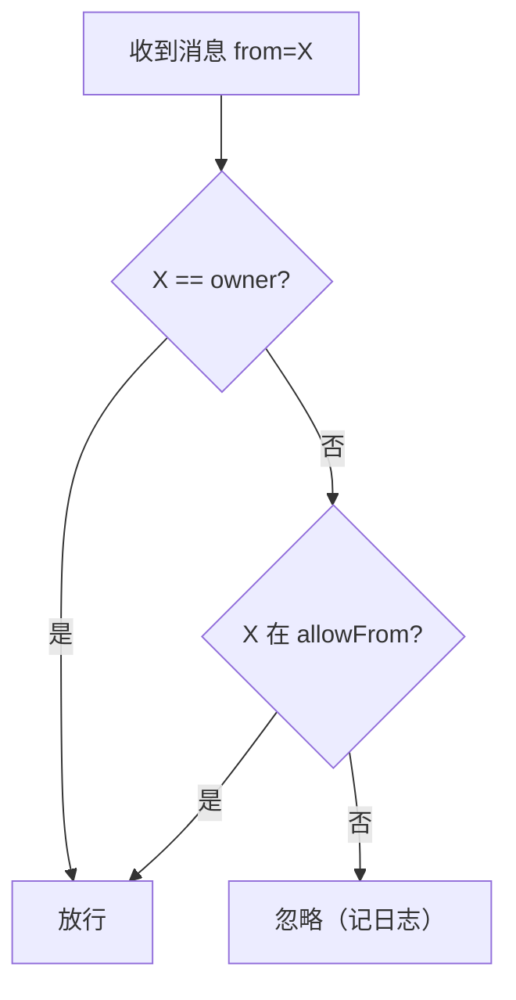

# 8. 数据存储与多账号

> 上一页：[7. 远程任务 Worker](07-远程任务-Worker.md) ｜ 下一页：[9. 配置项与环境变量](09-配置项与环境变量.md)
>
> **最后核对**：2026-11-12

本章梳理 WeMind 的全部写入磁盘文件、目录布局，以及多账号机制和授权安全模型。

## 8.1 数据根目录

所有运行时状态保存在 **`~/.wemind/`** 下，**独立于代码仓库** —— 改名/重装/重新 clone 代码都不影响登录态。

- 根目录默认 `~/.wemind`，可用 `WEMIND_HOME` 覆盖；
- 每个账号一份独立子目录 `~/.wemind/<key>/`。**key 由该账号的 botId 派生**（如 `feead781eb44`），不是固定 `default`；`accounts.json` 的 `default` 字段才指向「CLI 省略账号时用哪个」。`WECHAT_ACCOUNT`（默认 `default`）只决定**没走注册表**的直接运行（`wemind daemon` / `WECHAT_DATA_DIR` 未设时）用哪个目录。

数据目录解析优先级（见 [3. 协议内核](03-iLink-协议内核.md#数据目录解析storeaccountts)）：

```
WECHAT_DATA_DIR（完整路径，最高优先级）
  > ~/.wemind/<WECHAT_ACCOUNT>（默认 WECHAT_ACCOUNT=default）
```

## 8.2 目录布局总览

```
~/.wemind/
├── accounts.json                 # 账号注册表（key → 元数据 + 默认账号）
├── .staging-<随机>/              # 每次 login 一个独立暂存目录（归档或失败后删；旧 finalize 命令仍用 .staging/）
└── <key>/                        # 每个账号一份独立子目录
    ├── account.json              # 登录凭证
    ├── state.json                # 长轮询游标（读到哪了）+ context_token + uint64 去重游标/最近 ID 环
    ├── allowFrom.json            # 登录者白名单（兜底校验）
    ├── qr_login.json             # 扫码登录临时态（登录后失效）
    ├── qrcode.png / qrcode.txt   # 二维码（PNG / 终端文本）
    ├── brain.json                # 持久大脑选择（agent / presets 启动覆盖 / worker 默认任务大脑）
    ├── brain-sessions.json       # <agent>:userId → ACP sessionId（对话大脑，按 agent 分开存）
    ├── session-registry.json     # 会话登记表（会话列表用：名字/标题/轮次/最近使用）
    ├── handoff.json              # 交接摘要（「交接」命令生成，切到别的大脑后带上一次，默认 24h 过期）
    ├── runtime.json              # 账号级 homeMode（缺省 real；可显式 mirror/sandbox）
    ├── brain-mcps.json           # brain 激活集；version 2 按 agent 分键（默认空）
    ├── agent-view/<role>/<agent>/ # real/mirror 最小配置视图；仅用于有 homeEnvVar 的 Agent
    ├── agent-overrides/<agent>.json # 微信独享 config patch 与 mcp.disable/extra
    ├── workspace/{brain,worker}/ # brain/worker 默认 managed 工作区
    ├── workspace.json            # 可选：把默认工作区指向外部已存在目录
    ├── session-cwd.json          # <agent>:<sessionId> → cwd，恢复旧会话时使用
    ├── env.json                  # 可选：非敏感环境快照（PATH/代理/locale；不含密钥）
    ├── wechat-settings.json      # 预留：账号级微信行为设置（新账号自动创建空 {version:1}）
    ├── media/inbound/            # real/mirror 的入站文件/视频/无转写语音（默认保留 30 天 / 1GB）
    ├── brain-home/               # 仅 sandbox：大脑沙箱；其 media/inbound 也是该模式的入站媒体目录
    ├── agent-sessions/           # 仅 sandbox：agent 派生会话配置（DSH：deepseek/{brain,worker} + session-root-*.patch.yml）
    ├── worker-sessions.json      # 单任务 ACP sessionId（worker，键 <agent>:task-<编号>@<userId>）
    ├── worker-home/              # 仅 sandbox：worker 沙箱；其 media/inbound 也是该模式的入站媒体目录
    ├── task-inbox/               # 本地命令收件箱（CLI 写、daemon 扫描后删）
    ├── task-out/                 # 本地命令答复（daemon 写、CLI 短轮询后删）
    ├── tasks.json                # 任务表（重启后续跑：编号/agent/状态/轮次/cwd/最近输出）
    ├── task-state.json           # 任务状态记录（供 task-status 读；顶层复制最近一条任务 + tasks 数组）
    ├── control-inbox/            # 控制桥请求（CLI 原子写，daemon 扫描执行后写应答）
    ├── control-out/              # 控制桥应答（.bridge 存 daemon pid，供 CLI 校验 daemon 版本一致）
    ├── daemon.log                # 运行日志（各账号独立，避免文件锁竞争）
    ├── wrapper.pid               # 后台守护进程 pid（builtin watchdog / run-daemon.ps1 -Mode shell）
    ├── daemon.pid                # daemon 本体进程 pid
    ├── brain.pid                 # 对话大脑进程身份记录（JSON：pid/agent/bin/args/state…）
    ├── brain-runtime.json        # 运行中 daemon 实际生效的大脑（agent/source/bin/args；启动/热切换写入，stop 清掉）
    ├── workers.pid.json          # worker 池进程记录（pid/agent/bin/args/state/taskId…；单条时写对象、多条写数组；旧 worker.pid 裸整数仍可读）
    └── pm2.app.json              # 仅 --runner pm2：pm2 的 app 声明（其它启动方式不生成）
```

### 8.2.1 路径口径：real / mirror / sandbox

默认 `homeMode=real`，但“real”不等于“所有 Agent 都拿到同一个目录”。实际落点取决于该 Agent 预设能否把配置目录指向 WeMind 给的路径：

| Agent 形态 | `real` / `mirror`（默认） | `sandbox`（显式） |
|------------|---------------------------|-------------------|
| 预设声明了 `homeEnvVar`（kiro / gemini / copilot / opencode / deepseek / pi 等） | 配置目录是 `<账号>/agent-view/<role>/<agent>/`；未覆盖的目录/文件链接真实 home，只生成 MCP / settings / 权限 / overlay 等权威副本 | 配置目录是 `<账号>/brain-home` 或 `<账号>/worker-home`；完整复制并按 `inheritDirs` / `inheritFiles` 选择性继承 |
| 没有 `homeEnvVar`、但预设用 `env` 把配置目录模板写到 `%HOME%`（claude-code / cline / qoder） | 直接用真实 home（`~/.claude`、`~/.cline`、`~/.qoder`），`realEnv` 修正环境变量，避免多拼一层目录 | `%HOME%` 指向账号沙箱根，配置目录落到 `<sandbox>/<configSubdir>`；凭据/设置按 sandbox 规则同步 |
| Codex（适配器不认配置目录变量） | 直接使用真实 `~/.codex`；WeMind 只控制会话 cwd 与 ACP 下发的 MCP | 同样没有独立配置目录，`~/.codex` 仍是真实目录；`cwd` 仍是角色工作区（brain / worker），不因 `sandbox` 改变 |

因此：

- `agent-view/` 不是所有 Agent 都有；没有 `homeEnvVar` 的 Agent 在 `real` 下不会创建/使用视图，直接读写真实 home。
- `brain-home/` / `worker-home/` **只在 `sandbox` 模式使用**；`real` / `mirror` 下旧目录迁移时会重命名为 `.bak-<时间>`。
- `agent-sessions/` **只在 `sandbox` 模式使用**。DSH 的 `session-root-<role>.patch.yml` 由 `prepareAgent()` 生成；`real` 模式不追加 `--patch`，DSH 使用真实 `~/.dsh` 会话库，终端可见微信会话。
- 入站媒体：`real` / `mirror` 是 `<账号>/media/inbound`；`sandbox` 是当前角色沙箱下的 `media/inbound`（brain 即 `brain-home/media/inbound`，worker 即 `worker-home/media/inbound`）。
- `mirror` 当前与 `real` 共用同一最小视图构建路径；“三路合并”仍是后续 Phase 2 计划，不要把它当成已实现能力。

查看当前实际路径：

```powershell
wemind config show --key <key|label>   # homeMode / realHome / 工作区 / overlay / env / brain MCP 文件
wemind workspace show --key <key|label>
wemind mcp list --key <key|label>
```

## 8.3 文件清单速查

| 文件/目录 | 写入者 | 内容/用途 |
|-----------|--------|-----------|
| `account.json` | core | Bot Token、botId、userId、baseUrl（POSIX 权限 600；Windows 明文，见安全说明） |
| `state.json` | core | 长轮询游标 `updatesBuf`、各会话 `context_token`、去重用 `lastMessageId`（**string**，uint64 无损）与 `seenMessageIds`（最近 200 条环；POSIX 权限 600） |
| `allowFrom.json` | core | 登录者白名单（**兜底校验**：允许发消息的 userId 清单，默认拒绝；`{version, allowFrom[]}`） |
| `qr_login.json` / `qrcode.*` | mcp/manage | 扫码登录临时态与二维码（登录后即失效；`qr_login.json` POSIX 权限 600） |
| `brain.json` | manage / brain-config | 持久大脑选择 `agent`，另有可选 `presets`（按 agent 名保存 `--bin` / `--args` / `--shell` / `homeEnvVar` / `model` 覆盖，换 agent 时迁移进来，避免「切走再切回丢 `--bin`」）与可选 `worker`（默认任务大脑 `{agent, bin?, args?, shell?, homeEnvVar?, model?}`）；`wemind brain set` 读-改-写，不再整体覆盖 |
| `brain-sessions.json` | acp-brain | `<agent>:userId → ACP sessionId`，重启后 `session/load`/`session/resume` 恢复（agent 不支持则新建）；切大脑时各 agent 的会话互不覆盖；**「当前是哪个会话」的唯一权威**（登记表只做展示）；读/解析失败时先备份为 `brain-sessions.json.corrupt-<时间戳>` 再按空表继续（后续写入不会把损坏内容整张覆盖） |
| `session-registry.json` | session-registry | 会话登记表 `{version:1, entries[]}`（名字/标题/轮次/最近使用），只供「会话列表」展示；每 (agent,userId) 上限 50 条、先淘汰未命名最旧、再淘汰命名过的；**「不淘汰当前会话」是有条件的**——`capEntries` 的保护集默认空，只有 `upsertEntry` 自动放进「本次写入的那条」，`acp-brain` 的调用点都不传当前会话 id，所以补登记/刷新别的会话时当前会话仍可能被淘汰（已知边界，2026-11-05 核对，详见 [6. ACP 大脑与沙箱](06-ACP-大脑与沙箱.md)）；**daemon 启动时**按 `brain-sessions.json` 回填一次（幂等；不是「首次读取懒回填」——运行中删掉本文件要等下次启动才重建），文件坏了最多列表空（写失败只记日志不抛） |
| `handoff.json` | handoff | 交接摘要 `{version:1, fromAgent, userId, text, createdAt, expiresAt}`，`交接` 命令生成；`fromAgent` 记**实际答话的 agent**（`askBrainTurn` 返回，排队期间切换完成也不会记错）；切到别的大脑后下一条用户消息作为前缀带上一次、答成才清除，切回来源大脑不带上；TTL 见 `WEMIND_HANDOFF_TTL_MS`（默认 24h） |
| `runtime.json` | home-mode | 账号级 `{version:1, homeMode:"real"\|"mirror"\|"sandbox"}`；缺失/损坏回落 `real`，`WEMIND_HOME_MODE` 只做一次性覆盖 |
| `brain-mcps.json` | mcp-sandbox | `{version:2, active:{ "<agent>":["name"] }}`；旧版 `{active:[...]}` 首次读取时归到当前 agent。brain 默认空，显式加载后按 agent 持久 |
| `agent-view/<role>/<agent>/` | config-view | `real`/`mirror` 且预设声明了 `homeEnvVar` 时的最小视图：未覆盖项链接真实 home，生成 MCP/权限/overlay 副本；`.wemind-view.json` 记录 links/generated。manifest 路径相对 view root；复制回退不保证双向。没有 `homeEnvVar` 的 Agent 直接用真实 home |
| `agent-overrides/<agent>.json` | overlay | 微信独享：`config`（文件相对路径 → patch）与 `mcp.disable` / `mcp.extra`；不写回真实配置，拒绝疑似密钥键与越界路径 |
| `workspace/{brain,worker}/` | workspace | 默认 managed 工作区；0700；账号删除时一起清理 |
| `workspace.json` | workspace | 可选覆盖：`{brain:{mode,path?},worker:{mode,path?}}`；`external` 必须已存在，改后只影响新会话 |
| `session-cwd.json` | session-cwd | `<agent>:<sessionId> → cwd`；恢复旧会话时使用，避免静默搬到新工作区 |
| `env.json` | env-snapshot | 白名单非敏感环境（PATH/PATHEXT/ComSpec/SystemRoot、代理、locale、证书路径）；禁止 `*_KEY`/`*_TOKEN` 等；POSIX 0600 |
| `wechat-settings.json` | account-bootstrap | 账号级微信行为设置的预留文件（回复风格等）；新账号创建空 `{version:1}`，第一期不启用 |
| `media/inbound/` | daemon（media-store） | `real`/`mirror` 的入站文件/视频/无转写语音；文件名安全清洗、同名加后缀；启动时和写入时（至少间隔 1 小时）按 TTL/总量清理。图片不落这里 |
| `brain-home/` | mcp-sandbox | **仅 `sandbox`** 的大脑配置沙箱；`real`/`mirror` 下有 `homeEnvVar` 的 Agent 使用 `agent-view/brain/<agent>`，没有的直接用真实 home |
| `brain-home/media/inbound/` | daemon（media-store） | **仅 `sandbox`** 的 brain 入站媒体目录；worker 对应 `worker-home/media/inbound/` |
| `agent-sessions/` | `brain-agents.ts` 的 `prepareAgent()` | **仅 `sandbox`** 的 agent 会话库/派生配置。目前只有 DSH：`deepseek/session-root-brain.patch.yml` + `deepseek/brain/`、`deepseek/session-root-worker.patch.yml` + `deepseek/worker/`。启动前写入 `--patch` 文件，把 DSH 的 `session-persistence-jsonl.root` 指到这里——共用沙箱根时 kiro/pi 写进 `sessions/` 的平铺文件会让 DSH 报 `unsupported flat-file layout`（2026-11-03 真机修复）；用户 `--args` 自带 `--patch` 时不追加。`real` 模式不生成、不追加 |
| `worker-sessions.json` | worker-acp | worker 单任务 sessionId（键 `<agent>:task-<编号>@<userId>`，带编号与用户，避免多任务/多用户相撞），重启后续传；旧键由 `session-map.ts` 迁移规则处理；读/解析失败时先备份为 `worker-sessions.json.corrupt-<时间戳>` 再按空表继续 |
| `worker-home/` | worker-sandbox | **仅 `sandbox`** 的 worker 配置沙箱（全量 MCP 除 wechat + 记忆/技能/settings 含模型） |
| `task-inbox/*.json` | manage（CLI） | 本地任务命令（dispatch/reply/stop，带 `ack` 答复编号），daemon 扫描后删；daemon 启动时连同 `task-out/` 一起清空（防重放）。两侧共用 `task-inbox.ts` |
| `task-out/<id>.json` | daemon（task-manager 经 `setTaskAckSink`） | 本地命令的**答复** `{id, at, ok, text}`，CLI 短轮询读到即删。**派发的答复等 `acquire` 之后才发**（达上限/起不来是那时才知道的）；`text` 为空＝成功且无别的话（CLI 用自己的措辞）。老版 daemon 不写这个目录 → CLI 退回「已发送…」+ 一句说明，不假装成功 |
| `tasks.json` | task-store | 任务表（编号/agent/状态/轮次/cwd/最近输出/时间戳），用于**重启后续跑**：daemon 启动读回但**不自动 spawn**（未完成标「已中断」，用户回「继续」/`#n` 才拉进程 + `session/load`/`resume` 续跑）；编号跨重启不归零，损坏降级为空表、不阻塞启动 |
| `task-state.json` | daemon | 任务状态记录，供 `task-status` 读；顶层字段复制最近一条任务并多一个 `tasks` 数组（旧版 CLI 读到不会误判「无任务」） |
| `control-inbox/*.json` | manage（CLI） | 控制桥请求（CLI 原子写 `<ts>-<id>.json`），daemon 定期扫描执行后写应答；daemon 启动时清空该目录（作废残留命令防重放） |
| `control-out/` | daemon | 控制桥应答 `control-out/<id>.json`，CLI 短轮询读到后打印并**删除该应答**；daemon 每秒扫描时顺手清掉超过 1 小时没人读的旧应答（CLI 崩溃/放弃留下的），长期运行不会无限堆积；`control-out/.bridge` 是「这个 daemon 认识控制桥」的凭据（内容为 `{pid, at}` 的 JSON，CLI 取其中 pid）：与 CLI 读到的 `daemon.pid` 对不上说明 daemon 在跑旧版本——**必须由 daemon 执行**的（`session new\|resume`、`brain switch`、`brain switch --worker`、`brain handoff`）会在**发出前**就拒绝并提示「重启一次」；`session rename\|delete` 本来就只是改登记表文件，照常成功；`session list` 退回直接读登记表并附一行说明；`task-list`/`task-status` 直接读 `tasks.json`（从不经过控制桥），只在 daemon 没在跑时才加一行「上次留下的记录」 |
| `wrapper.pid` / `daemon.pid` | 各进程 | 进程 pid，供管理命令精确停止整条链 |
| `brain.pid` | acp-brain（经 `pid-record.ts`） | 对话大脑进程**身份记录**（JSON `{pid, agent, bin, args, shell, state, startedAt, writtenAt}`），存的是起进程时真实用的 bin/args（旧版本为裸整数）；热切换的 `brain-switch.ts` 只调 `restart()`/`warmup()`，不自己写这个文件 |
| `brain-runtime.json` | index / brain-switch（经 `brain-state.ts`） | daemon **实际生效**的对话大脑（`{agent, source, bin, args, startedAt}`）；启动成功与热切换成功后写入，`stop` 删除。`wemind list` 只在 daemon 活着时采信它——这样 `WEMIND_BRAIN=cline` 启动（brain.pid 尚未生成）也不会把 agent 显示成 brain.json 里的 deepseek |
| `workers.pid.json` | worker-pool | worker 进程池**记录数组**（每条 `{pid, agent, bin, args, shell, state: "busy"\|"idle", taskId?, startedAt, writtenAt}`；**只有一条时文件里是单个对象**，读侧数组/对象都认），取代裸整数 `worker.pid`。兼容分两种：账号里只有旧的裸整数 `worker.pid`（没有本文件）时，回退「用**配置里**的 bin/args 算特征串」的老办法判定/杀进程；本文件里若出现 legacy/缺字段记录（没有可用特征串），判为「不是我们的进程」**跳过、不杀**（安全侧） |
| `daemon.log` | 后台守护进程（builtin `RotatingLog`，含 `run-daemon.ps1` 默认薄壳；`-Mode shell` 自管轮转；pm2 路线归 pm2 管） | 运行日志（前缀 `[wemind/wechat-daemon]`，子系统加后缀：`/acp`、`/worker`、`/task`、`/watchdog`、`/wrapper`）。达到 `WEMIND_LOG_MAX_MB`（默认 10MB）轮转为 `.1`…`.N`（默认保留 3 份） |

**原子写**：上表中会被多个写者碰、或在关键路径上的 JSON（`brain.json` / `brain-runtime.json` / `handoff.json` / `brain.pid` / `workers.pid.json` / `brain-sessions.json` / `session-registry.json`）统一走 `atomic-json.ts`：临时文件名带 pid + 时间 + 随机后缀（不再共用固定的 `<文件>.tmp`，两个进程同时写也不会互相踩掉对方写到一半的内容），写/rename 失败会清掉本次临时文件再把错误交给调用方（有的调用方选择只记日志）。

**重置技巧**：

- 删 `account.json` + `state.json` = 退出登录重新扫码；
- `real` 模式下对话记忆在 Agent 自己的真实会话库，和终端共用；删 `brain-sessions.json` 只清“微信当前用哪条”。要彻底清 Agent 历史，按该 Agent 自己的存储处理，WeMind 不替它删；`sandbox` 模式才在 `brain-home` / `worker-home` / `agent-sessions/` 下。
- 删 `session-registry.json` = 清空会话列表元数据（下次 daemon 启动时按 `brain-sessions.json` 回填，不影响当前会话；运行中删掉不会自动重建）。

## 8.4 多账号机制

支持登录多个微信账号，每个账号完全隔离（不同 token、不同目录、各跑一个 daemon、互不冲突）。

### key vs label

- **key**：由微信 botId 派生的唯一标识（`deriveAccountKey` 净化 botId，如 `feead781eb44@im.bot` → `feead781eb44`），也是目录名，系统据它区分。当前 iLink 接口不返回昵称/微信号，故用 botId。
- **label**：人类可读别名（可改、可重复）。

管理命令多数可用 key 或 label 选择账号（label 唯一匹配时）。

### 账号注册表

`~/.wemind/accounts.json` 记录所有账号（CLI `login` 按 botId 派生 key 登记；MCP 形态登录在标准目录下按目录名登记，默认 key 是 `default`——见 [4. MCP Server](04-MCP-Server.md)）：

```jsonc
{
  "default": "feead781eb44",
  "accounts": {
    "feead781eb44": {
      "key": "feead781eb44",
      "botId": "feead781eb44@im.bot",
      "userId": "...",
      "baseUrl": "https://ilinkai.weixin.qq.com",
      "label": "工作号",
      "addedAt": 1718000000000
    }
  }
}
```

注册表的写操作（`login` 归档、`label`、`set-default`、`delete`）在 `accounts.json.lock` 上串行：并发命令最多等 5 秒，超时会报错而不是无锁覆盖；持有者崩溃留下的锁超过 10 秒会被自动清理。读失败（权限/磁盘/路径损坏）会直接报错，**不会**当空表——只有文件不存在才视为首次运行，避免下一次写把全部账号抹掉。

### 管理命令（wemind）

```
wemind <command>
```

| 命令 | 作用 |
|------|------|
| `login [--label 名] [--start]` | **一条命令完成扫码登录**：自刷新二维码 + 自动归档（`--start` 顺带启动 daemon） |
| `list` | 列出账号、别名、botId、运行状态 |
| `start [<key\|label>]` / `stop [<key\|label>]` | 启动 / 停止某账号的 daemon（**省略账号 = 默认账号**） |
| `logout <key\|label>` | 停 daemon + 通知下线 + 清凭证（保留目录，可重登） |
| `delete <key\|label>` | 停 daemon + 删除目录 + 移除注册；**停不干净（daemon 仍在运行）就拒绝删目录**，先 `stop` 再删 |
| `label <key\|label> <新别名>` | 改别名 |
| `set-default <key\|label>` | 设默认账号 |
| `adopt <key> [--label 名]` | 把已存在的账号目录登记进注册表 |
| `allowlist <key\|label>` | 查看登录者白名单（allowFrom）——兜底工具，正常无需碰 |
| `allow <key\|label> <userId>` | （兜底）把某个 userId 加入白名单 |
| `revoke <key\|label> <userId>` | （兜底）从白名单移除某个 userId |
| `task "…" [--agent <名字>] [--cwd 目录] [<key\|label>]` / `task-list` / `task-reply <编号\|"#编号 正文">` / `task-stop [编号\|全部\|all]` / `task-status` | 本地任务管理：派发（可指定 agent 与账号）、列表、按编号发话、结束（见 [7. Worker](07-远程任务-Worker.md)） |
| `brain [show\|set\|unset\|check\|switch\|handoff] [<key\|label>]` | 大脑选择与自检；**`switch <agent 名>` 在 daemon 运行时经控制桥热切换**，`handoff` 生成交接摘要（见 [6. ACP 大脑与沙箱](06-ACP-大脑与沙箱.md)） |
| `session list [--page N]` / `current` / `new [名字]` / `resume <序号\|名字\|id前缀>` / `rename <ref> <名>` / `delete <ref>`（均可带 `<key\|label>`） | 会话管理（登记表 `session-registry.json`；`current` 读当前会话表 `brain-sessions.json`；读优先走桥，daemon 不在也能读） |

### 多账号 = 多 daemon（互不越界）

**一个账号一个 daemon**，各自一条 `~/.wemind/<key>/` 目录链：独立 `brain.json`、会话指针、`agent-view`、`agent-overrides`、工作区、MCP 激活集、登录者白名单与进程树。`real` 模式下 Agent 真实配置/技能/记忆/会话库是同一 OS 用户的共享基线；`sandbox` 模式才按账号隔离 `brain-home` / `worker-home`。

- **微信侧只能影响「消息进来的那个账号」**：`切换大脑`/`交接` 这类账号级命令只在对应 daemon 内生效，**没有跨账号操作**；
- **每个账号各有自己的登录者**（= 扫码登录它的微信号），它跟别的账号没有任何关系——**不存在「主号」**；`label`（别名/昵称，可改可重复）与 `默认账号`（只管「CLI 里省略账号时用哪个」）都**不是权限**；
- **本机 CLI 可以指定任意账号**（`wemind brain switch X <key|label>`，省略 = 默认账号）——那是「能在本机敲命令 = 机主」的本地入口，不经过微信侧「只认登录者」那道门。

换大脑在两个入口下的范围、限制与区别（含 daemon 没跑时的降级行为）见 [6. ACP 大脑与沙箱](06-ACP-大脑与沙箱.md#多账号下的范围两个入口)。

### 登录流程（login）

`login` 在终端里完成全流程：自动生成二维码（**过期自动刷新**、终端 ANSI 渲染 + 自动打开 PNG）→ 你用要登录的微信扫码确认 → 写入本次独立的 `.staging-<随机>/` 暂存（并发登录互不干扰；QR 状态也写这里，不碰默认账号目录）→ 按 botId 归档（`finalizeStaging`：重命名到 `<key>/` + 登记注册表 + 把扫码者 userId 加入 allowFrom 配对授权，即登录者白名单）→ `--start` 顺带启动该账号 daemon。

整条命令在终端跑，二维码原生渲染、过期自动换、不怕过期。

## 8.5 授权与安全

由于 daemon 大脑**默认免审批**（内置预设各用自己 agent 的机制，见 [9. 配置项与环境变量](09-配置项与环境变量.md)）（**消息一旦被接受**，就能让 AI 在你电脑上执行任意工具），安全的第一层是**平台本身**：微信只把发给这个 bot 的消息发送给**登录者本人**（必须扫码登录该 bot 才能给它发消息）。代码里再加一道**登录者白名单**（**默认拒绝**）：清单外的发件人一律忽略（`daemon.log` 记 `ignore unauthorized sender`）。它是**兜底校验**——正常用法下清单里只有登录者一个 userId，防的是「发送范围将来变化 / daemon 被接到别的入口」。

### 授权模型

鉴权 = **登录者（owner，始终允许，安全兜底）** 或 **在 allowFrom 清单中**。



- `owner`（**登录者**）= 扫码登录这个 bot 的那个微信号的 userId（`WECHAT_OWNER_ID` 可覆盖）。它是**按账号算的**：一个账号的登录者跟别的账号没有任何关系，**不存在「主号」**——多账号就是多个 daemon，各有自己的登录者与登录者白名单（多账号下换大脑的范围见 [6. ACP 大脑与沙箱](06-ACP-大脑与沙箱.md#多账号下的范围两个入口)）。
- **配对授权（pairing）**：扫码登录者的 userId 在 `finalize`/`adopt` 时自动加入 allowFrom；daemon 启动也会把登录者种入（自动迁移老账号）。所以现有账号**无需任何手动配置**即可工作。
- daemon 每条消息实时读取清单（增删即时生效，无需重启）。
- `allow` / `revoke` / `allowlist` 是**兜底工具**：微信平台只发送登录者本人的消息，正常用法下清单里只有登录者一个 userId，无需手动维护。

### 安全注意事项

- ⚠️ **不要关掉登录者白名单这道闸**：大脑默认免审批（各 agent 自己的开关，见 [9. 配置项与环境变量](09-配置项与环境变量.md)），它是兜底防护（正常用法下清单里只有登录者一个 userId）。
- 凭证类文件在 POSIX 下统一落为权限 600（临时文件在 rename 前收紧）：`account.json`（Bot Token）、`state.json`（`context_token`）、`qr_login.json`（扫码态）。**Windows 上 chmod 无效、明文存放**，需用文件夹权限或磁盘加密保护 `~/.wemind/` 目录（保存凭证时会有一次性告警）。
- allowFrom 文件损坏时 fail-closed（全员锁死），不会误放行。
- 隐私：消息经腾讯 iLink 渠道与本地 AI 流转，涉及对话内容外发，请自行评估。

## 8.6 自启全部账号

`scripts/run-all-daemons.ps1` 读 `<WEMIND_HOME>/accounts.json`（默认 `~/.wemind`），为每个已登记账号起一条独立的 daemon 链（各账号单实例守卫，重复运行安全），可用于手动启动或源码开发。开机自启用 `wemind autostart install`：Windows 生成登录触发的计划任务（受管机器降级 `HKCU\...\Run`），动作是 `wemind start --all`，触发时同样按 `accounts.json` 拉起所有账号。详见 [10. 部署与运维](10-部署与运维.md)。

---

接下来：[9. 配置项与环境变量](09-配置项与环境变量.md) 是所有 env 的速查表。

> **日志格式（2026-11-11 起）**：运行日志统一由 `core/logging.ts` 的 `createLogger(scope)` 输出，格式为 `[wemind/<scope>][INFO|WARN|ERROR|DEBUG] …`，全部写 stderr（MCP 的 stdout 仍是 JSON-RPC 通道）；CLI 用户输出走 stdout 的 `print()`，不加前缀、不加级别。本文正文中的日志样例可能省略了级别标记，实际每行都有。`wemind log --errors` 精确认 `[ERROR]/[WARN]` 标记，升级前写入的旧日志仍按关键词兼容。`WEMIND_LOG_LEVEL=debug` 才输出 DEBUG（目前没有 debug 调用点，属预留级别）。
