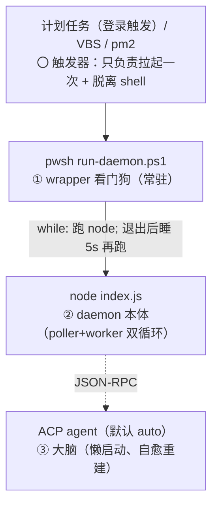

# 10. 部署与运维

> 上一页：[9. 配置项与环境变量](09-配置项与环境变量.md) ｜ 下一页：[11. 开发指南](11-开发指南.md)
>
> **适用版本**：WeMind 1.2.0 ｜ **最后核对**：2026-10-28

本章讲 daemon 如何做到「开机自启 + 一直在后台收发 + 崩了自动恢复」，以及 Windows 专用方案与跨平台 pm2 方案。

> MCP server 形态不需要常驻部署（随 MCP 客户端生命周期），本章只针对 daemon 形态。

## 10.1 常驻不是单一机制

daemon 的常驻是**三层进程 + 一个看门狗循环 + 一套保活/隔离细节**的组合：



一句话总结：

> 计划任务/VBS 负责「开机拉起一次」并脱离 shell；wrapper 的 `while` 循环负责「崩了再拉」；node 的两个 `while(true)` 负责「自己不退」；Mutex 负责「不重复」；pid 文件链负责「能精确停」。五者叠起来 = 稳定的后台常驻。

## 10.2 三层进程与 PID 文件

三层进程各写 PID 文件到账号目录 `~/.wemind/<key>/`。**1.2.0 起 ACP 侧**（brain / worker）不再写裸整数，而是写**身份记录**——记下起进程时**真实用的** `bin`/`args`，判定与杀进程都按记录里的值算特征串：

| 文件 | 属于 | 写入者 | 形态 | 用途 |
|------|------|--------|------|------|
| `wrapper.pid` | ① wrapper | `run-daemon.ps1` | 裸整数 | 停看门狗（否则停了 daemon 会被立刻重拉） |
| `daemon.pid` | ② daemon | `index.ts` 启动时 | 裸整数 | 精确定位本账号 node 进程 |
| `brain.pid` | ③ 大脑（1 个） | `acp-brain.ts` spawn 后 | JSON 身份记录 | 区分「bot 的大脑」与你日常用的 agent |
| `workers.pid.json` | worker（**N 个**） | `worker-pool.ts` spawn / 回池时 | 记录数组 | 逐条精确清理 worker 进程 |

`brain.pid` 字段：`{pid, agent, bin, args, shell, state, startedAt, writtenAt}`；`workers.pid.json` 每条含 `pid/agent/bin/args/shell/state:"busy"|"idle"/taskId?/时间戳`。

**为什么从裸整数改成 JSON**：`manage.ts` 过去用**配置里**的 agent 算进程特征串（bin + args）来判定/杀进程，三种情况会失效——① `wemind brain set X` 不带 `--restart`（配置已改、旧 agent 进程还在跑）；② 热切换窗口内；③ **多任务 / 多 agent 并存**（多 worker 之后是常态）。改成记录后，特征串按**起进程时真实用的** bin/args 算，三种情况都对得上。

**进程数模型**：brain 固定 1 个 ACP 进程；worker 是 **N 个**（进程池：并发上限 `WEMIND_MAX_WORKERS` 默认 3、保留空闲进程上限 `WEMIND_IDLE_MAX` 默认 2、空闲超 `WEMIND_WORKER_REAP_MS` 默认 5 分钟回收）。任务跑完**进程回池**（不杀）；例外有两种——正在跑的任务被 `结束任务`/`task-stop` 时是**杀掉**（ACP 回合没法优雅取消，不回池），「等你回复」的任务一直占着连接、不进空闲池；只有 `wemind stop` / daemon 进程退出才**一次杀光整池**。

**兼容性**：① 旧账号只有裸整数 `worker.pid`（没有 `workers.pid.json`）时仍可读——读出来是一条 `legacy:true`、没有 bin/args 的记录，判定回退到「用**配置里**的 bin/args 算特征串」的旧办法；而 `workers.pid.json` 里若混进 legacy/缺字段记录（没有可用特征串），一律判为「不是我们的进程」，**跳过、不杀**（安全侧）；② 反方向不兼容——**旧版 CLI 读新的 JSON pid 文件会拿到 `NaN`**，显示「已停止」且**不杀进程**（安全侧的兼容取舍）。

**进程身份特征串** `CLI_PID_MARKERS` 现在有三组：`["wemind","cli.js"]`、`["wechat-daemon","dist","cli.js"]`、`["run-daemon.ps1"]`。第二组是给「在仓库根用**相对路径**手跑 CLI」（`node packages/wechat-daemon/dist/cli.js …`）用的——相对路径的命令行里既没有仓库名也没有包名，只有源码目录名 `wechat-daemon`（并要求 `dist` 同在，收窄误命中面）；没有它，手跑的 CLI 与 daemon 会互相认不出。

**停止顺序必须自上而下**：先停 wrapper（断看门狗），再 `taskkill /T` daemon（连带大脑进程树），最后清 brain —— 顺序错了 daemon 会被 wrapper 在 5 秒后重拉。

## 10.3 wrapper 看门狗（run-daemon.ps1）

wrapper 本质是一个永不结束的监督循环：

```powershell
while ($true) {
  "[wemind/wechat-daemon/wrapper] start daemon ..." | Add-Content $log
  & $node "packages/wechat-daemon/dist/cli.js" daemon *>> $log   # 前台阻塞，直到 node 退出
  "[wemind/wechat-daemon/wrapper] daemon exited (code=...), restart in 5s ..." | Add-Content $log
  Start-Sleep -Seconds 5
}
```

- `& $node ...` 前台阻塞，node 可能跑几天；一旦退出（崩溃/被杀），记日志、睡 5s、重拉。这就是「崩了自动恢复」的来源。
- 职责分离：node 只管业务，保活完全交给 wrapper。

启动时 wrapper 还做：设 UTF-8 编码（否则中文输出按 GBK 乱码）、用 `$PSScriptRoot` 反推仓库根（可移植）、解析数据目录（日志写各账号 `daemon.log` 避免文件锁竞争）、解析 node/所选 ACP agent（kiro-cli 找不到时兜底到 `%LOCALAPPDATA%\Kiro-Cli\kiro-cli.exe`；其它 agent 也可用 `brain set --bin` 落绝对路径）。

## 10.4 单实例守卫（命名 Mutex）

为防多个 wrapper 同时跑、抢同一 token 打架，wrapper 启动用**命名 Mutex** 做单实例守卫：

- Mutex 名按**数据目录**派生（`SHA1(dataKey)` 前 16 位 hex）；
- 抢到锁才继续，抢不到说明同账号已有 wrapper 在跑，本次直接退出；
- **不同账号 = 不同数据目录 = 不同 Mutex** → 多账号各自独立、可共存。

## 10.5 daemon 本体为何「不自己退」

`index.ts` 起来后跑两个永不返回的循环（poller + worker），所以正常情况下永不自然结束。它只会因为：未捕获异常（已加全局处理器记录而不退出）、被 `taskkill`、或会话过期 `-14`（不退出，而是暂停 1 小时等重新登录）而退出。一旦退出 → wrapper 5s 后重拉。

## 10.6 大脑/worker 的自愈

大脑是**懒启动**：第一条消息到来时才 spawn，之后常驻复用。`session/prompt` 超时/失败 → 杀掉假死进程 → 下条消息重建并尝试 `session/load`/`session/resume` 恢复上下文（agent 不支持则新建）。所以大脑这层有自己的「崩了重建且尽量不丢历史」。

**热切换（1.2.0）不再需要重启 daemon**：CLI `wemind brain switch <预设|auto>` 或微信 `切换大脑 <名>`，流程是 预检（未知/不可用预设直接拒绝，不 spawn）→ 等在跑的回合结束（drain，`WEMIND_SWITCH_DRAIN_MS` 默认 30s，超时 = **诚实失败**，不砍回合）→ 准备沙箱 → 起新进程预热（硬上限 `WEMIND_SWITCH_TIMEOUT_MS` 默认 120s）→ **成功才写 `brain.json`**。失败**回滚**（槽位留旧大脑、清半截 pid 记录、`brain.json` 不动），下条消息懒重建；持久化放在最后，所以回滚不需要撤销。注意 `WEMIND_BRAIN` 优先级高于 `brain.json`，命令式切换会绕开它生效，回执里会如实警告「重启后会回到环境变量指的大脑」。

**worker 侧的「自愈」是进程池的复用与回收**：任务跑完**进程回池**（不杀，同 agent 的下个任务直接复用，省掉冷启动）；空闲超 `WEMIND_WORKER_REAP_MS`（默认 5 分钟）或空闲数超 `WEMIND_IDLE_MAX`（默认 2）时，从最旧的开始回收，`busy` 的永不动——被中途结束的 running 任务是例外：`drop` 直接杀掉，不会进池；停在「等回复」的任务一直算 `busy`，因此也不受空闲回收影响。只有 `wemind stop` / daemon 进程退出才**一次杀光整池**。注意 `WEMIND_WORKER_IDLE_MS` 是另一回事——那是**单轮 `session/prompt` 多久没有帧算卡死**，与池的空闲回收无关。

> ⚠️ **已知窄窗口**：切换的 `restart()` 与「新进程写 pid 记录」之间约 1s，此刻 `wemind stop` 可能漏杀新起的 ACP 子进程（与既有的 `/加载` 触发 `restart()` 同类形态，不是 1.2.0 新引入的）。

## 10.7 故障模式与恢复一览

| 现象 | 机制层 | 恢复 |
|------|--------|------|
| daemon 崩溃（含旧的静默 `code=1`） | ① wrapper | 日志 `daemon exited` → 5s 重拉；全局异常处理器从源头减少崩溃 |
| 大脑假死/超时 | ③ acp-brain | 杀进程 → 下条消息重建 + `load`/`resume` 恢复 |
| 热切换失败（drain 超时 / 预热超时 / 握手失败） | ③ brain-switch | **回滚**：槽位留旧大脑、清半截 pid 记录，`brain.json` 保持旧值；下条消息懒重建，无需手动处理 |
| 并发任务超上限 | worker 池 | `WEMIND_MAX_WORKERS`（默认 3）超限**直接拒绝派发**（不排队，用户当场知道）；扛不住就把上限调小 |
| worker 进程越积越多 | worker 池 | 空闲超 `WEMIND_WORKER_REAP_MS`（默认 5 分钟）或超 `WEMIND_IDLE_MAX`（默认 2）自动回收最旧的，`busy` 的不动 |
| 升级 CLI 后热切换/会话命令用不了 | CLI ↔ daemon 控制桥 | daemon 还跑着旧版（`control-out/.bridge` 的 pid 对不上/缺失）：**必须由 daemon 执行**的（`session new\|resume`、`brain switch`、`brain switch --worker`、`brain handoff`）在**发出前**就拒绝并提示重启；`session rename\|delete` 只改登记表文件、照常成功；`session list` 直接读登记表 + 一行说明；`task-list`/`task-status` 从 `tasks.json` 直读（从不过桥），只在 daemon 没在跑时才加一行「上次快照」。按提示 `wemind stop <key> && wemind start <key>` |
| 切换瞬间 `wemind stop` 漏杀新 ACP 子进程 | ③ brain-switch | 已知约 1s 窄窗口（与 `/加载` 触发 `restart()` 同类形态，非本次新引入）；漏了再 `stop` 一次 |
| 网络抖动 `getUpdates fetch failed` | ② poller | try/catch + 2s 重试，不崩 |
| 登录会话过期 `-14` | ② daemon | 暂停 1 小时，重新登录后自动恢复 |
| 重复启动/多实例 | ① Mutex | 抢不到锁的 wrapper 直接退出 |
| 开机没起来 | 〇 触发器 | 检查计划任务是否启用、PS7 路径、`ExecutionTimeLimit=0` |

## 10.8 Windows 开机自启

### 首选：计划任务（登录触发）

```powershell
$pwsh = "C:\Program Files\PowerShell\7\pwsh.exe"          # 必须 PS7 全路径
$wrapper = "<仓库绝对路径>\scripts\run-daemon.ps1"
$action = New-ScheduledTaskAction -Execute $pwsh -Argument "-NoProfile -ExecutionPolicy Bypass -WindowStyle Hidden -File `"$wrapper`""
Register-ScheduledTask -TaskName "wemind-daemon" `
  -Action $action `
  -Trigger (New-ScheduledTaskTrigger -AtLogOn) `
  -Settings (New-ScheduledTaskSettingsSet -ExecutionTimeLimit ([TimeSpan]::Zero) -MultipleInstances IgnoreNew) -Force
```

要点：

- `-AtLogOn`：登录即触发；
- `ExecutionTimeLimit = 0`：不限时长（否则计划任务会在若干小时后杀掉常驻进程）；
- `MultipleInstances IgnoreNew`：配合 wrapper 的 Mutex 双保险；
- `Execute` 必须用 **PS7 全路径**，不要用 `pwsh`（依赖 PATH）或 WindowsApps 执行别名（非交互上下文常解析失败）；
- **node 由版本管理器管理时（fnm / nvm / Volta）**：持久 PATH 里通常没有 node。`scripts/run-daemon.ps1` 已内置回退（fnm `%APPDATA%\fnm\aliases\default`、Volta、`C:\Program Files\nodejs`）并把命中目录**前置进 PATH** —— daemon 拉起的大脑（`opencode acp` 等）同样靠 PATH 解析；安装位置不同则改脚本候选或改用绝对路径 node；
- **大脑配置错误**会让 daemon 以退出码 `78` 退出：`run-daemon.ps1`（wrapper 循环）、CLI 自带看门狗、pm2（`stop_exit_codes: [78]`，`--runner pm2` 与 `ecosystem.config.cjs` 两条路线都设了）都会**停止重拉**，需人工修好后重新登录或手动启动。

### 退路：启动文件夹 + VBS

环境禁建计划任务时，在 `shell:startup` 放一个 `.vbs`，用 `WScript.Shell.Run` 以隐藏窗口调 `pwsh ... -File scripts/run-daemon.ps1`。VBS 的 `Run` 能彻底脱离、不残留控制台窗口。

> **为什么一定要「脱离」启动**：让 wrapper（及子孙 node/kiro-cli）不继承启动者的 stdout 管道，否则启动它的 shell 会一直等管道 EOF → 「看似卡住」。

## 10.9 多账号自启

`scripts/run-all-daemons.ps1` 读注册表 `~/.wemind/accounts.json`，为每个账号起一条独立 wrapper 链：

```powershell
foreach ($key in $accounts) {
  Start-Process -FilePath $pwsh `
    -ArgumentList @('-NoProfile','-ExecutionPolicy','Bypass','-WindowStyle','Hidden','-File',$wrapper) `
    -WindowStyle Hidden -Environment @{ WECHAT_ACCOUNT = $key }   # 显式传账号
}
```

- 每账号不同 `WECHAT_ACCOUNT` → 不同数据目录 + 不同 Mutex + 不同日志 → 完全独立、可共存；
- 多账号必须用 `Start-Process -Environment` **显式传** `WECHAT_ACCOUNT`（靠 `$env:` 继承不可靠）；
- 重复运行安全（已在跑的账号被 Mutex 挡掉）。

## 10.10 跨平台常驻（pm2）

daemon 本体是纯 Node.js、跨平台；只有「常驻外壳」原先是 Windows 专属。用 [pm2](https://pm2.keymetrics.io/) 可在 Windows / Linux / macOS 通用常驻。

> **两条 pm2 路线**：发布版用户直接 `wemind start <账号> --runner pm2`——`pm2-runner.ts` 会在账号目录写 `pm2.app.json`（`restart_delay: 5000` / `max_restarts: 50` / `stop_exit_codes: [78]` / 日志合并，与 builtin 看门狗同语义）再 `pm2 start` 它。本节讲的是**源码开发者**的 `ecosystem.config.cjs` 路线（按 `accounts.json` 批量生成 app，设置同上一组）。

pm2 一个工具顶替整套 PowerShell 外壳：

| 能力 | 原 Windows 方案 | pm2 |
|------|----------------|-----|
| 崩溃自动重拉 | wrapper while 循环 | `autorestart` |
| 开机自启 | 计划任务/VBS | `pm2 startup` + `pm2 save` |
| 单实例 | 命名 Mutex | 按 app 名天然唯一 |
| 脱离终端 | 计划任务/Start-Process | pm2 守护化 |
| 多账号 | 每账号一 wrapper | `ecosystem.config.cjs` 按账号生成多 app |
| 日志 | `*>> daemon.log` | `out_file`/`error_file` 指到各账号 `daemon.log` |

`ecosystem.config.cjs` 读 `~/.wemind/accounts.json`，为每个账号动态生成一个 app（`wemind-<key>`，注入 `WECHAT_ACCOUNT`，崩溃 5s 重启，日志写各账号 `daemon.log`）。无注册表时回退到单账号 `default`。其中 `stop_exit_codes: [78]` 让「大脑配置错误」不再反复重启（与 `run-daemon.ps1`、CLI 自带看门狗一致）。

启动：

```bash
npm install -g pm2
npm run build
pm2 start ecosystem.config.cjs    # 为每个账号起一个 app
pm2 save                          # 保存进程列表
pm2 startup                       # Linux/macOS：按提示执行生成 systemd/launchd 集成
```

- **Linux/macOS**：`pm2 start + save + startup` 一条龙；
- **Windows**：pm2 自启较特殊（`pm2 startup` 不原生支持 Windows），建议自启仍走计划任务执行 `pm2 resurrect`，或直接沿用原 `run-daemon.ps1`。

> ⚠️ **同一账号只用一套常驻方案**，别同时跑 pm2 和 `run-daemon.ps1`（会两个 daemon 抢同一 token）。原方案的 Mutex 只防它自己重复，不感知 pm2。

文档还提供原生 systemd（`Restart=always` + 模板化多账号）/ launchd（`KeepAlive`）示例，等价于 pm2，只是手写 unit。

## 10.11 用 npm 包部署（推荐路径）

生产用户不需要源码仓库：装 `@wemind/cli` 即可，命令是 `wemind`。

```bash
npm i -g @wemind/cli          # 或 npx -y @wemind/cli …
wemind version                # → wemind 1.2.0 (@wemind/cli, node …, <platform>-<arch>)
wemind login --label 主号 --start
```

- 包内是单文件产物 `dist/cli.js`（附带 `cli.js.map` 便于排错）；内核已内联，运行时只依赖第三方 `qrcode`（**只在 `wemind login` 时懒加载**）。
- 常驻默认用**自带看门狗**（`wemind start` → `cli.js _watchdog`），需要时用 `--runner pm2` 切到 pm2；`npm run build` / `ecosystem.config.cjs` / `run-daemon.ps1` 仍是**源码开发者**的路径。
- 升级：`npm i -g @wemind/cli@latest` 后 **必须** `wemind stop <账号> && wemind start <账号>` —— 已在运行的 daemon 不会自动加载新代码。
- 发布/发版/回滚规则见 [`docs/发布-wemind-npm.md`](../发布-wemind-npm.md)。

> ⚠️ **包名 ≠ 命令名**：装 `@wemind/cli`，敲 `wemind`。`npx` 按包名解析，所以只能 `npx -y @wemind/cli`。

## 10.12 运维速查

```bash
# 版本与账号状态
wemind version
wemind list

# 启停某账号
wemind start  <key|label>
wemind stop   <key|label>       # 连带杀光 worker 进程池
wemind logout <key|label>       # 停链 + 下线 + 清凭证（保留目录）

# 大脑：查看 / 落盘 / 热切换（1.2.0）
wemind brain                    # 看当前大脑
wemind brain set <预设>         # 落盘，重启后生效（等价于旧的「改配置」）
wemind brain switch <预设|auto> # 热切换：drain → 预热 → 成功才落盘，失败回滚；不需要重启 daemon
wemind brain switch <预设> --worker   # 换「默认任务大脑」（--worker 指定 worker 角色）
wemind brain check              # 真机 ACP 握手（默认 60s）

# 会话（1.2.0，走控制桥）
wemind session list [--page N]
wemind session new [名字]
wemind session resume <序号|名字|id前缀>
wemind session rename <引用> <新名字>
wemind session delete <引用>

# 任务
wemind task "…" [--agent <预设>]   # 不指定 agent 则用默认任务大脑
wemind task-list
wemind task-reply <n> "…"        # 编号单独一个参数；也支持 task-reply "#3 正文"
wemind task-stop [<n>|all|全部]  # 不带编号＝恰好一条活跃任务时结束它（≥2 条会回清单让你指明）；task-stop "#2" 会被当成账号选择而报错

# pm2 运维
pm2 status / pm2 logs wemind-<key> / pm2 restart wemind-<key>

# 看日志
# Windows: ~/.wemind/<key>/daemon.log（含 `[wemind/wechat-daemon]` 及其 `/acp`、`/worker`、`/task`、`/watchdog`、`/wrapper` 子前缀）
```

**运维三句提醒**：

1. **装完新版 CLI 要重启一次 daemon**：CLI 用 `control-out/.bridge`（内容 = daemon 自己的 pid）判断对方认不认识**控制桥**。daemon 还在跑旧版时，**必须由 daemon 执行**的命令（`session new|resume`、`brain switch`、`brain switch --worker`、`brain handoff`）会在**发出前**就拒绝并提示 `wemind stop <key> && wemind start <key>`；`session rename|delete` 只是改登记表文件、照常成功；`session list` 会降级为直接读登记表并加一行说明（能看，但按「下次会用的那个大脑」列）；`task-list` / `task-status` 从 `tasks.json` 直读、从不经过桥，只有 daemon 没在跑时才会多一行「上次留下的快照」。所以升级后不重启，热切换/会话命令都用不了。
2. **多任务共享同一份微信连发额度**：约 10 条是**按用户**计的，多 worker 并行时进度消息会一起抢额度；扛不住就调小 `WEMIND_MAX_WORKERS`。
3. **进程数看两个文件**：`workers.pid.json` 的条数 = 当前 worker 进程数（`state` 为 `busy`/`idle`）；`brain.pid` 只有一条。`wemind stop` 会整池清空，`wemind list` 的 pid 判定按记录里的 bin/args 算特征串。

---

接下来：[11. 开发指南](11-开发指南.md) 讲构建、测试与贡献。
