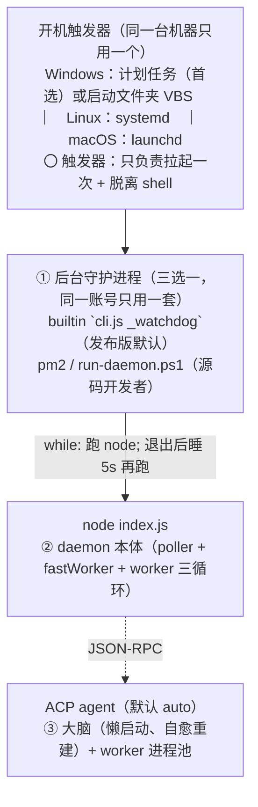

# 10. 部署与运维

> 上一页：[9. 配置项与环境变量](09-配置项与环境变量.md) ｜ 下一页：[11. 开发指南](11-开发指南.md)
>
> **最后核对**：2026-11-05

本章是部署与运维的**速查参考**：进程模型、pid 文件、故障表、常用命令。**深入详解另有两篇**，本章只在需要细节时指过去，不重复它们的正文：

- 常驻机制、后台守护进程循环、单实例守卫、开机自启、多账号启动 → [daemon 常驻原理](../部署与运维/daemon-常驻原理.md)
- pm2 / systemd / launchd 的完整配置 → [跨平台常驻（pm2）](../部署与运维/跨平台常驻-pm2.md)

> MCP server 形态不需要常驻部署（随 MCP 客户端生命周期），本章只针对 daemon 形态。

## 10.1 常驻不是单一机制

daemon 的常驻是**三层进程 + 一个后台守护进程循环 + 一套保活/隔离细节**的组合：



一句话总结：

> 开机触发器负责「开机拉起一次」并脱离 shell——Windows 用计划任务（首选）或启动文件夹 VBS（禁建任务时的退路）、Linux 用 systemd、macOS 用 launchd，**同一台机器只选一个**；后台守护进程的 `while` 循环负责「崩了再拉」；node 的三个 `while(true)` 负责「自己不退」；Mutex / `wrapper.pid` 负责「不重复」；pid 文件链负责「能精确停」。五者叠起来 = 稳定的后台常驻。

**三套常驻外壳**（同一账号只能用一套，互不感知）：

| 外壳 | 谁用 | 单实例守卫 | 日志轮转 |
|------|------|-----------|---------|
| builtin `cli.js _watchdog` | `npm i -g @wemind/cli` 的默认（`wemind start`） | `wrapper.pid` + 进程身份校验 | 内置 `RotatingLog`（运行中轮转） |
| pm2 | `wemind start --runner pm2` / `WEMIND_RUNNER=pm2` / 源码 `ecosystem.config.cjs` | app 名唯一 | 交给 `pm2-logrotate` |
| `run-daemon.ps1` | 仓库里从源码跑、Windows 自启 | 命名 Mutex | 每次重拉前轮转 |

## 10.2 三层进程与 PID 文件

三层进程各写 PID 文件到账号目录 `~/.wemind/<key>/`。**1.2.0 起 ACP 侧**（brain / worker）不再写裸整数，而是写**身份记录**——记下起进程时**真实用的** `bin`/`args`，判定与杀进程都按记录里的值算特征串：

| 文件 | 属于 | 写入者 | 形态 | 用途 |
|------|------|--------|------|------|
| `wrapper.pid` | ① 后台守护进程 | builtin watchdog / `run-daemon.ps1` | 裸整数 | 停后台守护进程（否则停了 daemon 会被立刻重拉）；pm2 路线由 app 名管理 |
| `daemon.pid` | ② daemon | `index.ts` 启动时 | 裸整数 | 精确定位本账号 node 进程 |
| `brain.pid` | ③ 大脑（1 个） | `acp-brain.ts` spawn 后 | JSON 身份记录 | 区分「bot 的大脑」与你日常用的 agent |
| `workers.pid.json` | worker（**N 个**） | `worker-pool.ts` spawn / 留着复用时 | 记录（单条为对象、多条为数组） | 逐条精确清理 worker 进程 |
| `pm2.app.json` | ① 后台守护进程（pm2 路线） | `pm2-runner.ts` | app 声明 | 名字/重拉策略/日志/`WECHAT_ACCOUNT` |

`brain.pid` 字段：`{pid, agent, bin, args, shell, state, startedAt, writtenAt}`；`workers.pid.json` 每条含 `pid/agent/bin/args/shell/state:"busy"|"idle"/taskId?/时间戳`。

**为什么从裸整数改成 JSON**：`cli/process-lifecycle.ts`（原 `manage.ts`）过去用**配置里**的 agent 算进程特征串（bin + args）来判定/杀进程，三种情况会失效——① `wemind brain set X` 不带 `--restart`（配置已改、旧 agent 进程还在跑）；② 热切换窗口内；③ **多任务 / 多 agent 并存**（多 worker 之后是常态）。改成记录后，特征串按**起进程时真实用的** bin/args 算，三种情况都对得上。

**进程数模型**：brain 固定 1 个 ACP 进程；worker 是 **N 个**（进程池：并发上限 `WEMIND_MAX_WORKERS` 默认 3、保留空闲进程上限 `WEMIND_IDLE_MAX` 默认 2、空闲超 `WEMIND_WORKER_REAP_MS` 默认 5 分钟回收）。任务跑完**进程留着复用**（不杀）；例外有两种——正在跑的任务被 `结束任务`/`task-stop` 时是**杀掉**（ACP 回合没法优雅取消，进程不保留），「等你回复」的任务一直占着连接、不计入空闲进程；只有 `wemind stop` / daemon 进程退出才**一次杀光整池**。

**兼容性**：① 旧账号只有裸整数 `worker.pid`（没有 `workers.pid.json`）时仍可读——读出来是一条 `legacy:true`、没有 bin/args 的记录，判定回退到「用**配置里**的 bin/args 算特征串」的旧办法；而 `workers.pid.json` 里若混进 legacy/缺字段记录（没有可用特征串），一律判为「不是我们的进程」，**跳过、不杀**（安全侧）；② 反方向不兼容——**旧版 CLI 读新的 JSON pid 文件会拿到 `NaN`**，显示「已停止」且**不杀进程**（安全侧的兼容取舍）。

**进程身份特征串** `CLI_PID_MARKERS` 有三组：`["wemind","cli.js"]`、`["wechat-daemon","dist","cli.js"]`、`["run-daemon.ps1"]`。第二组是给「在仓库根用**相对路径**手跑 CLI」（`node packages/wechat-daemon/dist/cli.js …`）用的——相对路径的命令行里既没有仓库名也没有包名，只有源码目录名 `wechat-daemon`（并要求 `dist` 同在，减少误判）；没有它，手跑的 CLI 与 daemon 会互相认不出。查不到命令行时**一律判否、不杀**（防重启后 pid 复用误杀）。

**停止是一次批量完成的**：`stopDaemon()` 读出后台守护进程 / daemon / brain / workers 四类 pid 记录，逐条核对命令行身份后**一次性**交给 `killProcessTrees()`（Windows `taskkill /T /F` 连带子树；POSIX 先收集后代再 SIGTERM→SIGKILL）。不必分先后——同一批里后台守护进程在它的 5 秒重拉延时结束前就已被杀掉，daemon 不会被重拉。

## 10.3 后台守护进程做什么

后台守护进程本质是一个永不结束的监督循环：跑 node daemon（前台阻塞）→ 拿到退出码 → 睡 5s → 重拉。它只做保活，不碰业务；daemon 自己不做自重启。

三个必须尊重的**退出码**（builtin / `run-daemon.ps1` / pm2 三套都实现）：

| 退出码 | 含义 | 外壳行为 |
|-------|------|---------|
| `78` | 大脑配置错误（`BRAIN_CONFIG_EXIT_CODE`） | **停止自动重启**（重拉无益，只会每 5s 刷一条日志） |
| `75` | 同账号已有 daemon（`DAEMON_ALREADY_RUNNING_EXIT_CODE`） | **停止自动重启**（另一个实例已在消费同一个 token） |
| 其它 | 崩溃 / 被杀 | 睡 5s 重拉；连续短暂崩溃超 `WEMIND_MAX_RESTARTS`（默认 50，跑满 10 分钟清零）时停止重拉 |

> 循环代码、单实例守卫的具体实现、开机自启（计划任务 / VBS）、多账号 `Start-Process` 示例，见 [daemon 常驻原理](../部署与运维/daemon-常驻原理.md) §2–§7。

## 10.4 daemon 本体为何「不自己退」

`index.ts` 起来后跑三个并发循环，所以正常情况下永不自然结束：

- **poller**：`while(true)` 里 `getUpdates` 长轮询（25s 超时，无消息继续），更新 token、消息入队；
- **fastWorker**：从快车道队列取控制/任务指令，与大脑回合并发处理；
- **worker**：从消息队列串行取内容喂大脑。

它只会因为：未捕获异常（已加全局处理器记录而不退出）、被 `taskkill`、或会话过期 `-14`（不退出，而是暂停 1 小时等重新登录）而退出。一旦退出 → 后台守护进程 5s 后重拉。

## 10.5 大脑与 worker 的自愈

大脑是**懒启动**：第一条消息到来时才 spawn，之后常驻复用。`session/prompt` 超时/失败 → 杀掉假死进程 → 下条消息重建并尝试 `session/load`/`session/resume` 恢复上下文（agent 不支持则新建）。

**热切换不需要重启 daemon**：CLI `wemind brain switch <agent 名|auto>` 或微信 `切换大脑 <名>`，流程是 预检（未知/不可用 agent 直接拒绝，不 spawn）→ 等在途回合结束（`WEMIND_SWITCH_DRAIN_MS` 默认 30s，超时 = **诚实失败**，不砍回合）→ 准备沙箱 → 起新进程启动新大脑（硬上限 `WEMIND_SWITCH_TIMEOUT_MS` 默认 120s）→ **成功才写 `brain.json`**。失败**回滚**（槽位留旧大脑、清半截 pid 记录、`brain.json` 不动），下条消息懒重建；持久化放在最后，所以回滚不需要撤销。注意 `WEMIND_BRAIN*` 优先级高于 `brain.json`，命令式切换会绕开它们生效，答复里会列出仍在生效的变量并警告重启后的结果。

**worker 侧的「自愈」是进程池的复用与回收**：任务跑完**进程留着复用**（不杀，同 agent 的下个任务直接复用，省掉冷启动）；空闲超 `WEMIND_WORKER_REAP_MS` 或空闲数超 `WEMIND_IDLE_MAX` 时，从最旧的开始回收，`busy` 的永不动——被中途结束的 running 任务是例外：`drop` 直接杀掉，不会进池；停在「等回复」的任务一直算 `busy`，因此也不受空闲回收影响。注意 `WEMIND_WORKER_IDLE_MS` 是另一回事——那是**单轮 `session/prompt` 多久没有帧算卡死**，与池的空闲回收无关。

> ⚠️ **已知窄窗口**：切换的 `restart()` 与「新进程写 pid 记录」之间约 1s，此刻 `wemind stop` 可能漏杀新起的 ACP 子进程（与既有的 `/加载` 触发 `restart()` 同类形态）。

## 10.6 故障模式与恢复一览

| 现象 | 机制层 | 恢复 |
|------|--------|------|
| daemon 崩溃（含旧的静默 `code=1`） | ① 后台守护进程 | 日志 `daemon exited` → 5s 重拉；全局异常处理器从源头减少崩溃 |
| 大脑假死/超时 | ③ acp-brain | 杀进程 → 下条消息重建 + `load`/`resume` 恢复 |
| 热切换失败（等在途回合结束超时 / 新大脑启动超时 / 握手失败） | ③ brain-switch | **回滚**：槽位留旧大脑、清半截 pid 记录，`brain.json` 保持旧值；下条消息懒重建，无需手动处理 |
| 并发任务超上限 | worker 池 | `WEMIND_MAX_WORKERS`（默认 3）超限**直接拒绝派发**（不排队，用户当场知道）；扛不住就把上限调小 |
| worker 进程越积越多 | worker 池 | 空闲超 `WEMIND_WORKER_REAP_MS` 或超 `WEMIND_IDLE_MAX` 自动回收最旧的，`busy` 的不动 |
| 升级 CLI 后热切换/会话命令用不了 | CLI ↔ daemon 控制桥 | daemon 还跑着旧版（`control-out/.bridge` 的 pid 对不上/缺失）：**必须由 daemon 执行**的（`session new\|resume`、`brain switch`、`brain switch --worker`、`brain handoff`）在**发出前**就拒绝并提示重启；`session rename\|delete` 只改登记表文件、照常成功；`session list` 直接读登记表 + 一行说明；`task-list`/`task-status` 从 `tasks.json` 直读（从不过桥）。按提示 `wemind stop <key> && wemind start <key>` |
| 切换瞬间 `wemind stop` 漏杀新 ACP 子进程 | ③ brain-switch | 已知约 1s 窄窗口；漏了再 `stop` 一次 |
| 网络抖动 `getUpdates fetch failed` | ② poller | try/catch + 2s 重试，不崩 |
| 登录会话过期 `-14` | ② daemon | 暂停 1 小时，重新登录后自动恢复 |
| 重复启动/多实例 | ① 单实例守卫 | 抢不到锁/pid 对不上的后台守护进程直接退出（daemon 本身还会以退出码 75 自保） |
| 开机没起来 | 〇 触发器 | 检查计划任务是否启用、PS7 路径、`ExecutionTimeLimit=0` |
| 开机没起来（陈旧 pid 被复用） | 〇/① pid 文件 | pid 存活还须**身份校验**确属本程序，否则后台守护进程会误判「已有实例」而静默退出 |

## 10.7 部署方式速查

| 场景 | 做法 | 细节 |
|------|------|------|
| **生产用户（推荐）** | `npm i -g @wemind/cli` → `wemind login --label 工作号 --start` | 单文件产物 `dist/cli.js` + `.map`；内核已内联，运行时只依赖 `qrcode`（仅 `wemind login` 懒加载） |
| 升级 | `npm i -g @wemind/cli@latest` 后 **必须** `wemind stop <账号> && wemind start <账号>` | 已在运行的 daemon 不会自动加载新代码 |
| 换常驻外壳 | `wemind start <账号> --runner pm2` / `WEMIND_RUNNER=pm2` | 与 builtin 语义一致（`restart_delay: 5000` / `max_restarts: 50` / `stop_exit_codes: [78, 75]`） |
| 源码开发者（Windows） | `npm run build` → `pwsh -File scripts/run-daemon.ps1` + 计划任务 | [daemon 常驻原理](../部署与运维/daemon-常驻原理.md) §2/§6 |
| 跨平台 / 多账号集中管理 | `pm2 start ecosystem.config.cjs` → `pm2 save` → `pm2 startup` | [跨平台常驻（pm2）](../部署与运维/跨平台常驻-pm2.md) |
| 不想用 pm2（Linux/macOS） | 手写 systemd unit / launchd plist | 同上一篇 §9 |

> ⚠️ **包名 ≠ 命令名**：装 `@wemind/cli`，敲 `wemind`。`npx` 按包名解析，所以只能 `npx -y @wemind/cli`。
>
> ⚠️ **同一账号只用一套常驻方案**，别同时跑任意两套（builtin / pm2 / `run-daemon.ps1`）——会两个 daemon 抢同一 token。builtin 的 `wrapper.pid` 守卫与 PowerShell 的 Mutex 都只防自己那一套重复，不感知 pm2。

发布/发版/回滚规则见 [`docs/发布与变更记录/如何发布新版本.md`](../发布与变更记录/如何发布新版本.md)。

## 10.8 运维速查

```bash
# 版本与账号状态
wemind version
wemind list

# 启停某账号
wemind start  <key|label>
wemind stop   <key|label>       # 连带杀光 worker 进程池
wemind logout <key|label>       # 停链 + 下线 + 清凭证（保留目录）
wemind delete <key|label>       # 停链 + 删数据目录 + 注销注册表（停不掉就拒绝删）

# 大脑：查看 / 写入磁盘 / 热切换
wemind brain                    # 看当前大脑
wemind brain set <agent 名>         # 写入 brain.json；daemon 在跑且认控制桥时，只给 agent 名会当场热切换
                                    # （带 --bin/--args/--extra-args/--shell/--model 时只写盘，重启后生效；
                                    #   其中 --bin/--args/--extra-args/--model 可由随后的 brain switch 当场应用）
wemind brain switch <agent 名|auto> # 热切换：等在途回合结束 → 启动新大脑 → 成功才写入磁盘，失败退回
wemind brain switch <agent 名> --worker   # 换「默认任务大脑」（本次运行内生效，不写 brain.json）
wemind brain check              # 真机 ACP 握手（默认 60s）

# 会话（走控制桥）
wemind session list [--page N]
wemind session current            # 当前会话（读当前会话表 brain-sessions.json，不是登记表）
wemind session new [名字]
wemind session resume <序号|名字|id前缀>
wemind session rename <引用> <新名字>
wemind session delete <引用>

# 任务（都可带 <key|label> 指定账号）
wemind task "…" [--agent <名字>] [--cwd 目录]   # 不指定 agent 则用默认任务大脑
wemind task-list
wemind task-reply <n> "…"        # 编号单独一个参数；也支持 task-reply "#3 正文"
wemind task-stop [<n>|all|全部]  # 不带编号＝恰好一条活跃任务时结束它（≥2 条会回清单让你指明）

# pm2 运维
pm2 status / pm2 logs wemind-<key> / pm2 restart wemind-<key>

# 看日志（Windows: ~/.wemind/<key>/daemon.log）
# 前缀：[wemind/wechat-daemon] 及其 /acp、/worker、/task、/watchdog、/wrapper 子前缀
```

**运维三句提醒**：

1. **装完新版 CLI 要重启一次 daemon**：CLI 用 `control-out/.bridge` 判断对方认不认识控制桥。daemon 还在跑旧版时，必须由 daemon 执行的命令会在**发出前**就拒绝（见 §10.6 该行）。
2. **多任务共享同一份微信连发额度**：约 10 条是**按用户**计的，多 worker 并行时进度消息会一起抢额度；扛不住就调小 `WEMIND_MAX_WORKERS`。
3. **进程数看两个文件**：`workers.pid.json` 的条数 = 当前 worker 进程数（`state` 为 `busy`/`idle`）；`brain.pid` 只有一条。`wemind stop` 会整池清空。

---

接下来：[11. 开发指南](11-开发指南.md) 讲构建、测试与贡献。
