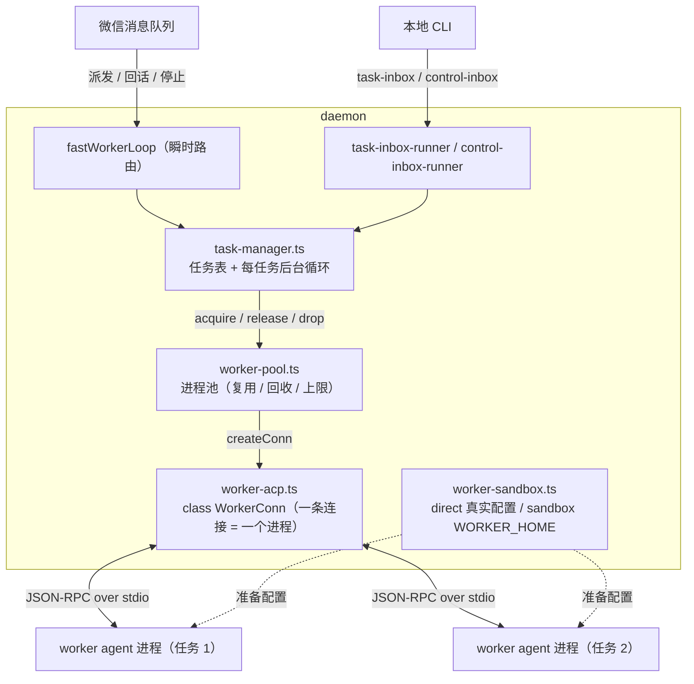
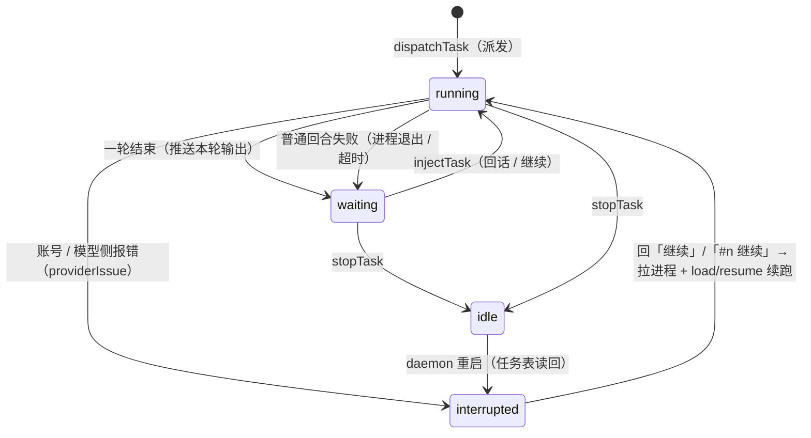

# 远程任务：human-in-the-loop（人在回路）设计与实现

> **最后核对**：2026-11-14 ｜ 现行设计文档（描述当前分支的最新代码，不绑定已发布版本号）。
>
> **一句话**：把**漫长任务**交给 daemon 管着的**受控 ACP worker 进程**去跑；平时不打扰你，只在任务**主动征询**（列方案让你选、问要不要继续）或**异常中断**时把情况推到微信，你回一句它就接着干。
>
> **本文写什么**：目标与场景、核心模型、组件与数据流、消息路由与状态机、进程池、会话与恢复、配置与权限、进度反馈、双入口、重启纪律、环境变量与边界。**不写**逐文件职责、逐测试覆盖、指令全集——那些在下面的「延伸阅读」里。
>
> **沿革**：前身是 2026-06-17 的《方案 C MVP：远程 human-in-the-loop》设计稿，当时只有**单任务单进程**。现在已经是**多任务 + 进程池 + 重启续跑 + 默认直接使用 Agent 真实配置**。本文于 2026-11-14 按当前实现整体重写为现行设计文档；MVP 时期的历史快照留在 git 历史里。
>
> **延伸阅读**：[repowiki 07-远程任务-Worker](../repowiki/07-远程任务-Worker.md)（实现细节与测试清单）、[使用指南-远程任务（worker）](../使用指南/使用指南-远程任务（worker）.md)（面向用户的操作步骤）、[本地双入口-命令派发与查看回复](../机制与协议说明/本地双入口-命令派发与查看回复.md)（CLI ↔ daemon 文件桥）、[WeMind 接入本机 Agent 工作模式设计与实现](WeMind-接入本机-Agent-工作模式设计与实现.md)（`direct` / `sandbox` 总设计）、[方案C-受控ACP工作机设计](方案C-受控ACP工作机设计.md)（方案 A/B/C 对比，历史文档）。

---

## 1. 目标与场景

要解决的不是「把电脑上 Agent 的全部输出实时同步到微信」，而是更聚焦的一件事——**human-in-the-loop（人在回路）的远程化**：

- 漫长任务自己跑，平时不打扰人；
- 只在两个时刻找人：① 任务**主动征询**（列出几种方案让你选 / 问要不要继续）；② 任务**异常中断**（崩溃 / 卡死 / 账号侧报错，需要你决定下一步）；
- 人在微信收到这些时刻的内容，**回一句指令**（选哪个 / 继续 / 追加要求），让电脑上的 Agent 接着干。

由此带来一个关键简化：**不需要解析面向人眼的 TUI 字符流**，只要在「一轮结束」时把这一轮的结构化文本推给微信。

### 1.1 为什么任务必须跑在「受控进程」里

用户手动开的交互式 Agent 窗口**无法被外部控制**——stdin 被终端占用，没有程序化的输入口。所以「可控」的前提是：任务得跑在一个由 daemon 自己拉起来的进程里。

三种方案对比：

| 方案 | 做法 | 评价 |
|------|------|------|
| A | 任务跑在对话大脑里（brain 自己干活） | 简单，但重活阻塞对话、无法多任务（方案 C 的退化版） |
| B | 文件状态 / 命令桥 | 适合在无 ACP 能力的环境跑，但需要任务侧改造、不实时 |
| **C** | **独立受控 ACP worker 进程** | 双向、实时、多轮、可重连、可多 worker ——**已采用** |

### 1.2 为什么用 ACP

ACP 天生就是为「外部程序控制 agent」设计的：`session/prompt` 下发指令、`session/update` 实时回传、`session/load`（或 `session/resume`）断线续传。worker 本质上就是把对话大脑那套 ACP 客户端能力复用到「第二个及以后的 Agent 进程」上。

但 ACP 是**最小公共方法集**，不是「所有 Agent 都一样」：`session/load` 不是通用能力（如 DSH 只有 `session/resume`），能恢复的会话、能否发图、MCP 怎么投递，都按 Agent 各自的实测结论走（见 `docs/接入方案/接入-*.md` 与 [repowiki 06](../repowiki/06-ACP-大脑与沙箱.md)）。

---

## 2. 核心模型：一条任务 = 一个独立的多轮对话 Agent

每条 worker 都是一条**独立的、跑在任务工作目录里的多轮对话进程**；它与对话大脑（以及彼此）互不干扰，各自一条 ACP 连接、各自一条会话：

```
派发任务  = 给该 worker 发第 1 个 prompt（任务描述）
一轮结束  = 这一轮 ACP 响应完成 → 把本轮拼接文本推微信
微信回复  = 给它发下一个 prompt（回话）→ 又一轮 → 再推送 …
任务中断  = 进程退出 / 超时 / 账号侧报错 → 推微信告警
任务续跑  = 用户回「继续」/`#n 继续` → 重建进程 + session/load（或 resume）恢复上下文 → 接着跑
```

**关键洞察**：`ask(instruction)` 的语义就是「发一个 prompt、等这一轮结束、返回拼接文本」——这正是「一轮」的天然单元。ACP 模式下 Agent 每响应完一轮就**明确进入「等待下一条指令」**状态，daemon 一清二楚，不需要靠抓屏去猜它是不是在等人。

**为什么是进程池而不是「一条任务一个临时进程」**：ACP Agent 的冷启动要几秒到几十秒（`initialize` + `session/new` + 沙箱准备），而任务往往是「派发 → 等很久 → 来回几轮」的节奏。跑完即杀会让每一轮都付一次冷启动；常驻复用则把成本摊到第一次。代价是内存——用**并发上限 + 空闲上限 + 空闲回收**三把闸兜住（见 §6）。

---

## 3. 组件与数据流



### 3.1 模块职责

| 模块 | 职责 |
|------|------|
| `fastWorkerLoop`（`index.ts`） | 微信侧**瞬时路由**：识别控制 / 任务指令并调 task-manager，**绝不 await 长执行** |
| `tasks/task-manager.ts` | 任务表（多任务）、编号、每任务的**后台异步循环**、续跑与 push 的依赖注入点 |
| `tasks/worker-pool.ts` | 进程池：按 agent 复用、空闲回收、并发上限；`planAcquire` / `planReap` / `planSweep` 是纯函数（IO 与判定分离） |
| `tasks/worker-acp.ts` | `class WorkerConn`：一条连接一个 ACP 进程；协议细节与 brain 共用 `acp/protocol/acp-connection.ts` |
| `agents/sandbox/worker-sandbox.ts` | 按角色 / 模式准备 Agent 的配置 home 与 MCP、MCP 投递方式 |
| `tasks/task-store.ts` | 任务表落盘 `tasks.json`，只为「重启后能续跑」 |
| `tasks/task-inbox.ts` | CLI ↔ daemon 的两个文件桥目录与协议（`task-inbox/` / `task-out/`） |
| `ipc/control-bridge.ts` | 需要**在 daemon 进程里**执行、且 CLI 要当场拿到结果的命令（切脑 / 会话） |

### 3.2 磁盘痕迹（账号目录内）

| 文件 | 内容 | 谁写 |
|------|------|------|
| `tasks.json` | 任务表 + 每人 `nextId`（编号只增不复用） | daemon |
| `worker-sessions.json` | `<agent>:task-<编号>@<userId>` → sessionId（按 agent 分区） | daemon |
| `session-cwd.json` | `<agent>:<sessionId>` → cwd，恢复旧会话时优先用它 | daemon |
| `task-state.json` | 任务概览快照，供本地 `task-status` 读 | daemon |
| `workers.pid.json` | 池里全部 worker 的 pid 身份记录，`wemind stop` 据此精确收进程 | daemon |
| `task-inbox/` → `task-out/` | 本地命令通道与「命令真实结果」回执 | CLI 写 / daemon 读+回 |
| `control-inbox/` → `control-out/` | 切脑 / 会话类的双向控制桥 | CLI 写 / daemon 读+回 |

> 既有约定不变：账号数据按账号隔离（`<数据目录>/<账号>/`），Agent 的真实配置、技能、记忆、会话库是**同一 OS 用户的共享基线**（`direct` 下）；只有 `sandbox` 才按账号隔离 home。

---

## 4. 消息路由

微信侧的路由在 `fastWorkerLoop`（**入队时**由 `isFastLane()` 判一次，出队时对「继续」类再判一次），按优先级：

| 优先级 | 条件 | 动作 |
|---|---|---|
| 1 | `问大脑 …` / `问大脑：…` 前缀 | 去前缀后**强制走大脑**（任务在等你时也能临时插话） |
| 2 | 控制指令（`mcp` / 新会话 / 会话列表 / 恢复会话 / 删除会话 / `AI` / 切换大脑 / 切换任务大脑 / 交接 / 允许敏感文件 / 工作区 / 设置工作区 / 重置工作区 / 微信配置 查看 / 帮助） | 走 `handleControl`（daemon 自己处理） |
| 3 | `结束任务 [编号]` / `结束全部任务` | 结束任务（见 §5） |
| 4 | `任务列表` | 回任务清单 |
| 5 | `#<编号> 正文`（全角 `＃` 也认） | 回给指定编号的任务 |
| 6 | `任务 <agent 名>：正文` | **用指定 agent 新开一条任务**（只影响这一条，不改默认任务大脑） |
| 7 | `任务：正文` / `>正文` | 有活跃任务 → 发给它 / 追加；没有 → 派发新任务 |
| 8 | 裸「继续」类短句 + 有可续跑任务 | 交给任务续跑（多条可续跑任务时回编号清单，不替你选） |
| 9 | 其余（含**任何带附件**的消息） | **走大脑** |

三条要点：

- **默认归大脑**。`waiting` 不再接管任意无前缀消息（真机踩过：任务出完结果还躺在 `waiting`，把用户找大脑的日常消息吞掉）。回任务一律显式寻址：`#<编号> 正文` / `>正文` / `任务 …`。
- **任务输入只收纯文本**。带附件（图片 / 语音 / 文件 / 视频）的消息不进快车道、也不进任务侧，一律交给大脑——要给任务传文件，目前把路径写进任务正文，让 worker 自己用文件工具读。
- **控制 / 任务指令不排在大脑回合后面**（它们在快车道）。但切脑 / 会话 / 交接要操作同一个 ACP 连接，仍会在 ACP 门口等当前回合结束——那是语义要求，不是排队阻塞。

---

## 5. 状态机与「继续」的三种含义

### 5.1 任务状态机



| 状态 | 含义 | 该用户来消息时 |
|------|------|----------------|
| `running` | 正在跑一轮 | 按序压入 `pendingInjects`（**一条不丢**，不是只留最近一条），答复「已记下，等这步跑完处理」 |
| `waiting` | 等你回话 | 收到即转 `running`；若已攒了 `pendingInjects`，按顺序合并成下一轮前缀一次处理 |
| `interrupted` | 未在跑（重启遗留，或账号 / 模型侧报错） | 需显式回「继续」/`#n 继续` 才续跑 |

**为什么账号 / 模型侧报错要直接转「已中断」**：停在 `waiting` 的任务会抢用户下一条无编号消息（「谁在等就喂谁」），一条「余额不足」的任务因此会不断吞掉日常消息、每次都白失败一轮。这类错误重试不会好，如实转「已中断」，等用户把账号 / 模型处理好再续跑。判据是关键字表 `providerIssue()`（各 Agent 的 provider 措辞不统一），**限流（429 / rate limit / overloaded）优先判为「不算」**——等一会儿重试就会好，仍停在「等你回复」；认不出的一律按老规矩停在「等你回复」，宁可多抢一次，也不把偶发失败误判成账号问题。

### 5.2 「继续」的三种含义

daemon 里「继续」有三个可能含义，判定顺序保证它们不互相吞掉：

1. **连发额度的等待段恢复**（`budgetOf.awaiting`）；
2. **发给在跑 / 在等的任务**（裸「继续」类短句 + 有可续跑任务）；
3. **续跑已中断的任务**（拉进程 + 恢复上下文）。

### 5.3 编号

任务编号**按用户单调递增、永不复用**（避免「任务 2」在对话里指代变化），且**跨重启不归零**（`nextId` 存在 `tasks.json` 里，只增不减）。多条任务并存时输出带编号（`🤖【任务2】`），单任务免编号。

---

## 6. 进程池与并发控制

### 6.1 三把闸

| 闸 | 变量 | 默认 | 行为 |
|---|---|---|---|
| 同时运行的**任务**数 | `WEMIND_MAX_WORKERS` | 3 | 超出时**直接拒绝派发**（用户当场知道），不排队 |
| 池中保留的**空闲**进程数 | `WEMIND_IDLE_MAX` | 2 | 超编时从最旧的开始回收 |
| 空闲进程回收时间 | `WEMIND_WORKER_REAP_MS` | 300000（5min） | 空闲超过这个时长就杀掉 |

> **命名坑**：空闲**进程**回收是 `WEMIND_WORKER_REAP_MS`；`WEMIND_WORKER_IDLE_MS` 是「单轮 prompt 多久没有帧算卡死」。同名两义必然踩，所以没有复用同一个变量名。

### 6.2 取用顺序与连接身份

取用顺序：**同身份的空闲连接命中**（最旧的先用——它本来就最接近被回收，先让它干活正好续命）→ **回收最旧空闲腾位** → spawn。

**连接身份 = agent 身份（名字 + bin + args）+ 实际生效的任务工作目录**。子进程的 cwd 在 spawn 时固定、不能中途改，所以换 `--cwd` 必须换进程；不把 cwd 纳入身份就会复用旧进程、让它在上一个项目里干活。

### 6.3 结束与回收语义

- 结束**在等你回复**的任务：连接是干净的 → **还回池里复用**（`release`）；
- 结束**正在跑**的那条：ACP 回合没法优雅取消 → **只能力杀**（`drop`）；
- `busy` 的死连接**保留**在池里等 `release` / `drop`（任务可能还会在它里面复活进程），只清 pid 记录；`sweep` 只收「空闲且已死」的空壳；
- 只有 `wemind stop` / daemon 退出才 `killAll()` 杀光整池（Windows 上子进程不会随父进程退出，漏掉就是一堆孤儿 Agent 进程）。

> **同一 agent 并发 = 两个终端在同一个配置目录里跑**：不同 agent 各有自己的 `configSubdir`（天然隔离），但同一 agent 的两条任务共用同一个 home（2026-10-29 一轮样本未见互踩，长期风险仍在）。

---

## 7. 会话、上下文与恢复

- **每任务一条会话**，键是 `task-<编号>@<userId>`；`worker-sessions.json` 里存成 `<agent>:task-<编号>@<userId>` → sessionId，**按 agent 分开存**（换大脑不带旧条目）。
- **cwd 也记一条**（`session-cwd.json`：`<agent>:<sessionId>` → cwd）：恢复旧会话时优先用记录里的 cwd，找不到才回落到当前默认工作区；不把旧会话静默搬到新工作区。
- **恢复按 Agent 能力兜底**：`session/load` → 失败再试 `session/resume`；预设里声明 `restore: "resume"` 的 agent（如 DSH）只试 `resume`。
- **严格恢复（`strictResume`）**：用户主动续跑时，磁盘上明明有旧会话、却 load / resume 都失败——**不静默新建空会话**，直接抛「接不上」并如实告诉用户（重试还是同一结果；要重来就结束这条任务后重新派一条）。普通回合则相反：失败即杀本连接进程，下一轮 `ask` 重建并恢复上下文（进程重建对用户透明）。
- **会话清理**：任务被用户结束（`stopTask` 里 `dropSession`）时清掉它的会话指针，下一条任务全新开始；回到「已中断」的任务保留会话指针，用户重述进展后还能再试。

---

## 8. 配置、权限与 MCP 策略

### 8.1 默认 `direct`：用 Agent 自己的配置

默认 `homeMode=direct`：**Agent 直接用真实的配置目录**（`~/.claude` / `~/.cline` / `~/.qoder` / `~/.codex` / `~/.gemini` …）。daemon 启动 / 运行期**不自动写、不复制** Agent 的真实配置；只有用户显式执行 `wemind config agent set|unset|edit` 时才写入并备份。技能、记忆、会话库与终端共用同一份基线——**终端里是什么效果，微信侧就是什么效果**。

`sandbox` 是**显式隔离选项**：这时才用 `WORKER_HOME`（默认 `<数据目录>/worker-home`），由 adapter 复制设置基底、按 `inheritDirs` / `inheritFiles` 选择性继承技能与记忆。

### 8.2 免审批（yolo）

worker 与 brain 都按「无人值守」跑：ACP 反向请求里的权限默认 yolo（自动选 `allow_once` / `allow_always`），**不放宽 Agent 自己的沙箱**；要恢复逐次拒绝设 `WEMIND_ACP_AUTO_ALLOW=0`。各内置预设再用自己 Agent 的免审批开关（如 `--approval-mode yolo`）。

### 8.3 MCP：worker 与 brain 策略相反

| | brain | worker |
|---|---|---|
| `sandbox` 下的 WeMind 托管 MCP 集 | **默认空**，会话中按需「加载 X」 | **默认全量**（catalog 全量 − 排除集），无人值守要开箱即用 |
| `direct` | Agent 自己读真实配置，WeMind 不重发 catalog | 同左 |
| 微信 MCP（`wechat`） | **永久排除**（防它把消息发回自己） | **永久排除**（同因），另加 `WEMIND_WORKER_MCP_EXCLUDE` |

投递方式按 Agent 分：文件式 Agent 由 sandbox 写配置文件，`mcpDelivery: "acp"` 的 Agent（DSH / Claude Code / Copilot / Codex）不写文件，随 `session/new|resume` 用 ACP 声明下发；`direct` 下只有用户显式配置 `overlay.mcp.extra` 时才补微信独享项。Agent 真实配置里若出现微信 MCP，**只告警、不阻止启动**（用户需自行移除，否则可能形成第二个 poller / 回环）。

---

## 9. 进度反馈与发送额度

- **跑一轮期间持续「正在输入中」**（每 5s；typing 不占连发上限），让用户知道任务在干活。
- **文字默认安静**：只在「一轮结束 / 中断 / 派发答复」推送，正合「只在卡点找我」。设 `WEMIND_WORKER_PROGRESS=1` 才追加逐工具进度。
- **连发额度是按用户共享的**：N 条任务的进度 + 对话大脑的回复算同一份约 10 条额度。大脑回合已到「上限 − 2」时，任务推送会让出最后一条额度给最终答案，回合结束后再发（没有额度就转挂起队列，等用户下一条消息补发）。扛不住就调小 `WEMIND_MAX_WORKERS`。
- 每条需要用户接话的推送末尾都带一行当前编号的回复写法（`↩ 回这条任务用「#2 正文」；不带前缀的消息会交给大脑。`）。

---

## 10. 双入口：微信与本地终端

两个入口**管同一批任务**，最终都汇到同一套 task-manager：

| | 微信 | 本地终端（`wemind`） |
|---|---|---|
| 通道 | iLink 长轮询 → 快车道 | 文件桥 `task-inbox/` → `task-out/` |
| 优势 | 人不在电脑前 | 可指定工作目录（`--cwd`，微信入口做不到）、可贴长描述、不依赖微信 |
| 派发 | `任务 [agent：]正文` | `wemind task "正文" [--agent X] [--cwd 目录]` |
| 回话 | `#n 正文` | `wemind task-reply <编号> "正文"` |
| 列表 / 结束 | `任务列表` / `结束任务 [编号]` | `wemind task-list` / `task-stop [编号 或 全部]` |

**文件桥协议的要点**（细节见 [本地双入口](../机制与协议说明/本地双入口-命令派发与查看回复.md)）：

- **收命令**：CLI 原子写（临时文件 + rename）`task-inbox/`，daemon 独立定时器扫描（`WEMIND_TASK_SCAN_MS`，默认 1s，不挂 poller）后删除。
- **回结果**（1.2.0）：命令带 `ack` 编号，daemon 处理完写 `task-out/<id>.json`；CLI 短轮询后打印真实结果。**派发的回执等 `acquire` 之后才发**——达上限 / 起不来是那时才知道的，所以 `wemind task` 说的「已派发」是真话。空 `text` 也算一种回执（＝「已送达、无别的话」）。
- **写状态**：daemon 在派发 / 每轮 / waiting / 停止时原子写 `task-state.json`，`task-status` 读它。
- **控制桥**：切脑 / 开新会话 / 恢复会话这类**必须发生在 daemon 进程里**、且 CLI 要当场知道成没成的操作，走 `control-inbox/` → `control-out/`（复用微信指令同一段实现）。控制桥的请求里只有 `target`（agent 名）/ `ref` / `name` / `page` / `expiresAt`，**没有也不可能有 `bin` / `args` / `shell`**——被伪造时最坏也只是「选一个已装的 agent 或清掉自己的会话」。

---

## 11. 重启纪律

任务表另存一份原子写的 `tasks.json`。daemon 启动时读回：

- **不自动 spawn**（几个 agent 一起冷启动既重、也可能正好复现刚崩的原因）；
- 未完成的任务一律标 **「已中断」**，在 `任务列表` 可见；
- 用户回「继续」/`#n 继续` 才拉进程 + 按该 agent 的能力试 `session/load` → `session/resume` 续跑。

两条诚实的失败必须照实说：① Agent 不支持恢复、或该会话已被它自己清理 →「这次接不上」（重试还是同一结果；要重来就结束这条任务后重新派一条，别劝「把进展重述一遍」——重述走的还是同一条恢复路径）；② 半截回合的副作用可能已经发生（改到一半的文件）→ 续跑前提示「可能有重复动作，注意核对」。任务表损坏 → 降级为空表，**不阻塞启动**。

> **不做历史归档**：微信聊天记录本身就是每条任务输出的归档，另存历史收益低、维护面大。

---

## 12. 环境变量

| 变量 | 默认 | 说明 |
|------|------|------|
| `WEMIND_WORKER_CWD` | `<账号>/workspace/worker` | worker 默认工作目录的一次性覆盖；本地 `task --cwd` 更优先 |
| `WEMIND_WORKER_BRAIN` | — | **默认任务大脑**（agent 名）。优先级：`WEMIND_WORKER_BRAIN` → `WEMIND_BRAIN` → `brain.json` 的 `worker.agent ?? agent` → `auto` |
| `WEMIND_MAX_WORKERS` | 3 | 同时运行的**任务**数上限 |
| `WEMIND_IDLE_MAX` | 2 | 池中保留的**空闲** worker 进程数上限 |
| `WEMIND_WORKER_REAP_MS` | 300000 | 空闲 worker 进程回收时间（**不是**单轮空闲超时） |
| `WEMIND_WORKER_IDLE_MS` | 180000 | 单轮 prompt 空闲超时 |
| `WEMIND_WORKER_CAP_MS` | 1800000 | 单轮硬上限（30min） |
| `WEMIND_WORKER_FIRST_FRAME_MS` | 30000 | 首帧超时（预设可覆盖） |
| `WEMIND_WORKER_PROGRESS` | `0` | 是否推全程文字进度 |
| `WEMIND_WORKER_HOME` | `<数据目录>/worker-home` | **仅 `sandbox` 模式**的 worker 沙箱目录；`direct` 直接用真实 home |
| `WEMIND_WORKER_MCP_EXCLUDE` | `wechat` | 不继承的 MCP（`wechat` 强制排除） |
| `WEMIND_TASK_SCAN_MS` | 1000 | daemon 扫描 `task-inbox/` 与 `control-inbox/` 的间隔 |
| `WEMIND_CONTROL_TIMEOUT_MS` | 30000 | CLI 等 daemon 回话的上限（`brain switch` 自动放大） |

默认任务大脑可用微信 `切换任务大脑 [名]` 或 CLI `wemind brain switch <agent> --worker` 在**进程内**改（**不写 `brain.json`**，重启回到配置值；答复里会写明）。

---

## 13. 边界与非目标

- **不接管手动窗口**：任务必须跑在受控 worker 进程里。
- **一条任务同时只跑一件事**（ACP 限制）。多任务靠多条连接（进程池），不是靠一个 worker 分时。
- **并发有上限**（默认 3），超出直接拒绝，不排队。
- **连发额度与大脑共享**（约 10 条）。
- **资源占用**：池里每个进程都是一个完整 Agent（内存 / 网络），靠空闲回收与上限约束。
- **续跑可行性取决于 Agent**：能否 `load` / `resume` 回该会话由各 Agent 决定，接不上就如实报错。
- **任务输入只收纯文本**；带附件的消息一律给大脑。
- **不做任务历史归档**（聊天记录即归档）。
- **不做跨机器 worker**（ACP over 网络转发）——留待将来。

---

## 14. 设计不变量（改代码前先读）

1. **绝不在消息循环里 `await` 长执行**：`runTask` 必须 `void` 掉、后台跑；否则长任务会阻塞 poller 入队（含用户回话），机制失效。
2. **一条连接一条会话**：同一连接同一时刻只跑一条任务；多任务靠多条连接。
3. **cwd 是连接身份的一部分**：`connKey = agent 身份 + 实际生效 cwd`；不把 cwd 纳入身份就会复用错进程。
4. **微信 MCP 永不出现在 WeMind 生成的 worker MCP 集里**（brain / worker 共用判定）；Agent 真实配置里的 `wechat` 只告警。
5. **不自动恢复、不静默换新会话**：重启后只标「已中断」，续跑失败要如实报「接不上」。
6. **编号只增不复用、跨重启连续**。
7. **任务表损坏只降级为空表，不阻塞启动**。
8. **依赖注入保持单向**：task-manager 不直接碰发送层 / 文件系统，push / typing / stateSink / ack 都由 `index.ts` 注入，保证可测。
